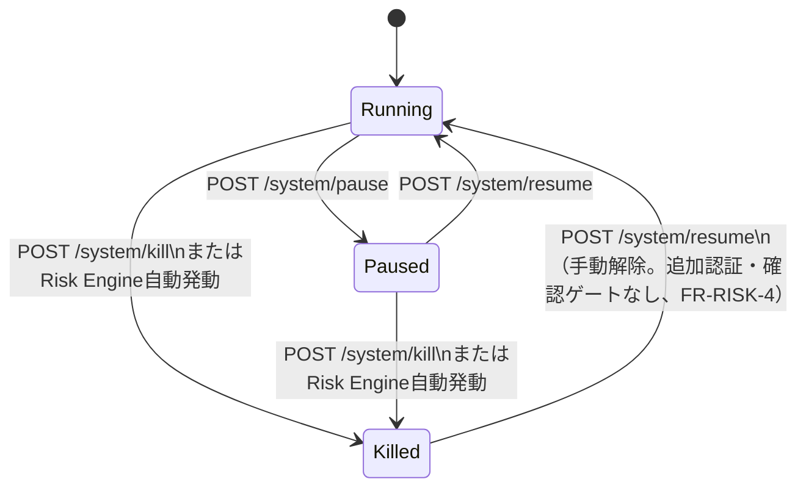

# API 仕様

HALTアーキテクチャの3パターン（ページルート/アクションルート/APIルート）に従う。詳細な設計思想は `components/overview.md` を参照。

## 1. 認証・アクセス制御

- Wailsアプリのページ・APIはWails AssetServer（ネットワークポートなし）経由でのみ配信する。Windows（WebView2）のみ、`/ws/...`のUpgradeだけを受ける専用のループバックリスナー（`127.0.0.1`と`[::1]`の同一ランダムポート。`[::1]`が使えない環境は`127.0.0.1`のみ。他のパスは404）を追加で起動する。いずれもループバックにのみバインドし、外部ネットワークからは到達不能（§6、`requirements/non-functional.md` §4、`cmd/desktop/ws_listener.go`）
  - `cmd/server`の既定待受は`127.0.0.1:48080`。`PITHA_SERVER_ADDR`でloopback以外（`:48080`・`0.0.0.0`・LAN IP等）を指定すると起動を拒否する。意図的に公開する場合のみ`PITHA_SERVER_ALLOW_NON_LOOPBACK=1`を併用する（issue #91/#99）
- 単一ユーザー・単一デスクトップアプリのため、外部IdP連携やユーザーログイン画面は持たない
- 起動時にWailsプロセスがランダムなローカルセッショントークンを生成し、Cookie（`HttpOnly`, `SameSite=Strict`）としてWebViewに設定する。全ての状態変更リクエスト（アクションルート・Huma APIのPOST/PUT/PATCH/DELETE）はこのセッションCookie必須とする
  - 実装（`internal/web/middleware/session.go`）: `SecurityHeaders`・`RequestLog`・`Recovery`・（ws-base設定時の）`WebSocketBase`・（後述の）Host検証の**後**、Setup Guardより**前**にGinエンジン全体（`/static`を除く）へ適用する。適用順は`internal/router/router_middleware.go`のとおり `SecurityHeaders（最外周） → RequestLog → Recovery → WebSocketBase（ws-base設定時） → HostGuard（許可リスト設定時） → Session → Heartbeat（recorderがあれば） → Setup Guard（secrets storeがあれば） → SystemState`（RequestLog/RecoveryをSessionより前に置くのは、Sessionの403拒否もアクセスログに残し、panicを500として回復するため。issue #109/#122。SecurityHeadersを最初に置くのは、Recovery・HostGuard・Sessionの拒否応答にもヘッダを付けるため。issue #378）。プロセス起動ごとにセッショントークンとCSRFトークンを別々に乱数生成し、Cookie（名前`pitha_session`）は有効なCookieを持たない安全なリクエスト（GET/HEAD/OPTIONS、WebSocketアップグレードを除く）の応答で発行する
  - POST/PUT/PATCH/DELETE等の状態変更メソッドは、有効なセッションCookieと、CSRFトークンに一致する`X-CSRF-Token`ヘッダの両方が無ければ403を返す。WebSocketアップグレード（`/ws/...`）は有効なセッションCookieが無ければ403を返す
  - 例外として、`GET /api/v1/logs/errors`・`GET /api/v1/export`は安全メソッドのGETだがエラーログ・取引ログ・判断ログ・計測ログを取得するため、有効なセッションCookieを必須とし、無ければ403（`missing or invalid session cookie`）を返す（FR-ERRLOG-6、`endpoints/huma-api.md`）。他の`/api/v1`のGETはCookie不要
  - **CSRF拒否の識別（issue #138）**: トークンは起動ごとに再生成されるため、アプリ再起動前に開いたままのページは旧Cookie/旧CSRFトークンを持ち続ける。Cookie無効・CSRFトークン不一致による403には`X-CSRF-Reject: stale`ヘッダを付け、`lib/api.ts`は`StaleSessionError`（Kill Switchパネル等に表示）、`pitha-htmx-errors`は同内容のトーストで「ページを再読み込みしてください」と案内する。再読み込みで新しいCookieとトークンが配布される。ページ遷移（`Accept: text/html`かつ非HTMX・非WebSocket・非`/api/v1`）でのCSRF拒否とpanicによる500は、`router.useMiddleware`が注入する`shared.RenderErrorPage`（`internal/web/handler/shared`）（`pages.ErrorPage`）でHTML本文を返し（`X-CSRF-Reject`ヘッダは維持）、HTMX・fetch・API・WebSocketは従来どおりステータスのみ／プレーンテキストとする（issue #171）
  - **`_csrf`フォームフィールド（issue #142）**: ヘッダを付けられない素のHTMLフォーム送信（JS無効・htmx読込失敗時の`SecretFieldRow`フォールバック）のため、`Content-Type: application/x-www-form-urlencoded`のボディの隠しフィールド`_csrf`も`X-CSRF-Token`ヘッダの代わりに受け付ける（ヘッダがあればヘッダを優先）。セッションCookieは引き続き必須
- **Host/Origin検証（DNS rebinding対策、issue #136）**: `internal/web/middleware/host_guard.go`の`HostGuard`をSessionの前段に置き、Hostヘッダ（ポート・大文字小文字・末尾ドット・IPv6括弧は無視）が許可リストに無いリクエストは`/static`を含め全て403（Cookie・CSRFトークンも発行しない）。状態変更リクエストとWebSocketアップグレードは、`Origin`ヘッダがあれば同じ許可リストに含まれるホストであることも必須（`null`や外部ホストは403、Originなしの非ブラウザクライアントは通す）。許可リストは`router.WithAllowedHosts`で与える
  - `cmd/server`: `localhost`/`127.0.0.1`/`::1`。`PITHA_SERVER_ALLOW_NON_LOOPBACK=1`のときのみ、`PITHA_SERVER_ADDR`のバインドホスト（ワイルドカード以外）と`PITHA_SERVER_ALLOWED_HOSTS`（カンマ区切り）を追加する
  - `cmd/desktop`: Wails AssetServerのHost（`wails.localhost`（Windows）・`wails`（macOS/Linuxの`wails://wails/`））
- **セキュリティヘッダ（issue #378）**: `middleware.SecurityHeaders`が最外周ミドルウェアとして全レスポンス（SSR/HTMX/`/api/v1`/`/static`/NoRoute、Recovery・HostGuard・Sessionによる拒否レスポンスを含む）に付与する。
  - `Content-Security-Policy`: `default-src 'self'`、`script-src 'self'`、`style-src 'self'`＋lightweight-chartsのTradingViewアトリビューション用`<style>`のsha256ハッシュ、`img-src 'self' data:`、`font-src 'self'`、`connect-src 'self'`＋別リスナのWebSocketベース（`ws://wails.localhost:<port>`、`WithWebSocketBase`で渡された場合のみ）、`object-src 'none'`、`base-uri 'self'`、`form-action 'self'`、`frame-ancestors 'none'`。`'unsafe-inline'`/`'unsafe-eval'`は使わない。そのため`htmx-config`で`includeIndicatorStyles:false`（`allowEval`/`allowScriptTags`も`false`）、Litコンポーネントはインライン`style`属性ではなくCSSOM（`el.style`）で動的スタイルを設定する
  - `X-Content-Type-Options: nosniff`、`X-Frame-Options: DENY`（`frame-ancestors`の旧WebView向け補完）、`Referrer-Policy: same-origin`（設定画面の戻り先がSame-origin RefererのPathに依存するため`no-referrer`にはしない）
  - `/swagger`のみ、Stoplight Elementsが実行時にインラインスタイルを注入するため`middleware.SwaggerCSP`（`style-src 'unsafe-inline'`を追加。スクリプトは`'self'`のまま、`frame-ancestors 'none'`維持）でCSPを置き換える
- **`GET /swagger`（オプトイン）**: Stoplight ElementsのAPIドキュメントUI。環境変数`SWAGGER_ENABLED=true`のときのみ`internal/router/router_routes.go`が登録し、未設定・それ以外は404（既定は無効）。`/api/v1/openapi.json`は本変数に関わらず常に公開される（`environment/setup.md`「Swagger / OpenAPI」）
- HTMXフォームにはCSRFトークンをmetaタグ経由で付与し、`X-CSRF-Token`ヘッダで送信する（`components/overview.md` セキュリティ節）
  - `layout.Shell`/`SetupShell`が`<meta name="csrf-token">`を出力し、`<body hx-headers>`でHTMX全リクエストに`X-CSRF-Token`を付与する。Litコンポーネントは`lib/api.ts`が同metaから読み取って送信する。`SecretFieldRow`のフォームは上記フォールバック用に隠しフィールド`_csrf`も持つ
- 実売買（Phase 7）へ移行しても、Kill Switch解除・発注確定操作に人手の追加認証は要求しない（完全自動運用。`requirements/non-functional.md` §4、FR-RISK-4）。実装（`internal/web/handler/system/system.go`）にも追加認証は無く、`pitha-kill-switch-panel`が確認ダイアログ（`window.confirm`）を出すのはKill操作のみで、Resume（Killedからの手動解除を含む）は確認なしで`POST /api/v1/system/resume`を呼ぶ
- **Setup Guard**: 選択中のブローカー・環境に必要な認証情報（kabu選択時＝JEV_API_KEY/KABU_API_PASSWORD、tachibana選択時＝JEV_API_KEY＋選択環境の`TACHIBANA_{DEMO,PROD}_AUTH_ID`＋秘密鍵パス`broker.tachibana.{demo,production}.private_key_path`。KABU_API_PASSWORDは立花選択時は任意。ブローカーは`runtime_settings`の`broker.provider`、未設定ならkabu）のいずれかが未設定の間は、`GET /setup`・`POST`/`DELETE /settings/:key`・`POST`/`DELETE /ops-settings/:key`（`broker.provider`・`broker.tachibana.*`のキーのみ）・静的アセット（`/static/...`）以外の全リクエスト（ページ・アクション・`/api/v1`・WebSocket含む）を`/setup`へ誘導する。誘導方法はリクエスト種別で応答を分ける（ページ遷移: `/setup`へ302、HTMX（`HX-Request: true`）: `204`＋`HX-Redirect: /setup`、`/api/v1`: `503` JSON `{"setup_required":true,"setup_url":"/setup"}`、WebSocketアップグレード: `403`。302をスクリプト系リクエストが追従して`/setup`のHTML全体を受け取らないため、issue #140）。判定はリクエストごとに行うため、必須2キーが揃った次のリクエストから解除される（issue #80）

## 2. ルーティング概要

| パターン | 例 | HX-Request分岐 | 返却 | 登録先 |
|---------|-----|----------------|------|--------|
| ページルート | `/scanner`, `/symbols/:symbol` | する | フルページ（`/scanner/scan`のみ`HX-Request`でフラグメント） | Gin |
| アクションルート | `/system/update-check` 等 | しない | フラグメントのみ | Gin |
| APIルート | `/api/v1/...` | しない | JSON | Huma |
| WebSocket | `/ws/scanner` 等 | 該当なし | JSONメッセージ | Gin (`github.com/coder/websocket`) |

## 3. ページルート

| メソッド | パス | 説明 |
|---------|------|------|
| GET | `/` | ホーム画面（issue #896。以前は`/scanner`へ302。`pages.HomePage`、`handler/home`）。常にフルページを返す。1段目「今日の状況」（取引の状態・今日の Paper 損益・保有ポジション）、2段目「要対応」、3段目「今日の詳細」（折りたたみ可）。読み取り専用で、書き込みルートは持たない（Kill Switchの操作は既存の`pitha-kill-switch-panel`が既存の`/api/v1/system/*`を呼ぶ）。取引の状態の理由の優先順は Kill Switch → 一時停止 → 日次ガード → kabu 401・未ログイン・未起動 → 立会時間外 → 市況取得停止 → メタモデル未採用かつブートストラップ無効。今日の損益は`GET /api/v1/performance`の`daily_pnl`（Paper 実績 MCP の`paper_daily_pnl`の今日の行と同値）＋保有中の`unrealized_pnl`の合計。ヘッダーのバナー枠は廃止し、他ページでは`GET /home/attention-badge`の「要対応 N 件」に縮約する |
| GET | `/home/trade-status` | ホームの取引の状態カードの本体（HTMXフラグメント。`every 30s`・`systemStateChanged from:body`で`X-Pitha-Background: 1`付きで取得。issue #896）。システムの状態を読めないときは本体に`data-testid="home-card-error"`のエラー行のみ。理由を判定できる入力（日次ガード・市況の警告・ヘルス）が読めないときは「可能」と言わず「状態を確認できません」か、理由に加えて読めなかった旨を出す |
| GET | `/home/pnl` | 今日の Paper 損益カードの本体（`every 30s`。実現損益（JST 0時以降の決済）・含み損益（保有中）・合計・決済件数・新規エントリー件数・損失上限までの残り（上限に達した後は「損失上限に達しました」）。読み取り失敗時はそのカードだけエラー行） |
| GET | `/home/positions` | 保有ポジションカードの本体（`every 30s`。`closed_at`が無いもの全件（日次ガードの建玉と同じ。新しい決済済み行が多くても古い保有は切れない）。0件は「保有中のポジションはありません」） |
| GET | `/home/attention` | 要対応セクションの本体（`every 30s`・`secretsStatusChanged`・`updateStatusChanged`。`query.HealthToday`の`attention_codes`と、市況データ接続・新規エントリー停止・市況データ停止の警告・任意キー未設定・アップデートをカードで1回ずつ並べる。0件は「対応が必要なものはありません」の1行） |
| GET | `/home/details` | 今日の詳細セクションの本体（`every 30s`。エントリーしなかった理由（今日の NONE シグナルの`reject_reason`の接頭辞別件数。`entry_quality_below_threshold`が最多のときは使用中の最低エントリー品質（Paper/Live）と設定リンク）・スキャン状況のファネル・AIの注文提案の今日の件数と最新3件・最近の決済5件・モデル状態・最近の Kill Switch 3件。ブロックごとに読み取り失敗を隔離する） |
| GET | `/home/attention-badge` | ヘッダーの`#attention-badge`のフラグメント（`load`・`every 30s`・`secretsStatusChanged`・`updateStatusChanged`。`X-Pitha-Background: 1`付き）。ホームの要対応と同じ件数の「要対応 N 件」（`/`へのリンク）か、0件なら何も描かない。ホーム自身のヘッダーはこの枠を描かない |
| GET | `/scanner` | Scanner Dashboard。常にフルページを返す（`HX-Request`による分岐はない。HTMXフラグメントは`GET /scanner/scan`のみ）。ページ上部にスキャン状況パネル（ファネル件数・最終サイクル時刻/所要時間・「スキャン対象を見る」「更新」）を含む |
| GET | `/scanner/scan` | スキャン状況パネル（`#scan-panel`）。HX-Requestならパネルのフラグメントのみ、それ以外はパネルを開いた状態のフルページ。クエリ: `q`（銘柄コード/名称の部分一致）, `status`（`passed`/`excluded`/`missing`）, `reason`（理由コード）, `page`, `page_size`（既定50・最大200）, `open=0`（ファネルのみ）。未知の値は無視する（400にしない）。最新サイクルの結果を都度1回読む（`/ws/scanner`には流さない）。東証の立会時間外は、サイクルの有無によらずパネルに停止通知`data-testid="scan-offhours"`と次回立会開始（JST）を含める（`GET /scanner`のパネルも同様。「更新」の再取得でも同じ通知が出る。立会時間中は出ない）。issue #303, #367 |
| GET | `/symbols/:symbol` | Symbol Detail。`<pitha-price-chart>` 等のLitアイランドを埋め込んだフルページ |
| GET | `/performance` | 成績画面（issue #895。旧Performance画面。タブ「実績」「バックテスト」「予測の精度（`/calibration`）」、メインナビは「成績」を強調）。クエリ `tab=backtest`（または `from` 付き）は「バックテスト」タブでフォームと結果だけを表示し実績は読まない。旧ブックマーク `/performance#backtest` は `pitha-performance-tabs` が `/performance?tab=backtest` へ転送する。以下は既定の「実績」タブ: 先頭に「実績（Paper）」節（クローズ済みポジションのTotal/Daily PnL・Win Rate・Profit Factor・Expectancy・Max Drawdown・Average Hold Time・Sharpe/Sortino参考値・Signal count。§5 `GET /api/v1/performance` と同一集計、算出不能は「—」）を表示し、取得失敗時は節内にエラーを示して500。バックテストの実行トリガーはクエリ `from` の指定（`from` が空でなければ実行。`to` だけの指定は実行されず既定値入りのフォームを表示する）。`from` 指定時は `to`（YYYY-MM-DD、JST、`to`含む。省略は400）・`training_days`/`validation_days`/`forward_days`（既定5/2/1）とともに記録済みデータでWalk Forwardバックテスト（FR-BT-1〜3）を実行し結果を表示する。不正入力は400（日付形式不正・`to` 省略・`to < from`・上限超過・1 Foldも取れない短い期間＝0 Fold）。上限: 各 `*_days` は最大366、`from`〜`to` は最大1830日（366×5）、Fold数は最大1000（超過は400）。実行が60秒を超えた場合は503、それ以外の実行失敗は500（固定文言「バックテストの実行に失敗しました。」を節内に表示し、原因はslogへ） 「実績（Paper）」節の下に「実績評価」節（`GET /api/v1/performance/evaluation`と同一集計。合格ライン判定、円建て・資金比の最大DD、切り口別の指標と信頼区間、基準未満は「判定不能」。取得失敗は節内エラー＋500。issue #777）を表示する。 |
| GET | `/performance/cost-sensitivity` | コスト感度表のエクスポート（FR-COST-1、issue #779）。`/performance`のバックテスト条件と同じクエリ（`from`/`to`/`training_days`/`validation_days`/`forward_days`）でWalk Forwardを実行し、Forward取引に追加の往復コスト0/2/5/10bpsを引いた表を返す。列は`extra_cost_bps`・`trade_count`・`expectancy_pct`・`expectancy_bps`・`positive_share`（**実現した再生netから追加コストを引いて0超になった取引の割合**。モデルの予測EVではない）・`predicted_ev_trade_count`・`predicted_ev_positive_share`（**エントリー判断時のメタモデルの予測EV（bps）から追加コスト（bps）を引いて0超になる取引の割合**。分母は予測EVを持つ取引だけで、その件数が`predicted_ev_trade_count`。旧エントリー則（`EntryLegacyConfidence`）の取引はモデルを使わず予測EVが無いので分母に入らない。分母が0なら0）。`format=csv`（既定、`cost-sensitivity.csv`の添付）/`json`（`rows[]`に同名のキー）。形式不正・入力不正は400、実行失敗は500、タイムアウトは503。Performance画面のバックテストフォームの「Download cost sensitivity (CSV)」ボタン（`data-testid="cost-sensitivity-export"`）が、フォームの現在の入力値のまま`format=csv`で`GET`する |
| GET | `/calibration` | Calibration画面 |
| GET | `/settings` | 設定のページ一覧（issue #805・#895）。取引ルール／リスク・資金／予測モデル／証券会社・データ／外部連携・AI／システムの6ページへのリンクと、メインメニューにない画面（稼働ログ`/activity`・初回セットアップ`/setup`）へのリンクをサーバ描画するフルページ（登録簿`internal/web/settingspages`）。旧`/settings#modal-<id>`・`/settings#update-panel`のハッシュ直リンクは、ページが埋め込む対応表を`pitha-settings-hub`が読んで該当ページへ転送する。メインナビの「設定」が唯一の入口。Setup Guardの対象 |
| GET | `/settings/:page` | Settingsの1ページ（`:page`＝`operations`（取引ルール）/`risk`（リスク・資金。資産ごとの予算枠を含む）/`results`（予測モデル）/`broker`（証券会社・データ）/`integrations`（外部連携・AI）/`maintenance`（システム）。issue #805・#824・#895）。そのページに属する接続先（各接続先のモーダルに許可キー（`internal/config`のallow-list）の`SecretFieldRow`をまとめ、各行が独立した保存・削除フォームを持つ。保存済みの値は再表示せず「設定済み」バッジのみ表示する）・設定項目（`POST`/`DELETE /ops-settings/:key`、`environment/setup.md`。日次ガード（FR-RISK-8）と予算枠（FR-RISK-10、`risk`ページ）のグループには保存値から導出した「計算結果」パネル`SettingGroupDerived`も表示する。issue #782・#824）・MCPカード・システム（アップデート`#update-panel`、エラーログのダウンロード`#error-log-panel`（`GET /api/v1/logs/errors`を呼ぶフォーム。FR-ERRLOG-1）、データエクスポート`#data-export-panel`（`GET /api/v1/export`を呼ぶフォーム。FR-EXPORT-7））のカードとモーダルを描き、Settingsの外の関連画面へのリンクを添える。どのカードがどのページかは`settingspages`の登録簿が決める（`docs/components/screens.md`）。`/settings/mcp-panel`など`:page`以外の静的ルートはそれぞれの行を参照（issue #57/#79/#267/#302/#805） |
| GET | `/setup` | 初回セットアップ画面。Settingsと同じ接続先一覧・モーダルで、Jev・選択中のブローカーの接続先（kabuステーション／立花証券 e支店）・任意のSlackを表示し、保存・削除は`POST`/`DELETE /settings/:key`を共用する。運用設定の「ブローカー」（立花選択時は立花の接続設定も）を`POST`/`DELETE /ops-settings/:key`で保存でき、ブローカー/環境の保存後は`HX-Refresh`で再読込する。Setup Guardの例外で、セットアップ完了後も直接アクセスできる（issue #80/#302） |
| GET | `/activity` | 稼働ログ画面（旧System Activity Log。issue #895 で設定 ＞ システムから開く画面になり、メインナビは「設定」を強調）。`<pitha-activity-feed>`アイランド（SSRフォールバック: キュー状況＋アクティビティ一覧）を埋め込んだフルページ |
| GET | `/order-proposals` | 注文案画面（issue #829。親 #826）。MCP の `order_proposals_list` と同じ読み取りで、`from` / `to`（JST の日付で、`to` の日を含む。省略は直近 30 日。MCP の `to` は含まないので、画面の `to` が 1 日だけ広い）・`status`（固定コード）・`bucket` で絞った案の一覧（新しい順。`limit` は固定 50、`cursor` で次ページ）。不正な絞り込み（日付の形式・`status`・`bucket`・`cursor`）は 400 で、画面にその理由を出す。読み取り専用で、承認・作成・取消の操作は無い |
| GET | `/order-proposals/:id` | 注文案の詳細（issue #829）。理由・損切りと手じまいの計画・最大損失（あいりの見込み・アプリの見積もり・実際の損失）・情報源・状態の時系列・紐づくシグナル／注文／ポジション（実現損益）。`rationale` などの自由文は HTML として解釈せず文字として出し、情報源の URL は http / https だけをリンクにして `rel="noopener noreferrer"` を付ける。ない ID は 404 |
| GET | `/watchlist` | Watchlist画面（issue #730）。立花証券選択時の監視リスト（直近7立会日分。確定方法・基準日・確定時刻・理由、銘柄ごとの枠の由来`held`/`manual`/`screen`/`fixed`と選ばれた指標）と使用中のリストを表示するサーバ描画のフルページ（アイランドなし）。kabu選択時は「立花選択時のみ」の案内を表示する |
| GET | `/admin` | 旧管理ハブ（issue #793）。Settingsへ統合したため`/settings`へ301リダイレクトする（issue #805）。Setup Guardの対象（必須の接続が未設定の間は`/setup`へ） |
| GET | `/settings/asset-buckets` | 旧「資産ごとの予算枠」ページ（issue #824）。リスク・資金へ統合したため`/settings/risk`へ301リダイレクトする（issue #895）。ハッシュ付きの旧リンク（`#modal-asset-buckets`）はブラウザがハッシュを保ったまま転送先のダイアログを開く。Setup Guardの対象 |
| GET | `/swagger` | Swagger UI（Stoplight Elements）。`SWAGGER_ENABLED=true`のときのみ登録、既定は404。詳細は§1・`environment/setup.md`「Swagger / OpenAPI」 |

## 4. アクションルート

| メソッド | パス | 説明 | 返却 |
|---------|------|------|------|
| GET | `/system/status` | システム状態バッジのフラグメント再取得（Lit→HTMX間接連携: `systemStateChanged`イベント受信時にHeaderが呼び出す）。Kill Switchの操作（pause/resume/kill）はHTMXアクションルートを持たず、`pitha-kill-switch-panel`が§5の`/api/v1/system/*`を呼ぶ（issue #108） | システム状態バッジ |
| GET | `/system/update-status` | 新バージョン検知バナーのフラグメント再取得（Headerの`#update-banner`が`load`・60秒周期・`updateStatusChanged`イベントで呼び出す）。新バージョンが無い/アップデーター未搭載（`cmd/server`）なら空 | `UpdateBanner`（安全ゲート待ち/再起動直前の状態を明示） ※issue #896でヘッダーは呼ばなくなった（ヘッダーは`GET /home/attention-badge`に集約。ルートと応答は変更なし） |
| GET | `/system/update-panel` | Settings画面`#update-panel`のフラグメント取得（現在バージョン・最終確認結果・安全ゲート保留の理由・失敗の種別・確認ボタン）。アップデーター未搭載（`cmd/server`）ではその旨の説明のみ返す（確認ボタンなし） | `UpdatePanel` |
| POST | `/system/update-check` | 「今すぐアップデートを確認」。スケジューラーと同じ`CheckForUpdate`を即時実行し、`HX-Trigger: updateStatusChanged`付きで`UpdatePanel`を返す。確認失敗もパネル内表示（HTTP 200）。アップデーター未搭載なら404 | `UpdatePanel` |
| POST | `/scanner/universe/import` | 「JPXから取得して投入する」（Scanner Dashboardのスキャン状況パネルの銘柄マスタ未投入案内のボタン。CSRFトークン必須）。有効な`stock`が無いときだけ、JPXの東証上場銘柄一覧（`data_j.xlsx`）を1回取得して株式を`instruments`へ投入し（検証・対象区分は`environment/setup.md`「銘柄マスタの投入」）、`#scan-panel`のフラグメントを返す（成功は`scan-universe-imported`の件数通知、失敗はマスタ無変更で`scan-universe-import-error`に失敗種別（接続不可／JPX側の形式・URL変更／保存失敗）ごとの固定文言とCSV投入の案内。下位エラーは画面に出さず`slog`のみ。どちらもHTTP 200）。有効な`stock`が既にあれば409（取得しない）、状態確認の失敗は500、インポーター未搭載（ルーターに`WithUniverseImporter`なし）は404（issue #508） | `ScanPanel` |
| POST | `/settings/:key` | 単一キーの保存（フォーム項目`value`）。他キーには一切影響しない。`:key`が許可キー一覧（`internal/config`のallow-list: JEV_*/KABU_API_PASSWORD/SLACK_WEBHOOK_URL/LUNA_*/NEWS_FEED_*（NEWS_FEED_ENABLEDを含む）/SOL_*/OPUS_*/TACHIBANA_DEMO_AUTH_ID/TACHIBANA_PROD_AUTH_ID/TACHIBANA_DEMO_SECOND_PASSWORD。計17キー。本番の第二暗証番号のキーは無く400）に無い場合、または`value`が前後空白トリム後に空の場合は400（空入力で保存済みの値が消えることはない）。`value`は保存前に前後空白をトリムし、キー別に検証する（URL系6キー: `http`/`https`かつホスト非空、`NEWS_FEED_ENABLED`: `on`/`off`のみ（大文字小文字無視、小文字へ正規化して保存。`false`/`0`/`no`等は400）、その他: 制御文字・改行を含まない）。違反は400で保存せず、Setup Guardも解除されない。反映はアプリ再起動後（issue #79/#235） | 更新後の`SecretFieldRow`フラグメント |
| DELETE | `/settings/:key` | 単一キーの削除。他キーには一切影響しない。`:key`が許可キー一覧に無い場合は400（issue #79） | 更新後の`SecretFieldRow`フラグメント |
| GET | `/settings/mcp-panel` | Settings画面「外部連携」の MCP モーダル（`#modal-mcp`、カード`settings-card-mcp`）の中身を`hx-trigger="load"`で取得するフラグメント（`#mcp-panel`）。状態（待受中／起動中／停止中／エラー／キー未設定）・「次回起動時も自動で起動する」表記・起動／停止／再起動ボタン・有効化・待受アドレス・API キーの有無・Grok Bot に登録する値（URL と伏せ字の`Authorization: Bearer ●●●●●●●●`）・`paper-results-mcp`の配置先（見つかる／見つからない）・設定ファイルの場所を表示する。有効かつキーがあるときだけ待受アドレスへ TCP 接続して待受の有無を調べるため、`/settings`本体は接続しない。API キーは返さない（伏せ字のみ）。`WithMCPSettings`未配線では登録されず404。Setup Guardの例外ではない（`GET`はもともと例外外）。`Cache-Control: no-store`（issue #792） | `McpPanel`（`internal/web/organisms/mcp`） |
| POST | `/settings/mcp` | MCP の有効/無効と待受アドレスの保存（フォーム項目`enabled`（チェック時のみ送られる）・`listen`）。待受アドレスはサーバー側で検証し、loopback（`127.0.0.1`・`::1`）かこの PC の tailnet アドレスの IP リテラル`host:port`だけ許可する。`0.0.0.0`・`::`・ホスト部が空・LAN・ホスト名・ポート 0・この PC に無い tailnet アドレスは422で保存しない（日本語の`atoms.Toast`）。空は`127.0.0.1:48110`。API キーと Cloudflare Access の項目は保つ。設定ファイルの書き込み失敗は500。成功は200でパネルを再描画する（反映には`paper-results-mcp`の再起動が要る。再起動は`POST /settings/mcp/restart`）。Setup Guardの例外ではなく、セットアップ完了前は`/setup`へ誘導する。CSRFヘッダ必須（issue #792） | 更新後の`McpPanel`フラグメント |
| POST | `/settings/mcp/key` | MCP の API キーの生成・再生成。`pitha-mcp-`＋32バイトの乱数を設定ファイル（`0600`）にだけ保存し、応答の`McpPanel`に**一度だけ**表示する（読み取り専用の欄・`Authorization: Bearer <キー>`・コピーボタン。`hx-history="false"`・`autocomplete="off"`・`Cache-Control: no-store`）。以後のどのパネルにもキーは出ない（伏せ字）。キーは DB・ログ・データエクスポート・バックアップに入れない。失敗は500。Setup Guardの例外ではない。CSRFヘッダ必須（issue #792） | 一度きりの表示つき`McpPanel`フラグメント |
| POST | `/settings/mcp/start` | MCP（`paper-results-mcp`）を本体の子プロセスとして起動する（issue #795）。保存された設定が有効・API キーあり・待受アドレスが許可範囲のときだけ起動し、満たさないときはプロセスを作らず422（無効／キー未設定／設定ファイル不可／許可範囲外。日本語の`atoms.Toast`）。アプリが起動した子がいる・待受アドレスがすでに応答している（アプリの外で起動された MCP を含む）・実行ファイルが見つからない・アプリ終了中は409（二重には起動しない）。起動後すぐ終了した・OS が起動できないは500。成功は200でパネルを再描画する。API キーは起動引数・環境変数・応答に載せない（子が`0600`の設定ファイルから読む）。`Cache-Control: no-store`。CSRFヘッダ必須（セッション Cookie ＋ `X-CSRF-Token`）、GET では起動しない、Setup Guardの例外ではない | `McpPanel`フラグメント |
| POST | `/settings/mcp/stop` | アプリが起動した MCP を止める。起動していなければ409、アプリの外で起動された MCP は止めない（409）。成功は200でパネルを再描画する。CSRFヘッダ必須（issue #795） | `McpPanel`フラグメント |
| POST | `/settings/mcp/write` | MCP の設定書き込みの許可の保存（issue #806。フォーム項目`enabled`（チェック時のみ送られる）。`runtime_settings`の`mcp.settings_write_enabled`を保存し、同じ値を MCP の`settings_write_enable`/`settings_write_disable`も読み書きする。既定は許可）。成功は200でパネルを再描画する（直近の監査ログ10件を含む）。変更は`mcp_settings_audit`（`actor=gui`）に残る。切り替えと監査行は1トランザクションで書き、**監査行の書き込みに失敗したときは切り替えも取り消され、保存されずに500**（`atoms.Toast`「設定変更の許可を保存できませんでした。」。原因は返さず`slog`のみ。FR-MCP-21、issue #818）。CSRFヘッダ必須、Setup完了後のみ。`router.WithMCPWriteGate`が未配線なら404。保存失敗は500（値は返さない） |
| POST | `/settings/mcp/order-proposals` | MCP の注文案の受け付けスイッチ（`runtime_settings` の `mcp.order_proposals_enabled`。既定オフ）の保存（フォーム項目`enabled`。チェック時のみ送られる。issue #827）。**オンにできる唯一の経路**で、MCP からはオフにしかできない（`order_proposals_disable`）。セッション Cookie と CSRF ヘッダ必須。切り替えは監査ログ（`mcp_settings_audit`、操作名`order_proposals_enable` / `order_proposals_disable`）と同じトランザクションで保存し、失敗は500（日本語の`atoms.Toast`「注文案の受け付けを保存できませんでした。」。原因は`slog`にだけ残す）。成功は200で`McpPanel`を再描画する（`Cache-Control: no-store`）。`WithMCPWriteGate`未配線ならルートごと無い | `McpPanel`フラグメント |
| GET | `/settings/mcp/experiments` | Settings の MCP カードの「調整の実験」の節のフラグメント（issue #871）。実験の一覧（状態・期間・変数・前後の取引件数・判定。新しい順 20 件）と、変数 1 つだけの作成フォーム。最低取引件数の下限が暫定値（本番の σ は未確認で見直す予定。あいりの承認も未）であることを併記する。 |
| POST | `/settings/mcp/experiments` | 実験の作成（フォーム項目`hypothesis`・`kind`・`name`・`before`・`after`・`started_at`（`datetime-local`・JST・省略は今））。変数は 1 つだけ。不正は422、成功は一覧を再描画。CSRF 必須。作成者は`gui`で、MCP の書き込み許可のスイッチには従わない |
| GET | `/settings/mcp/experiments/:id` | 実験 1 つの前後比較（前後の指標・拒否理由の内訳・交絡・判定）。404＝その ID の実験なし |
| POST | `/settings/mcp/experiments/:id/close` | 実行中の実験を終える（フォーム項目`status`＝`closed`/`aborted`。必須で、それ以外は422。終了時刻は今）。終わっている実験は409、ない ID は404。CSRF 必須 |
| POST | `/settings/mcp/restart` | 停止（起動していれば）してから保存済みの設定で起動し直す。設定の保存・API キーの再生成の反映に使う。起動条件・エラーは`/settings/mcp/start`と同じ。CSRFヘッダ必須（issue #795） | `McpPanel`フラグメント |
| POST | `/ops-settings/:key` | 運用設定（バックアップ先`system.backup_dir`・ログディレクトリ`system.log_dir`・`policy.{long,short}.*`・Paper専用の`policy.paper.{long,short}.min_entry_quality`・`screener.*`・ブローカー選択`broker.provider`と立花の接続設定`broker.tachibana.*`8キー・立花の監視銘柄ソース設定`broker.tachibana.{candidate_source,manual_symbols,fixed_symbols,nightly.{run_time,max_per_second,markets,min_price_jpy,exclude_symbols},screen.<指標>.{weight,top_n},event.max_connects_per_day,rest_quote.{min_interval_seconds,requests_per_round}}`25キー（issue #728）・ログレベル`system.log_level`・ログの保持期間`system.log_retention_days`の2キー（issue #772）・立会中のスリープ防止`power.sleep_guard_enabled`（0/1の整数。それ以外は400。issue #863）・Paperの運用資金・1銘柄上限・総エクスポージャ上限`risk.paper.{initial_capital_jpy,max_position_per_symbol_pct,max_total_exposure_pct,max_trade_loss_pct}`の4キー（issue #804）・Paperの資産ごとの予算枠`risk.bucket.{stock,bond_etf}.budget_jpy`の2キー（issue #824。株の枠と債券ETFの枠の合計が運用資金を超える保存と、合計より運用資金を下げる保存は、理由付きの400で保存せず監査行も残さない）・1日の新規エントリー停止ルール`risk.*`の7キー（運用資金`risk.operating_capital_jpy`・損失上限率`risk.daily_loss_limit_pct`・利益確保の発動率`risk.profit_lock.trigger_pct`の3キーはissue #782で追加、ほかに`risk.profit_lock.giveback_pct`・`risk.max_daily_trades`・互換の円指定`risk.daily_loss_limit_jpy`・`risk.profit_lock.trigger_jpy`）などで、許可キーは`internal/service/opsettings.Keys()`の計108キー）の単一キー保存（フォーム項目`value`）。他キーには一切影響しない。許可キー外は400、空・不正値（範囲外・数値でない・相対パス・FR-POLICY-2a/FR-FS-4違反・`broker.provider`/`broker.tachibana.environment`の許可値外・立花の接続先URLがhttpsでない・`reauth_time`が05:30〜08:00外・`request_max_per_second`が1〜10外・監視銘柄ソースの`candidate_source`が`daily_screen`/`fixed`以外・`nightly.run_time`が`HH:MM`でないか08:00〜15:30（日中）・`nightly.max_per_second`が0.1〜3外・`nightly.markets`が`prime`/`standard`/`growth`/`other`以外・`nightly.min_price_jpy`が0〜1000000外・銘柄リスト（`manual_symbols`/`fixed_symbols`は最大120件、`nightly.exclude_symbols`は最大500件）の銘柄コードが英数字10文字以内でない・`screen.<指標>.weight`が0〜100外・`screen.<指標>.top_n`が0〜120外・重み>0かつ上位件数>=1の指標が1つも残らない・`event.max_connects_per_day`が1〜20外・`rest_quote.min_interval_seconds`が10〜3600外・`rest_quote.requests_per_round`が1〜3外・秘密鍵パスの指す先が存在しない/PEMでない/公開鍵・証明書/RSA 2048・4096でない）は理由付きの400で保存しない（鍵ファイルの中身は応答に含めない）。秘密鍵パスの保存済みの値は再表示せず「設定済み」のみ表示し、クラウド同期フォルダ配下のパスは警告を表示する。**監査**: MCP のホワイトリスト19キー（FR-MCP-20）の保存は、値の保存と監査行`mcp_settings_audit`（`actor=gui`）を1トランザクションで書く。監査行の書き込みに失敗したときは保存も取り消され、保存されずに500（`atoms.Toast`「保存に失敗しました。」。行は再描画せず、原因は返さず`slog`のみ。FR-MCP-21、issue #818）。ホワイトリスト外のキーは監査しない。`router.WithOperationalSettings`未指定の構成では404（issue #708） | 更新後の`SettingFieldRow`フラグメント＋グループ状態バッジの`hx-swap-oob`（日次ガードのグループは「計算結果」パネル`SettingGroupDerived`も`hx-swap-oob`で同梱、issue #782。予算枠のグループも同様、issue #824。非HTMXは`/settings`へ303） |
| DELETE | `/ops-settings/:key` | 運用設定の単一キーの削除（既定＝yaml値・既定ディレクトリ・バックアップ無効へ戻す）。許可キー外は400（issue #708）。Policy・Screener・OFI窓・barrier・コストのキーは、既定へ戻した結果が保存と同じ検証（例: ラベルのコストが損切り幅以上になる組み合わせ）に通らないときも400で、削除しない（issue #779）。予算枠`risk.bucket.*`のキーも、既定へ戻した結果の合計（株の既定は運用資金の全額、債券ETFの既定は0）が運用資金を超えるときは400で、削除せず監査行も残さない（issue #824）。運用資金`risk.paper.initial_capital_jpy`を既定へ戻す削除も、既定の運用資金が今の枠の合計を下回るなら同じく400で拒否する（削除せず、監査行も残さない）。**監査**: MCP のホワイトリスト19キー（FR-MCP-20）の削除は、値の削除と監査行`mcp_settings_audit`（`actor=gui`、`reset`）を1トランザクションで書く。監査行の書き込みに失敗したときは削除も取り消され、既定へ戻らずに500（`atoms.Toast`「既定に戻すのに失敗しました。」。行は再描画せず、原因は返さず`slog`のみ。FR-MCP-21、issue #818）。保存値が無いキーのリセットは何も変えず、監査行も作らない | 更新後の`SettingFieldRow`フラグメント（日次ガード・予算枠のグループは「計算結果」パネル`SettingGroupDerived`も`hx-swap-oob`で同梱、issue #782・#824。非HTMXは`/settings`へ303） |
| GET | `/system/secrets-status` | 任意キー（SLACK_WEBHOOK_URL等）の未設定を知らせる全ページ共通バナー（`Header`の`#config-banner`が`load`と、`POST`/`DELETE /settings/:key`のHTMX成功応答が発火する`HX-Trigger: secretsStatusChanged`イベント（`secretsStatusChanged from:body`）で取得）のフラグメント。必須2キー（JEV_API_KEY/KABU_API_PASSWORD）はSetup Guardが`/setup`へ誘導するため対象外。全て設定済みなら空 | `SecretsBanner` ※issue #896でヘッダーは呼ばなくなった（ヘッダーは`GET /home/attention-badge`に集約。ルートと応答は変更なし） |
| GET | `/system/marketdata-status` | 市況データ接続エラーを知らせる全ページ共通バナー（`Header`の`#marketdata-banner`が`load`・30秒周期で取得）のフラグメント。kabuステーションAPIのトークン発行が失敗している間だけ、原因（未起動・API未有効 / 未ログイン `4001007`・`4001017` / API利用不可 `4001008` / APIパスワード不正 `4001013`）と対処を表示。未ログイン`4001007`・`4001017`が連続5回以上または5分以上続くときは継続時間・失敗回数・「再ログインしてから待つ」を示す強調表示（`data-persistent="true"`）に切り替わる。立花証券選択時（issue #739）は`broker.SessionStatus`の原因別に案内（認証ID誤り／鍵不一致・復号失敗／API利用設定「利用しない」／書面未読／IP不正`10005`／時計ずれ`p_errno=8`／時間外／セッション取り合い等）を出し、「立花証券 デモ環境」「立花証券 本番環境」のバッジ（`data-environment`）を常に表示する（認証ID・秘密鍵・第二暗証番号・仮想URLは出さない）。kabu選択時は上記のまま変わらない。セッションが正常なら空 | `MarketDataBanner` ※issue #896でヘッダーは呼ばなくなった（ヘッダーは`GET /home/attention-badge`に集約。ルートと応答は変更なし） |
| GET | `/system/daily-halt` | 当日の新規エントリー停止を知らせる全ページ共通バナー（`Header`の`#daily-halt-banner`が`load`・30秒周期で取得。周期ポーリングのため`X-Pitha-Background: 1`を送り操作者ハートビートに数えない）のフラグメント。1日の損失上限・利益確保（profit lock）・最大取引回数（FR-RISK-8、Settingsの運用設定）のいずれかで新規エントリーが止まっている間だけ、ルール名・数値・「決済は通常どおり」・「翌営業日に自動で解除」を表示する（`data-testid="daily-halt-banner"`、`data-reason`にreason）。停止していない間・Risk Engine未接続時は空。状態は読み取るのみで書き込まない（評価は`Check`と1分周期の`RunPeriodicChecks`） ※issue #896でヘッダーは呼ばなくなった（ヘッダーは`GET /home/attention-badge`に集約。ルートと応答は変更なし） |
| GET | `/system/health-alerts` | 立会中の市況データ停止を知らせる全ページ共通バナー（`Header`の`#health-alert-banner`が`load`・30秒周期で取得。周期ポーリングのため`X-Pitha-Background: 1`を送り操作者ハートビートに数えない）のフラグメント。kabu未ログイン（`kabu_not_logged_in`。「kabuステーションにログインしてください」）・kabuステーション接続不可（`kabu_unreachable`。「kabuステーションを起動してログインしてください」。issue #863）とmarket-data無稼働（`market_data_idle`）を、固定の文言と開始時刻（JST）で表示する（`data-testid="health-alert-banner"`、`data-code`にコード）。非取引日・対象時間外・警告が無い間・検知未接続時は空。条件が解けると自動で消える（issue #802、FR-SETTINGS-8） ※issue #896でヘッダーは呼ばなくなった（ヘッダーは`GET /home/attention-badge`に集約。ルートと応答は変更なし） |
| POST | `/positions/:id/close` | 手動決済（成行Paper Exit）。約定価格・手数料は約定モデル（`requirements/functional/components-pipeline.md` FR-ENTRY-8: 呼値・スプレッド・滑り・寄り引け）で決まり、昼休み（11:30〜12:30）・立会時間外は約定しないため409を返してポジションを保持する。約定価格・板は`Engine.CloseAtMarket`が`CloseAll`と同じ選択（`CurrentPrice`＋同じ足の最新スナップショットの板）で決め、スナップショットの読み取りに失敗した場合は板なしで約定させず500（エラーログ）を返す | ポジション行フラグメント |

### システム状態遷移（`POST /api/v1/system/*`）

## 5. API ルート（Huma, `/api/v1`）

全文は `docs/api/endpoints/huma-api.md`（§5、節番号・内容は分割前と同一。スキャナ・銘柄・シグナル・ポジション・注文・システム状態・エラーログとエンドポイント一覧表）と、そこから分割した `docs/api/endpoints/huma-api-insights.md`（`performance`・`calibration`・`policy-proposals`・`activity`）・`docs/api/endpoints/huma-api-export.md`（`export`）に分割した。

## 6. WebSocket

データ取得（`engine.State`等）が失敗しても、直ちには接続を閉じない（閉じるとブラウザが再接続を始め、接続自体は生きているのに「接続が切れています」が出るため。issue #266）。サーバーは最初の失敗を`slog`にWarnで記録して次のポーリングで再試行し、連続`MaxConsecutiveTransientErrors`（5）回失敗したら閉じる。回復時はInfoを記録する。書き込み失敗（クライアント切断）と存在しない銘柄（`/ws/symbols/{symbol}`）は即座に接続を終了する（`internal/web/handler/shared/ws_poll.go`の`Transient`）。

デスクトップ版はWindows（WebView2）のみ対応する。Wails AssetServerはWebSocketを扱えず、WebView2は`http(s)://wails.localhost/...`以外（`ws://`）をAssetServerへ回さずネットワークへ直接送るため、待ち受けが無いと接続が失敗する。そこで`cmd/desktop`は`/ws/...`のUpgradeだけを受けるループバックの別リスナー（`router.WebSocketOnly`）をランダムポートで起動し、全画面の`<meta name="ws-base">`でそのアドレス（`ws://wails.localhost:<port>`）をLitコンポーネントに伝える（`lib/ws.ts`の`resolveWsUrl`が参照）。`*.localhost`は`::1`にも解決され得るため、リスナーは`127.0.0.1`と`[::1]`の同一ポートの両方で待ち受ける（IPv6ループバックが無い環境のみIPv4のみ。`::1`側が使用中なら別ポートで再試行）。ホストは`wails.localhost`のためセッションCookie（ポートを区別しない）とHostGuardのOrigin検査（ホスト名のみ比較）はHTTPルートと同じく働き、Origin（`http://wails.localhost`）とHost（`wails.localhost:<port>`）のポート差はws-baseのホスト名に限って許可する（`shared.AcceptWebSocket`）。Windows以外のデスクトップ版（`wails://wails/`）にはこのリスナーがなく、ページ自身のオリジンではWebSocketを張れないためライブ更新は機能しない（未対応）。`cmd/server`ではmetaを出さず、従来どおりページと同じオリジンへ接続する。

| パス | 用途 | 送信メッセージ例 |
|------|------|-----------------|
| `/ws/scanner` | Scanner Dashboardのライブ更新（`pitha-scanner-table`） | `{"type":"scanner_update","items":[...],"as_of":"2026-09-26T10:15:00+09:00"}`（`as_of`は`GET /api/v1/scanner`と同じスキャン時刻・RFC 3339） |
| `/ws/symbols/{symbol}` | Symbol Detailのチャートのライブ更新（`pitha-price-chart`）。Jev判定パネルはSSRのみで`jev_update`では更新されず、ページ再読み込みで更新される | `{"type":"tick","price":2831.5,"time":"2026-10-05T09:30:15Z"}` / `{"type":"jev_update","direction":"LONG","confidence":0.82,"time":"2026-10-05T06:12:00Z"}`。`jev_update`は最新のJev Trader判断（`GET /api/v1/symbols/{symbol}`の`jev`・Scannerと同じ、件数窓・経過時間の上限なし。毎tickの読み出しは`State`が取る最新Trader/Scout各1行のみ）の`direction`・`confidence`・`time`（判断時刻`domain.JevDecision.Timestamp`・RFC 3339。送信時刻ではない）のみを持ち（`entry_quality`は含まない）、`pitha-price-chart`は`direction`が変化したときだけ、`time`を含む1分足に方向マーカーを描画する。接続直後（およびDOM再挿入・URL変更による再購読直後）の最初の`jev_update`は現在の方向を伝える初期状態で、数時間前の判断であり得るため、マーカーは描画せず方向の初期化にだけ使う。`tick`の`time`は最新スナップショットの時刻（`State.LastScanAt`・RFC 3339）で、`pitha-price-chart`はクライアント時計ではなくこの時刻の分に1分足として集約して描画する。`tick`は最新価格が存在し（`price > 0`）、かつ前回送信から新しいスナップショットが現れたときだけ送信する（場外・昼休み・スキャン停止中は同じ価格を繰り返し送らず、偽の足が増えない。issue #183, #557） |
| `/ws/system` | Kill Switch発動等のシステムイベント通知（ヘッダーバッジ用、OOBの代替としてLit非経由でも利用可） | `{"type":"kill_switch","reason":"daily_loss_limit"}`。`reason`は未解決の`kill_switch_events.reason`で、`daily_loss_limit`/`consecutive_losses`/`market_data_down`/`jev_api_down`/`broker_api_error`/`unexpected_position`/`fill_discrepancy`/`db_write_failure`/`operator_heartbeat_timeout`/`operator_manual`（手動Killは`operator_manual`）のいずれか。`kill_switch_events`行の記録に失敗しフラグのみ立った場合のフォールバックは`manual`。Killed以外への遷移（Scheduler `AutoResume`による自動解除、別ウィンドウのResume/Pause）では`{"type":"state_changed","state":"running"}`（`state`は`running`/`paused`）を1回push（Killedへの遷移は`kill_switch`のみで`state_changed`は送らない）。接続時点の状態は送らず、Killedで接続した場合のみ`kill_switch`を送る。受信側は`state`を信用せず`GET /api/v1/system/status`で再同期する |
| `/ws/activity` | System Activity Logのライブ更新（`pitha-activity-feed`）。`job_update`は約0.5秒間の状態遷移をまとめ、変化のあったキューについて1回だけ送る | `{"type":"job_update","queue":"jev-scout","pending":2,"running":1,"failed_recent":0}` / `{"type":"activity_event","event":{"type":"jev_scout","timestamp":"...","symbol":"7203"}}`。接続直後の送信はなく、初期状態は`GET /api/v1/activity`から取得する。クライアントが遅く`job_update`/ジョブの`activity_event`の購読バッファ(64件)が溢れて取りこぼした場合は`{"type":"resync"}`を送り、クライアントは`GET /api/v1/activity`を再取得する。Kill Switch／Jev判断の`activity_event`は専用の予約バッファで溢れさせず、それすら溢れる購読者は切断して再接続→スナップショット再取得に任せる |

WebSocketクライアント実装は `components/overview.md` の `lib/ws.ts`（自動再接続、指数バックオフ）を必ず経由する。

## 7. エラーレスポンス

- Huma APIのバリデーションエラーはRFC 7807 Problem Details形式で自動生成される（`components/overview.md` Huma APIパターン参照）
- 5xx応答は固定メッセージのみを返し、原因エラーは`errors[]`に含めずslogへ記録する（`internal/web/apierror`の`huma.NewError`上書き、issue #215）。4xxのバリデーションメッセージは`errors[]`にそのまま出力し、`ErrInstrumentUnknown`の404は`unknown symbol`固定
- ビジネスエラー（例: 未登録銘柄の404 `unknown symbol`）はカスタムエラーも同じProblem Details形式に統一する。なお`POST /api/v1/system/resume`にRisk Engineによる拒否経路はなく、人手のResumeは常にRunningへ戻る（失敗は500固定メッセージ。FR-RISK-4）
- アクションルート（HTMX）の失敗（4xx/5xx）は該当ステータスと`atoms.Toast`フラグメントを返し、クライアントが`#toast-region`へ表示する（`components/overview.md` §4「エラー表示」）。SSRページルート（`/scanner`・`/symbols/:symbol`・`/activity`）の失敗は、フルページ遷移には`pages.ErrorPage`（ステータス＋固定メッセージ。`err.Error()`は画面に出さずslogへ）、HTMXには同じトーストフラグメントを返す。`/symbols/:symbol`は銘柄形式（`^[0-9A-Za-z]+$`・1〜16文字、JSON APIの`SymbolPathInput`と同じ）に反する値と`ErrInstrumentUnknown`のみ404、他は500（issue #143/#382）。`pitha-price-chart`へ渡す`candles-url`/`ws-url`は`organisms.EscapeSymbolSegment`（`SymbolHref`と同じ規則）で銘柄をパスエスケープして組み立てる。`POST`/`DELETE /settings/:key`の成功応答は、HTMXリクエスト（`HX-Request: true`）には行フラグメント、それ以外（JS無効のフォーム送信）には送信元画面（`/setup`または`/settings`）への303リダイレクトを返す。失敗応答（400/500）はHTMXリクエストにはトースト、それ以外には`pages.ErrorPage`（完全なHTML）を返す（issue #184） 未定義のパス・メソッド（どのルートにも一致しないリクエスト）は`internal/router/router_noroute.go`の`NoRoute`が同じ振り分けで応じる: `/api/v1`配下は`application/problem+json`の404（`not found`）、WebSocket Upgradeは本文なしの404、HTMXはトースト、それ以外のフルページ遷移は`pages.ErrorPage(404)`（gin既定のtext/plain 404は返さない、issue #605）
- 監査行の書き込み失敗（issue #818）: Settings 画面の MCP ホワイトリストのキーの保存・既定への戻し（`POST`/`DELETE /ops-settings/:key`）と MCP の書き込み許可の切り替え（`POST /settings/mcp/write`）は、設定の変更と監査行（`mcp_settings_audit`）を1トランザクションで書く。監査行が書けないときは設定の変更も取り消され、保存されずに500を返す（`/ops-settings/:key`はHTMXには「保存に失敗しました。」などの固定文言の`atoms.Toast`、それ以外には`pages.ErrorPage`。`/settings/mcp/write`は`atoms.Toast`）。「設定は保存されたが監査だけ欠けた」状態は作らない（FR-MCP-21）。ただし保存済みの値が壊れていて変更前の値を読めないキーだけは、上書き・リセットを妨げないよう監査なしで変更する（警告ログ。`mcpset.Audited`）

## 8. Paper 実績 MCP（アプリの HTTP とは別）

Paper の実績・Jev 判断・メタモデル・Risk・収集状況をリモートの Grok Bot が読み、ホワイトリストの基本設定を読み書きし、Paper の注文案を受け付けて記録する MCP（`settings_*` ツール。書き込み許可は Settings の`POST /settings/mcp/write`と MCP の両方から切り替え。issue #806・#807。`order_proposal_*` ツール。受け付けスイッチは Settings の`POST /settings/mcp/order-proposals`でオン、MCP は`order_proposals_disable`でオフだけ。issue #827）は、本節までの Huma / HTMX / WebSocket には含めない。待受の既定は `127.0.0.1:48110` の別プロセス、認証はセッション Cookie ではなく MCP 自身の別 API キーである。経路はプライベートトンネルで、Cloudflare は必須ではない。ツール一覧・入出力・上限は `docs/api/endpoints/paper-results-mcp.md`、接続と読み取り専用 DB は `docs/architecture/paper-results-mcp.md`、エラー表は `docs/architecture/paper-results-mcp-errors.md`（issue #783）。

## 改訂履歴

| 版 | 日付 | 変更内容 | 変更理由 |
|----|------|---------|---------|
| 1.0 | 2026-09-26 | 新規作成 | 初版 |
| 1.1 | 2026-09-28 | §3 `/performance` にWalk Forwardバックテスト実行クエリを追記 | #53 バックテスト実行導線 |
| 1.2 | 2026-09-29 | §4に`/system/update-status`・`/system/update-panel`・`/system/update-check`を追加 | issue #76実装 |
| 1.3 | 2026-09-29 | §5 `/api/v1/activity`・§6 `/ws/activity`を追加（System Activity Log画面向け、`requirements/functional.md` §4.15） | 実行中処理を可視化するログ画面の追加要望 |
| 1.4 | 2026-09-29 | §3に`GET /activity`ページルートを追加 | issue #77実装（System Activity Log） |
| 1.5 | 2026-09-29 | §5に`GET /api/v1/policy-proposals`（Sol/Opus実AI呼び出しの監査用読み取り専用API）を追加 | 現状Jevのみが実AI呼び出しであった状態の是正（AI機能実装フェーズ） |
| 1.6 | 2026-09-29 | §3に`GET /settings`、§4に`POST`/`DELETE /settings/:key`・`GET /system/secrets-status`を追加（一括`POST /settings`は廃止しフィールド単位の保存・削除へ変更） | issue #79実装 |
| 1.7 | 2026-09-29 | §1にSetup Guard、§3に`GET /setup`を追加。§4 `GET /system/secrets-status`を任意キーのみの案内へ縮小 | issue #80実装 |
| 1.8 | 2026-09-29 | §3 `/performance` に入力上限（`*_days`≤366・範囲≤1830日・Fold≤1000で400）と実行タイムアウト（60秒で503）を追記 | issue #128実装 |
| 1.9 | 2026-09-29 | §5 `/symbols/{symbol}/decisions`・`/signals`・`/signals/{symbol}`・`/performance`の出力スキーマ・クエリ・集計定義を追記（実装済み） | issue #92実装 |
| 1.10 | 2026-09-29 | §7 アクションルートのエラー応答を`atoms.Toast`フラグメント＋4xx/5xxステータスに統一、`/settings/:key`の非HTMX成功応答を303リダイレクトと明記 | issue #110/#121実装 |
| 1.11 | 2026-09-29 | §4から未使用の`POST /system/pause\|resume\|kill`を削除。§5に`GET /api/v1/system/status`、アクセスログ（slog）とpanic回復（500）を`internal/web/middleware`に実装。§1 Setup Guardの応答をリクエスト種別別（302/HX-Redirect/503 JSON/403）に変更、§7にSSRページ失敗時の`ErrorPage`を追記 | issue #108/#109/#122/#124/#140/#143 |
| 1.12 | 2026-09-29 | §1のSessionミドルウェア適用順を実装どおり（RequestLog→Recovery→HostGuard→Session→Heartbeat→Setup Guard→SystemState）に訂正。Phase 7の追加認証記述（§1・状態遷移図）を非機能要件§4/FR-RISK-4に合わせて削除。Host/Origin検証（DNS rebinding対策）、CSRF拒否の`X-CSRF-Reject: stale`識別、`_csrf`フォームフィールドを追記 | issue #136/#138/#142/#149 |
| 1.13 | 2026-09-29 | §5を`docs/api/endpoints/huma-api.md`へ分割（300行/ファイル制限）。節番号・内容は変更なし | issue #136/#149 |
| 1.14 | 2026-09-29 | `/calibration`に`by_direction`・バケット別`avg_confidence`/`sample_count`/PnLを追加、`/symbols/{symbol}`の`risk`を実設定連動と明記、`/decisions`・`/signals`の`limit`（1〜500）・`{symbol}`検証を追記 | issue #141/#164/#148/#162実装 |
| 1.15 | 2026-09-29 | §1 Session拒否（403）とRecoveryのpanic 500を、ページ遷移にはErrorPageで返すよう変更（HTMX/API/WebSocketは従来どおり） | issue #171 |
| 1.16 | 2026-09-29 | §7に`/api/v1`の5xx固定メッセージ化（原因はslogへ、`internal/web/apierror`）を反映済みであることを変更履歴へ記録 | issue #215/#219 |
| 1.17 | 2026-09-30 | `/system/update-panel`が保留理由・失敗種別を表示し、アップデーター未搭載時は説明を返すよう変更 | issue #241 |
| 1.18 | 2026-09-30 | ハンドラ分割（#245）に伴い実装パスの参照を更新（Kill Switch操作の実装を`internal/web/handler/system/system.go`へ、CSRF拒否ページの描画を`shared.RenderErrorPage`へ）。API仕様自体は変更なし | issue #245/#249 |
| 1.19 | 2026-09-30 | §6 `/ws/scanner`のメッセージに`as_of`を追加（REST/SSRとキャプションの時刻表記を統一） | issue #239 レビュー指摘 |
| 1.20 | 2026-10-01 | §5に`GET /api/v1/logs/errors`（エラーログのダウンロード）を追加（`api/endpoints/huma-api.md`）。§3の`/settings`にエラーログ節を追記 | issue #267 |
| 1.21 | 2026-10-01 | §6 WebSocketのデータ取得失敗時は即座に閉じず再試行（連続失敗で終了）、デスクトップ版は`ws-base`の別リスナーでWebSocketを提供すると明記 | issue #266 |
| 1.22 | 2026-10-02 | `POST /settings/:key`の許可キーから`UPDATE_GITHUB_TOKEN`を削除（リポジトリのpublic化に伴い更新確認用トークン機能を廃止） | 更新確認用トークン機能の廃止 |
| 1.23 | 2026-10-02 | §4に`GET /system/marketdata-status`を追加 | issue #295 |
| 1.24 | 2026-10-02 | §6 デスクトップ版WebSocketの機構記述を実態に修正（WebView2は`ws://`をAssetServerへ回さず無リスナーで失敗／Windowsのみ対応）、別リスナーが`127.0.0.1`と`::1`の両方で待ち受けること・Originのポート差の扱いを追記 | issue #285/#286 |
| 1.25 | 2026-10-02 | Setup Guardの必須キー（`JEV_API_KEY`/`KABU_API_PASSWORD`の2つ）への変更（`JEV_BASE_URL`は任意の上書き）に合わせ、`/system/secrets-status`の説明に残っていた「必須3キー」表現を更新 | issue #271/#291 |
| 1.26 | 2026-10-02 | `GET /api/v1/logs/errors`（`api/endpoints/huma-api.md`）にエクスポータ未注入時（組み立て漏れ）とログディレクトリ読取不可時の500を明記（FR-ERRLOG-5と一致） | issue #299 |
| 1.27 | 2026-10-02 | §1のWailsアプリのバインド記述を、Windowsのみ`/ws/...`専用ループバックリスナー（`127.0.0.1`と`[::1]`）を起動する実態に合わせて修正（「内蔵HTTPサーバーは`127.0.0.1`にのみバインド」を是正） | issue #300（#266/#285の実装との乖離解消） |
| 1.28 | 2026-10-03 | §3の`/settings`・`/setup`を接続先別の一覧＋モーダル構成に更新。`POST`/`DELETE /settings/:key`のHTMX応答は行に加えて接続先の状態バッジ（`hx-swap-oob`）を返す | issue #302 |
| 1.29 | 2026-10-03 | §3 に `GET /scanner/scan`（スキャン状況パネル）を追加、`GET /scanner` にスキャン状況パネルを追記 | issue #303 |
| 1.30 | 2026-10-03 | `POST`/`DELETE /settings/:key`のHTMX応答は、`Referer`が`/setup`のとき必須キー充足状態を再計算した完了メッセージ（`#setup-status`、`hx-swap-oob`）も返す | issue #325 |
| 1.31 | 2026-10-03 | §3 `/performance` に「実績（Paper）」節（クローズ済みポジションの実績指標、算出不能は「—」、取得失敗は節内エラー＋500）を追記 | issue #360実装 |
| 1.32 | 2026-10-03 | §6 `/ws/symbols/{symbol}`の用途から「Jev判定パネル」のライブ更新を削除（パネルはSSRのみ）し、`jev_update`が`direction`/`confidence`のみで`pitha-price-chart`は方向変化のマーカーだけ描画すると明記 | issue #362 |
| 1.33 | 2026-10-03 | §3 `GET /scanner/scan`・`GET /scanner` のスキャン状況パネルに立会時間外の停止通知を追記 | issue #367 |
| 1.34 | 2026-10-03 | §6 `/ws/system`にKilled以外への遷移を通知する`state_changed`を追記。`GET /api/v1/scanner`と`/ws/scanner`の`return_1m`/`return_5m`をパーセント単位と明記（`endpoints/huma-api.md`） | issue #363, #365 |
| 1.35 | 2026-10-04 | `GET /api/v1/scanner`と`/ws/scanner`の各itemに銘柄詳細リンク`detail_url`を追加（`endpoints/huma-api.md`） | issue #383 |
| 1.36 | 2026-10-04 | §3 `GET /scanner`から呼び出し元のない`HX-Request`時の候補テーブルフラグメント返却を削除し、常にフルページを返すと明記 | issue #381 |
| 1.37 | 2026-10-04 | §3 `GET /symbols/:symbol`が銘柄形式をJSON APIと同じ規則で先に検証し不正値は404とすること、`pitha-price-chart`へ渡すURLを`SymbolHref`と同じ規則でエスケープすることを明記 | issue #382 |
| 1.38 | 2026-10-04 | §1にセキュリティヘッダ（CSP/nosniff/X-Frame-Options/Referrer-Policy、`/swagger`の緩和CSP）を追記 | issue #378 |
| 1.39 | 2026-10-05 | §1のミドルウェア適用順に最外周の`SecurityHeaders`と`WebSocketBase`（ws-base設定時）を追記し、`router_middleware.go`の`engine.Use`順と一致させた | issue #413 |
| 1.40 | 2026-10-05 | §5の`performance`/`calibration`/`policy-proposals`/`activity`の各節を`api/endpoints/huma-api-insights.md`へ分割（`huma-api.md`が300行/ファイル制限を超過したため）。節番号・内容は変更なし | issue #403 |
| 1.41 | 2026-10-05 | §`/ws/activity`の`job_update`が約0.5秒間の状態遷移をまとめ、変化のあったキューについて1回だけ送ることを追記 | issue #392 |
| 1.42 | 2026-10-05 | `GET /api/v1/activity`（`api/endpoints/huma-api-insights.md`）に`failed_recent`の集計窓（`as_of`から過去1時間・固定）を追記 | issue #427 |
| 1.43 | 2026-10-05 | `GET /api/v1/calibration`（`api/endpoints/huma-api-insights.md`）が`question_version`で分離せず全版のTrader判断を混在して集計することを明記 | issue #440, #443, #448 |
| 1.44 | 2026-10-05 | `GET /api/v1/symbols/{symbol}`（`api/endpoints/huma-api.md`）の`risk.allowed_position_pct`の説明を、`max_position_per_symbol_pct`ではなくサイジング結果（`initial_capital`比。発注不可なら0。`max_position_per_symbol_pct`は未配線時の静的フォールバック）へ訂正（FR-ENTRY-3・実装と一致） | issue #456 |
| 1.45 | 2026-10-05 | `GET /api/v1/policy-proposals`（`api/endpoints/huma-api-insights.md`）の各itemに`applied_at`/`rolled_back_at`/`rolled_back_reason`（未発生は`null`）を追加 | issue #457 |
| 1.46 | 2026-10-05 | `GET /api/v1/symbols/{symbol}/candles`（`api/endpoints/huma-api.md`）の`volume`を1分足あたり出来高（累積の差分）と明記 | issue #474 |
| 1.47 | 2026-10-05 | `GET /api/v1/symbols/{symbol}`の`vwap`（最新スナップショット）と`jev`6項目（最新Jev Trader判断、無ければ`null`）の出所を明記し、`/ws/symbols/{symbol}`の`jev_update`も同じTrader判断由来と明記 | issue #491 |
| 1.48 | 2026-10-05 | `GET /api/v1/scanner`（`api/endpoints/huma-api.md`）の`jev_direction`/`jev_confidence`/`entry_quality`（最新Trader判断、無ければ`null`）と`current_position`（符号付き保有数量、無保有は`null`）の出所を明記 | issue #492 |
| 1.49 | 2026-10-05 | 最新Jev Trader判断を「件数窓・経過時間の上限なしの最新1行」としてScanner（`GET /api/v1/scanner`）・`GET /api/v1/symbols/{symbol}`の`jev`・`/ws/symbols/{symbol}`の`jev_update`で統一（直近50件窓によるnull化を解消） | issue #496, #497, #499 |
| 1.50 | 2026-10-05 | §4に`POST /scanner/universe/import`（銘柄マスタ未投入時のJPX東証上場銘柄一覧の確認付き取得）を追加 | issue #508 |
| 1.51 | 2026-10-05 | `POST /positions/:id/close`が、昼休み（11:30〜12:30）・立会時間外は約定しないため409（ポジション保持）を返し、約定価格・手数料は約定モデル（FR-ENTRY-8）で決まる旨を追記 | issue #509 |
| 1.52 | 2026-10-05 | §6 `/ws/activity`に`{"type":"resync"}`（購読バッファ溢れの通知）と、Kill Switch／Jev判断イベントの予約バッファ・溢れ時切断を追記 | issue #536 |
| 1.53 | 2026-10-05 | `GET /api/v1/scanner/scan`の`q`/`reason`最大長と422、`GET /api/v1/logs/errors`のCookie必須（未認証403）、`GET /api/v1/activity`の`queue`/`type`許容値（範囲外422）と`events[].queue`、`policy-proposals`の`backtest_result`全6フィールドとデルタの`null`条件、オプトインの`GET /swagger`を追記。§7のビジネスエラー例を実在する`unknown symbol`の404へ差し替え | issue #518, #582, #583, #584, #585, #586 |
| 1.54 | 2026-10-05 | §6 `/ws/symbols/{symbol}`の`tick`にスナップショット時刻`time`を追加し、スナップショットが更新されない間は`tick`を送らない（チャートの足時刻はスナップショット時刻基準） | issue #557 |
| 1.55 | 2026-10-06 | §7に未定義パスの404応答（`/api/v1`はproblem+json、ページ遷移は`ErrorPage`、HTMXはトースト、WebSocketは本文なし）を追記 | issue #605 |
| 1.56 | 2026-10-06 | §6 `/ws/symbols/{symbol}`の`jev_update`に判断時刻`time`を追加し、`pitha-price-chart`は初回の`jev_update`を転換として描画せず、`time`の分足にマーカーを置く | issue #624 |
| 1.57 | 2026-10-06 | §3 `/performance`に、バックテスト実行トリガー（`from`の指定。`to`のみは実行しない）・400の各条件（`to`省略・`to<from`・0 Fold）・実行失敗の500を追記 | issue #632 |
| 1.58 | 2026-10-06 | `GET /api/v1/scanner/scan/export`（スキャン結果のCSVダウンロード。`endpoints/huma-api.md`）を追記 | スキャン情報をエクスポートしたい |
| 1.59 | 2026-10-06 | `GET /settings`・`POST /settings/:key`の許可キーに`NEWS_FEED_ENABLED`を追加、`GET /api/v1/activity`の`type`に`news_feed`を追加（Luna/Sol/Opus既定=Jev・ニュースフィード既定=やのしん） | issue #273 |
| 1.60 | 2026-10-07 | `GET /api/v1/scanner/scan`（`huma-api.md`）の`funnel.universe`の例が`scan.full_scan_enabled: true`時の値で、既定のランキング監視では監視銘柄（最大45）の範囲になり、立会時間外は直前の監視リストを保存済みデータで評価する旨を注記 | issue #668, #669 |
| 1.61 | 2026-10-07 | §4 `POST /settings/:key`の検証規則に、`NEWS_FEED_ENABLED`は`on`/`off`のみ受け付け（大文字小文字無視・小文字へ正規化して保存）、それ以外は400である旨を追記 | issue #675 |
| 1.62 | 2026-10-07 | `GET /api/v1/positions`・`GET /api/v1/orders`（`endpoints/huma-api.md`）に出力スキーマ（`items`の全フィールド・`null`条件・RFC 3339時刻・新しい順・`side`の値域・`exit_reason`/`fees`/`slippage_bps`の意味）を追記 | issue #680 |
| 1.63 | 2026-10-07 | `GET /api/v1/positions`（`endpoints/huma-api.md`）に、`unrealized_pnl`は保有中のみ有効でクローズ済み行は`0`である旨を追記。`GET /api/v1/symbols/{symbol}/candles`に出力スキーマ（`symbol`/`candles`のラップ形状・`time`（RFC 3339 UTC）・`vwap`（`Feature.VWAP`、算出不能時`0`）・時刻昇順）を追記 | issue #682, #683 |
| 1.64 | 2026-10-07 | `GET /api/v1/symbols/{symbol}/candles`（`endpoints/huma-api.md`）に、未登録銘柄は404（`unknown symbol`）である旨と、`from`含む・`to`含まない半開区間`[from, to)`である旨を追記 | issue #684 |
| 1.65 | 2026-10-07 | `GET /api/v1/scan`系（`endpoints/huma-api.md`）の理由コードに欠損の`stale_snapshot`（立会中に最新の足が3分超古い銘柄。FR-SCAN-5/7）を追記 | issue #685 |
| 1.66 | 2026-10-07 | `GET /api/v1/symbols/{symbol}/candles`（`endpoints/huma-api.md`）の取得窓が現在時刻基準のため時間外は`candles`が空になりうる旨と、`pitha-price-chart`の空状態表示を追記 | issue #687 |
| 1.67 | 2026-10-07 | `GET /api/v1/scan`系（`endpoints/huma-api.md`）の`stale_snapshot`の説明を、ランキング監視は3分超・`scan.full_scan_enabled: true`は`scan.full_scan_max_snapshot_age_seconds`（同梱620秒）超へ訂正 | issue #686 |
| 1.68 | 2026-10-07 | `GET /api/v1/scanner/scan`系（`endpoints/huma-api.md`）の`stale_snapshot`の`label`を、閾値がモード別のため秒数を含まない閾値非依存の文言とし、実際の閾値は`config/strategy.yaml`の設定で確認する旨を追記 | issue #690, #691 |
| 1.69 | 2026-10-07 | §4`GET /system/secrets-status`の取得契機に、Settingsの`POST`/`DELETE /settings/:key`成功応答の`HX-Trigger: secretsStatusChanged`を追記 | issue #695 |
| 1.70 | 2026-10-07 | §4`POST /scanner/universe/import`の失敗表示を、下位エラーの生文字列ではなく失敗種別ごとの固定文言とし、下位エラーは`slog`のみに記録する旨に訂正 | issue #700 |
| 1.71 | 2026-10-08 | §4`GET /system/marketdata-status`に、未ログイン`4001007`/`4001017`の継続時の強調表示を追記 | issue #712 |
| 1.72 | 2026-10-08 | §4に`POST`/`DELETE /ops-settings/:key`（Settings画面の運用設定）を追加し、`GET /settings`に「運用設定」節を追記 | issue #708 |
| 1.73 | 2026-10-08 | §4の`POST`/`DELETE /settings/:key`の許可キーを17件（立花の認証ID2件とデモの第二暗証番号。本番の第二暗証番号は無い）へ、`POST`/`DELETE /ops-settings/:key`を33キー（`broker.provider`・`broker.tachibana.*`8件を追加。秘密鍵パスは保存時にファイル検証）へ更新 | issue #733 |
| 1.74 | 2026-10-08 | §1 Setup Guardの必須キーを選択ブローカー・環境（kabu／立花デモ／立花本番）に応じて切り替え、`/ops-settings/:key`のブローカー系キーをGuard例外に追加。§3 `GET /setup`が選択中のブローカーの接続先と運用設定（ブローカー選択）を表示 | issue #734 |
| 1.75 | 2026-10-08 | §4`GET /system/marketdata-status`を立花証券選択時の原因別案内とデモ/本番バッジ（`data-environment`）に対応（kabu選択時は不変） | issue #739 |
| 1.76 | 2026-10-08 | §5の`GET /api/v1/activity`の`type`に`broker_notice`（立花アダプタの運用者向け通知。インメモリ直近50件）を追加 | issue #727 |
| 1.77 | 2026-10-08 | §3に`GET /watchlist`ページルートを追加。`GET /system/marketdata-status`のバナーに、立花の監視リストが日足を使えず代替リスト（固定リスト切替／前営業日リスト引き継ぎ）になっている間の注意表示（`data-testid="marketdata-notice"`）を追加 | issue #730 |
| 1.78 | 2026-10-14 | §4に`GET /system/daily-halt`（1日の損失上限・利益確保・最大取引回数による新規エントリー停止バナー）を追加。`/ops-settings/:key`の許可キーに`risk.daily_loss_limit_jpy`・`risk.profit_lock.trigger_jpy`・`risk.profit_lock.giveback_pct`・`risk.max_daily_trades`を追加 | issue #753 |
| 1.79 | 2026-10-14 | `GET /api/v1/calibration`（`api/endpoints/huma-api-insights.md`）に`triple_barrier`（EV（net）・tp/sl/timeout到達率。トップレベルとバケット別）を追加。`horizon=all`にトリプルバリアのラベルを含める | issue #767・親 #751 |
| 1.80 | 2026-10-14 | `GET /api/v1/calibration`（`api/endpoints/huma-api-insights.md`）に`meta_model`（最新のメタラベリングモデルのOOS AUC・較正曲線・EVとJev評価期間。モデルが無ければ省略）を追加 | issue #766・親 #752 |
| 1.81 | 2026-10-14 | `endpoints/huma-api.md`の`stale_snapshot`の説明を、ランキング監視の閾値が3分固定からSettingsの`scan.snapshot_max_age_seconds`（既定20秒）へ変わったことに合わせて更新（issue #754、`functional.md` FR-FE-7） |
| 1.82 | 2026-10-14 | `GET /api/v1/calibration`（`api/endpoints/huma-api-insights.md`）に`ab_arms`（paper A/B比較のアーム別・レジーム別のコスト控除後EV・勝率。取得元が未配線なら省略）を追加。`/ops-settings/:key`の許可キーに`regime.{ab_enabled,window_minutes,autocorr_threshold,min_volatility_bps,vwap_z_threshold}`を追加 | issue #755・親 #751 |
| 1.83 | 2026-10-15 | §5に`GET /api/v1/export`（取引ログ・判断ログ・計測ログのZIPエクスポート。期間・種類・形式指定、Cookie必須で未認証403、期間最大366日。`api/endpoints/huma-api-export.md`）を追加。§3の`/settings`にデータエクスポート節を追記 | issue #773・親 #768 |
| 1.84 | 2026-10-17 | `/ops-settings/:key`の許可キーに`risk.operating_capital_jpy`・`risk.daily_loss_limit_pct`・`risk.profit_lock.trigger_pct`を追加（許可キーは計85キー。円のしきい値は運用資金×率で導出し、`GET /settings`と保存・削除の応答にその「計算結果」を`hx-swap-oob`で同梱）。issue #782は一部のみ対応（Live側の未設定時の扱い・Paperでの比較評価は未対応） | issue #782 |
| 1.85 | 2026-10-17 | §3に`/performance/cost-sensitivity`（コスト感度表のCSV/JSON）を追加。§5に`GET /api/v1/calibration/exit-alignment`（ラベル基準と実出口の整合・ラベル対再生・OOS EVとPaper実績）を追加（`api/endpoints/huma-api-insights.md`） | issue #774・#779 |
| 1.86 | 2026-10-17 | §5に`GET /api/v1/performance/evaluation`（実績評価、issue #777）を追加し、`GET /api/v1/calibration`の`meta_model`に採用判定の根拠（issue #780）、`meta_model_cutoff`にLLM学習データ終了日の状態・出典（issue #776）を追記（`api/endpoints/huma-api-insights.md`） |
| 1.87 | 2026-10-18 | `DELETE /ops-settings/:key`が、バリア・コストなど他の保存値に依存するキーでは既定へ戻した結果を保存と同じ検証にかけ、不正な組み合わせなら400にする旨を追記 | issue #779（PR #787レビュー） |
| 1.88 | 2026-10-17 | §8 を追加し、Paper 実績 MCP のツール仕様（`endpoints/paper-results-mcp.md`）が Huma `/api/v1` とは別待受であると明記 | issue #783 |
| 1.89 | 2026-10-17 | §8 の認証を MCP 自身の API キーへ改め、経路はプライベートトンネルで Cloudflare は必須ではないと明記 | 悠太さん指示。Cloudflare を必須にしない |
| 1.90 | 2026-10-18 | §3 `/performance/cost-sensitivity`に`predicted_ev_trade_count`・`predicted_ev_positive_share`（予測EVベースの割合）を追加し、`positive_share`は実現再生netベースと明記。Performanceのバックテストフォームにエクスポートボタンを追記 | issue #779（残件） |
| 1.91 | 2026-10-19 | §3 `GET /api/v1/calibration`の`meta_model`に`oos_ev_verdict`（`no_data`/`undetermined`/`positive`/`negative`/`not_significant`）と`min_detectable_edge_bps`（約11）を追加。区間が0をまたぐ約11 bps未満のEVは判定不能、take数0はデータ無し（足切りであり安全の証明ではない） | issue #780の決定（2026-10-19） |
| 1.92 | 2026-10-19 | §4に`GET /settings/mcp-panel`・`POST /settings/mcp`・`POST /settings/mcp/key`（Settings画面の MCP 設定。サーバー側の待受アドレス検証、API キーの一度きりの表示）を追加。`/settings/mcp*`はSetup Guardの例外ではなく`POST`/`DELETE /settings/:key`の例外は秘密キーの`:key`に限る | issue #792 |
| 1.93 | 2026-10-19 | §3に`GET /admin`（管理ハブ）を追加。既存のページルートは変更なし | issue #793 |
| 1.94 | 2026-10-19 | §4に`POST /settings/mcp/start`・`/stop`・`/restart`（MCP の起動・停止・再起動。CSRF 必須・Setup 完了後のみ・二重起動しない・キーは載せない）を追加し、`GET /settings/mcp-panel`の状態に 起動中・エラーと自動起動の表記を追記 | issue #795 |
| 1.95 | 2026-10-20 | §4に`GET /system/health-alerts`（立会中のkabu未ログイン・market-data無稼働の警告バナー）を追加。Paper 実績 MCP の`collection_status`の`alerts[]`は`endpoints/paper-results-mcp.md`§3.8に記載 | issue #802 |
| 1.96 | 2026-10-20 | §3の`GET /settings`をページ一覧に変え、`GET /settings/:page`（運用／成績・検証／リスク・資金／ブローカー・データ／外部連携／ログ・エクスポート）を追加。`GET /admin`は`/settings`への301に。非HTMXの保存・削除の戻り先は`Referer`の Settings ページ | issue #805 |
| 1.97 | 2026-10-20 | `/ops-settings/:key`の許可キーに`risk.paper.initial_capital_jpy`・`risk.paper.max_position_per_symbol_pct`・`risk.paper.max_total_exposure_pct`・`risk.paper.max_trade_loss_pct`の4キー（Paperの運用資金・1銘柄／総エクスポージャ上限・1回の最大損失。資金は0超〜1兆円、上限%は0超〜100、最大損失%は0.1〜3.0（両端を含む）。保存は次のリスク判定から反映）を追加。`GET /settings/risk`に「Paperの運用資金・建玉上限・1回の最大損失」グループを追加 | issue #804 |
| 1.98 | 2026-10-20 | §4に`POST /settings/mcp/write`（MCP の設定書き込み許可のチェック。CSRF 必須。監査ログ付きで MCP パネルを再描画）を追加。§8に設定ツールの追記 | issue #806 |
| 1.99 | 2026-10-20 | §4の`POST /settings/mcp/write`・`POST`/`DELETE /ops-settings/:key`と§7に、監査行の書き込みに失敗したときは設定も取り消され、保存されずに500を返す旨（FR-MCP-21）を明記 | issue #818（issue #813の挙動を採用、2026-10-20） |
| 1.100 | 2026-10-20 | §3の`GET /settings`・`GET /settings/:page`に7つ目のページ`asset-buckets`（資産ごとの予算枠）を追加。`POST`/`DELETE /ops-settings/:key`の許可キーに`risk.bucket.stock.budget_jpy`・`risk.bucket.bond_etf.budget_jpy`の2キー（計105キー、MCPホワイトリストは17キー）を追加し、枠の合計が運用資金を超える保存・既定への戻し・運用資金を下げる保存を400で拒否して監査行も残さない旨を明記 | issue #824（親 #823） |
| 1.101 | 2026-10-21 | §4に`POST /settings/mcp/order-proposals`（MCP の注文案の受け付けスイッチ。CSRF 必須。オンにできる唯一の経路）を追加。§8に注文案ツール（`endpoints/paper-results-mcp-proposals.md`）を追記 | issue #827（親 #826） |
| 1.102 | 2026-10-21 | §3に`GET /order-proposals`・`GET /order-proposals/:id`（注文案の一覧と詳細。読み取り専用。`pages.OrderProposalsPage`・`OrderProposalDetailPage`）を追加 | issue #829（親 #826） |
| 1.103 | 2026-10-21 | §3の`GET /system/health-alerts`のバナーに、kabuステーションへの接続拒否（未起動）の固定コード`kabu_unreachable`の文言を追加（応答の形・ステータスは変更なし）。§4の`POST /ops-settings/:key`が受けるキーに`power.sleep_guard_enabled`（スリープ防止。0/1）を追加 | issue #863 |
| 1.104 | 2026-10-21 | §3の`POST /ops-settings/:key`・`DELETE /ops-settings/:key`が扱うキーに、Paper専用の最低エントリー品質`policy.paper.{long,short}.min_entry_quality`（Policy Engineのグループ。Live用の`policy.{long,short}.min_entry_quality`の隣。issue #861）を追加。 | Paper の取引が 0 件だったため |
| 1.105 | 2026-10-22 | §4に`GET /settings/mcp/experiments`・`POST /settings/mcp/experiments`・`GET /settings/mcp/experiments/:id`・`POST /settings/mcp/experiments/:id/close`（MCP カードの調整の実験の節。一覧・比較・作成・終了）を追加 | issue #871 |
| 1.106 | 2026-10-22 | `GET /api/v1/calibration`（`api/endpoints/huma-api-insights.md`）が、Traderのプロンプトの版を混ぜず、ライブの版と同じコホートの判断だけを集計することに改めた（旧: 全版を混在）。`jev_calibration`（MCP）に`prompt_version`引数と版別の件数を追加（`api/endpoints/paper-results-mcp.md` §3.4） | issue #881 |
| 1.107 | 2026-10-23 | §3: `GET /` の説明にホーム項目の扱い（この版は従来どおり`/scanner`へ302）を追記。`GET /performance` を成績画面（タブ「実績」「バックテスト」「予測の精度」、`?tab=backtest`、旧`#backtest`の転送）に、`GET /settings`・`GET /settings/:page` を6ページ（取引ルール／リスク・資金／予測モデル／証券会社・データ／外部連携・AI／システム）に更新し、`GET /settings/asset-buckets` の301を追加。`GET /activity` は稼働ログ（設定 ＞ システム）に名称変更。ルート・API・設定キーの変更なし | issue #895（#852 の GUI 整理） |
| 1.108 | 2026-10-23 | §3の`GET /`をホーム画面にし（リダイレクト廃止）、`GET /home/trade-status`・`/home/pnl`・`/home/positions`・`/home/attention`・`/home/details`・`/home/attention-badge`（読み取り専用のHTMXフラグメント）を追加。`/system/update-status`・`/system/secrets-status`・`/system/marketdata-status`・`/system/daily-halt`・`/system/health-alerts`はヘッダーから呼ばなくなった旨を追記（ルート・応答は変更なし） | issue #896（#899の上に積む） |
| 1.109 | 2026-10-23 | §3の`GET /home/positions`を「`closed_at`が無いもの全件」（最新500行から探さない）、`GET /home/pnl`を損失上限到達後は「損失上限に達しました」の表示に更新（ルート・応答の形は変更なし） | issue #896（#899の上に積む。レビュー修正） |
