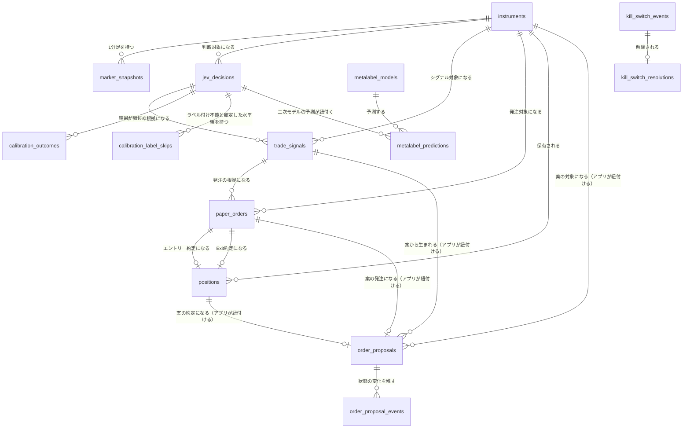

# ER / データモデル

DB: **SQLite**（アプリ内蔵、`modernc.org/sqlite` によるpure Go実装。cgo不要でWailsの単一実行ファイルに同梱する）。マイグレーションは `db/migrations`（golang-migrate、`database/sqlite`ドライバ。`modernc.org/sqlite`上で動作しcgo不要）で管理する。DBファイルはWindowsのアプリデータフォルダ（例: `%APPDATA%\pitha-trador\pitha.db`）に配置する。

## 型・規約（SQLite特有の注意点）

| 項目 | 規約 |
|------|------|
| 主キー | `integer PK` は SQLite の `INTEGER PRIMARY KEY`（rowidエイリアス）として宣言し、自動採番させる。Postgresの`bigserial`に相当 |
| 外部キー | `REFERENCES`句で宣言するが、SQLiteでは接続ごとに `PRAGMA foreign_keys = ON` を有効化しないと強制されない。Goのコネクションプール初期化時に必ず設定する |
| 日時 | `timestamptz`型は存在しないため `text` で宣言し、UTCのRFC3339文字列として保存する。小数秒は**固定9桁**（例: `2026-09-26T01:15:00.000000000Z`、Goの`sqlutil.FormatTime`）で、SQLiteのTEXT比較（辞書順）が時刻順に一致する（`time.RFC3339Nano`は末尾ゼロを切り詰める可変幅で、`…:05Z` > `…:05.5Z`と逆転するため使わない）。読み出し（`sqlutil.ParseTime`）は桁数を問わず受理する。保存済みの可変幅の値はマイグレーション000021で固定幅へ正規化する。比較・`ORDER BY`・窓境界に渡す引数も`FormatTime`で生成する |
| 日時列のDEFAULT | 一部の`created_at`/`updated_at`列にはスキーマ上`DEFAULT (strftime('%Y-%m-%dT%H:%M:%fZ', 'now'))`が残るが、`%f`は**ミリ秒3桁**（長さ24）で上記の固定9桁（長さ30）規約と幅が異なる。DEFAULTは本番経路では使わず、全INSERTで`created_at`/`updated_at`を`sqlutil.FormatTime`で明示する（`kill_switch_resolutions.created_at`を含む）。DEFAULTに依存して新規行を書くと同一テーブル内で幅が混在し、辞書順＝時刻順が崩れる |
| JSON | `jsonb`型は存在しないため `text` で宣言し、JSON文字列として保存する。クエリ時はSQLiteのJSON1関数（`json_extract`等）を用いる |
| 真偽値 | `boolean`はSQLite上は`integer`（0/1）として格納される。宣言上は`boolean`のまま表記する |
| 数値精度 | `numeric(x,y)`は桁数がDB側で強制されない（SQLiteの動的型付け）。宣言桁への丸め処理はアプリケーション層・リポジトリ層（`internal/repository/**`）のどちらにも存在せず、`float64`を無加工で保存・読み出しする（約定価格の呼値丸め`internal/service/fillmodel`は取引ルール上の丸めでDB桁への丸めではない）。宣言の`numeric(x,y)`は想定する値域・精度の目安であり、桁あふれ・桁丸めの強制は行わない |
| ベクトル検索 | pgvectorに相当する型は無いため、**sqlite-vec**拡張（`vec0`仮想テーブル）を別テーブルとして持つ（`docs/architecture/er/tables-system.md` の「ベクトルインデックス」参照） |
| 同時実行 | WALモード（`PRAGMA journal_mode=WAL`）を有効化する。書き込みはGo単一プロセスからのみ行うため、複数ライターの競合は発生しない |

## 全体ER図

## テーブル定義

テーブル定義は章ごとにファイルを分割している（`.linterly.yml` の300行/ファイル制限のため。見出し名・内容は分割前と同一）。コードコメント等の `er.md §<テーブル名>` は下表の該当ファイル内の同名見出しを指す。

| ファイル | テーブル / セクション |
|----------|----------------------|
| `docs/architecture/er/tables-market.md` | `instruments` / `market_snapshots` / `jev_decisions` / `daily_bars` / `daily_bar_runs` / `watch_lists` / `watch_list_entries` |
| `docs/architecture/er/tables-trading.md` | `paper_orders` / `positions` / `calibration_outcomes` / `calibration_label_skips` / `kill_switch_events` / `kill_switch_resolutions` / `trade_signals` / `order_proposals` / `order_proposal_events` |
| `docs/architecture/er/tables-metalabel.md` | `metalabel_models` / `metalabel_predictions` / `metalabel_retrain_skips`（メタラベリングの二次モデルとOOS指標・判断ごとの予測・データ不足の再学習見送り） |
| `docs/architecture/er/tables-system.md` | `runtime_settings` / `secrets` / `policy_proposals` / `jobs` / `health_alerts` / `health_alert_checks` / `mcp_settings_audit`、ベクトルインデックス（sqlite-vec） |

Paper 実績 MCP（issue #783、`docs/architecture/paper-results-mcp.md`）は上の既存テーブルを `mode=ro` で読む。書くのは、設定ツール（issue #806・#807）が `runtime_settings` のホワイトリストのキーと、設定変更の監査表 `mcp_settings_audit`（マイグレーション000040、`er/tables-system.md`）に対して行うものと、注文案ツール（issue #827）が注文案の表 `order_proposals` / `order_proposal_events`（マイグレーション000042、`er/tables-trading.md`）へ 1 案ごとに 2 行を `INSERT` するもの、注文案の受け付けスイッチ（`runtime_settings` の `mcp.order_proposals_enabled`）をオフにするものだけ。`paper_orders`・`positions`・`trade_signals`・`kill_switch_events` には書かない。`secrets`・`market_snapshots.raw_data_json`・`jev_decisions.state_json` は読まない（返す列は `docs/api/endpoints/paper-results-mcp.md` §4）。

## 改訂履歴

| 版 | 日付 | 変更内容 | 変更理由 |
|----|------|---------|---------|
| 1.0 | 2026-09-26 | 新規作成（PostgreSQL 16 + pgvector前提） | 初版 |
| 1.1 | 2026-09-26 | PostgreSQLからSQLite（アプリ内蔵）へ全面移行。pgvector→sqlite-vec仮想テーブル、River→自前`jobs`テーブルに変更 | Wails単一exe配布との整合、外部DBサービス常駐の排除 |
| 1.2 | 2026-09-26 | ベクトル次元を16→14（実際の特徴量数と一致）に修正。`runtime_settings`に`system.last_ui_heartbeat_at`等の例を明記 | レビュー指摘対応 |
| 1.3 | 2026-09-26 | sqlite-vecのGoバインディングを`modernc.org/sqlite/vec`（CGO不要のpure Go移植）と明記 | クロスコンパイル可否の正確化 |
| 1.4 | 2026-09-29 | テーブル定義を`docs/architecture/er/`配下の章別ファイル（tables-market/tables-trading/tables-system）へ分割。内容・見出し名は変更なし | issue #119（300行/ファイル制限の形骸化解消） |
| 1.5 | 2026-09-29 | `kill_switch_events`を追記専用化（UPDATE/DELETE拒否トリガー、マイグレーション000014）し、解除を`kill_switch_resolutions`へ分離。`secrets`テーブル（マイグレーション000013）を追記（`docs/architecture/er/`配下の該当章ファイルへ反映） | 監査ログの追記専用要件（non-functional.md §4）との整合、ER仕様の乖離解消（#102, #104） |
| 1.6 | 2026-09-29 | `jobs`（succeeded 7日/failed 30日）と`market_snapshots`（90日）の保持期間・日次パージを追記し、月次アーカイブ検討の記述を置換 | DB無制限増大の解消（#129） |
| 1.7 | 2026-10-01 | `jev_decisions`の`request_cost`はJev APIが課金額を返さないため常にNULLと明記。`question_version`の例を`scout-v2`/`trader-v2`へ更新。`response_json`は公式APIの生レスポンスではなく変換後の`ScoutResponse`/`TraderResponse`のJSONと明記 | issue #263 |
| 1.8 | 2026-10-02 | マイグレーション000018を追加し、`secrets`に保存済みの`UPDATE_GITHUB_TOKEN`行を削除（更新確認用トークン機能の廃止。許可キーから外れSettings画面から消せなくなるため） | 更新確認用トークン機能の廃止 |
| 1.9 | 2026-10-03 | 「数値精度」行の丸め処理の担当箇所を、sqlc生成コードから実装どおりのリポジトリ層（`internal/repository/**`）へ訂正 | issue #317 |
| 1.10 | 2026-10-03 | `market_snapshots.return_1m/5m/15m`の単位が小数比であること（%表示・閾値比較時に×100）を明記 | issue #364, #365 |
| 1.11 | 2026-10-05 | マイグレーション000019を追加し、`jobs(queue, status, finished_at)`索引を追加（直近`failed`件数・Jev Scout間引きが完了行を全走査しないため） | issue #392, #394, #395 |
| 1.12 | 2026-10-05 | マイグレーション000020を追加し、`jev_decisions`に`(decision_type, timestamp)`・`(timestamp)`索引を追加（Activity Logの直近判断`ListRecent`が全件走査・整列をしないため）。`jobs`の`finished_at`索引の用途にActivity Logの直近ジョブ`ListRecent`を追記 | issue #419 |
| 1.13 | 2026-10-05 | `jobs`の孤児`running`行の回復を`market-data`のみから全キュー共通（Schedulerが1分ごとに固定10分超を`failed`へ）へ変更 | issue #424, #425 |
| 1.14 | 2026-10-05 | §型・規約「日時」に小数秒の固定9桁（辞書順＝時刻順）を明記。マイグレーション000021を追加し、全TEXT日時列の保存済み可変幅RFC3339Nano値を固定幅へ正規化（`kill_switch_*`は追記専用トリガーを一時的に外して実施し、同一定義で再作成） | issue #430 |
| 1.15 | 2026-10-05 | §型・規約に「日時列のDEFAULT」行を追加（DEFAULTはミリ秒3桁で固定9桁規約と異なるため、INSERTは常に`FormatTime`で明示する）。`KillSwitchRepository.Resolve`が`kill_switch_resolutions.created_at`をDEFAULT任せにしていたのを`FormatTime`の明示指定へ修正（マイグレーション000021は未リリースのため追加の正規化は不要）。`er/tables-market.md`の`DEFAULT (RFC3339 now)`表記を実体（ミリ秒3桁のDEFAULT・本番では使わない）に合わせて訂正し、`er/tables-trading.md`の`kill_switch_resolutions.created_at`に同旨を追記 | issue #433, #434, #435（#430の取りこぼし） |
| 1.16 | 2026-10-05 | `jev_decisions.question_version`の例を`scout-v3`/`trader-v3`へ更新（RAG文脈が`calibration_outcomes`の実結果を含むようになったため、`stateGuide`を改訂） | issue #437 |
| 1.17 | 2026-10-05 | `er/tables-system.md`の類似検索SQL記述を実装に合わせて更新（`LIMIT 5`固定ではなく、`calibration_outcomes`紐付き済みに絞った検索でk件・不足時のみk×4件を取得してアプリ層で再ランクし上位k件を採用、`market_snapshot_vectors`は不足分のみ）。スキーマ変更なし | issue #441, #442, #445 |
| 1.18 | 2026-10-05 | `er/tables-market.md`の`trade_signals.policy_version`を、エンジン版`policy-v1`＋自己改善の適用版（`policy-v1+sol-12`）と明記 | issue #452 |
| 1.19 | 2026-10-05 | `er/tables-market.md`の`bid`/`ask`/`bid_depth`/`ask_depth`/`spread_bps`/`orderbook_imbalance`の意味を一般的な定義（bid=最良買気配・ask=最良売気配、bid < ask、`spread_bps`は正常な板で0以上、買い数量優勢で`orderbook_imbalance`が正）へ書き換え（kabuステーションAPIの売/買逆命名を入れ替えて保存）、修正前に保存された`market_snapshots`のbid/ask系・`spread_bps`・`orderbook_imbalance`・`microprice`は売/買が逆転している旨の注記を追加。スキーマ変更なし | issue #458, #463 |
| 1.20 | 2026-10-05 | `er/tables-market.md`の`market_snapshots.spread_bps`に、逆転板（bid > ask）は欠損（NULL）として扱う旨を追記（`microprice`も同様、`orderbook_imbalance`は数量のみのため対象外） | issue #465 |
| 1.21 | 2026-10-05 | `er/tables-system.md`の`jev_decision_vectors`に、bid/ask入れ替え修正（#458）前の符号反転ベクトルをマイグレーション`000022`で全件削除しRAG検索から除外する旨を追記（`jev_decisions`は不変） | issue #464 |
| 1.22 | 2026-10-05 | `er/tables-system.md`・`er/tables-market.md`に、bid/ask入れ替え修正（#458）前の`market_snapshot_vectors`もマイグレーション`000023`で全件削除しRAG検索から除外する旨を追記（`market_snapshots`は不変） | issue #469, #470 |
| 1.23 | 2026-10-05 | `er/tables-system.md`の類似検索に、問い合わせ対象の状態自身（同一銘柄の現在以降の判断・直近15分のスナップショット）を許可id集合で除外する旨を追記。スキーマ変更なし | issue #476 |
| 1.24 | 2026-10-05 | `er/tables-trading.md`に`calibration_label_skips`（ラベル付け恒久不能ペアの終端マーカー、マイグレーション000024）を追記 | issue #481 |
| 1.25 | 2026-10-05 | 全体ER図と`er/tables-trading.md`の`calibration_label_skips`節に、`jev_decisions`との関係線・`erDiagram`ブロックを追記（#481で追加したFKの図への反映漏れ） | issue #485 |
| 1.26 | 2026-10-05 | `er/tables-market.md`の`jev_decisions`索引説明に、`(decision_type, timestamp)`が`ListRecent`専用ではなく`CalibrationRepository.PendingLabels`の範囲走査（#484）にも必須で、`EXPLAIN QUERY PLAN`テストで固定している旨を追記。`er/tables-trading.md`の`calibration_label_skips`見出しを`###`→`##`へ是正（他テーブルと階層を統一）。スキーマ変更なし | issue #486, #487, #488 |
| 1.27 | 2026-10-05 | `er/tables-market.md`の`jev_decisions`に`(instrument_id, decision_type, timestamp DESC, id DESC)`索引（最新Trader/Scout判断の銘柄駆動seek用）を追記 | issue #498 |
| 1.28 | 2026-10-05 | `er/tables-trading.md`の`paper_orders.fees`/`slippage_bps`に、約定モデル（FR-ENTRY-8）が約定時に記録する値（手数料円・直近価格に対する不利方向bps）と、`positions.realized_pnl`が両約定の手数料控除後であることを追記。スキーマ変更なし | issue #509 |
| 1.29 | 2026-10-05 | `er/tables-market.md`の`market_snapshots`に取引可否カラム`special_quote`/`price_limit`/`lendable`を追加（マイグレーション000026。特別気配・ストップ高安・貸借なしショートをエントリー前に外す） | issue #511 |
| 1.30 | 2026-10-05 | 実装との乖離を是正: 「数値精度」の丸め処理は存在せずfloat64を無加工保存と訂正、マイグレーションドライバを`database/sqlite`（modernc）へ訂正、`secrets`許可キー13個の明記、`market_snapshots`のER図に全列を反映、`calibration_outcomes`の`future_return`/`max_*_excursion`の単位（%）を明記 | issue #565, #569, #574, #575, #576 |
| 1.31 | 2026-10-06 | `er/tables-market.md`の`market_snapshots`索引に`INDEX (timestamp)`、`er/tables-system.md`の`jobs`索引に`INDEX (status, finished_at)`（いずれもマイグレーション000027、retentionの期限切れ行取得用）を追記し、`jobs`の索引を3本と訂正。スキーマ変更なし | issue #533, #615, #616 |
| 1.32 | 2026-10-07 | `er/tables-market.md`の`jev_decisions`索引説明が参照する`calibration_plan_test.go`のパスを実在する`internal/repository/calibration/`に訂正（#601でjudgementから分離済み）。スキーマ変更なし | issue #659 |
| 1.33 | 2026-10-07 | `er/tables-trading.md`の`positions.unrealized_pnl`に、保有中のみ有効でクローズ時に`0`へリセットする旨を追記（`PositionRepository.Close`/`CloseWithExitOrder`が`closePosition`で設定）。スキーマ変更なし | issue #682 |
| 1.34 | 2026-10-07 | `er/tables-trading.md`の`positions.unrealized_pnl`に、#682以前にクローズされた過去行もマイグレーション000029で`0`へ揃えた旨を追記（保有中の行は不変、downはno-op） | issue #688 |
| 1.35 | 2026-10-07 | `er/tables-market.md`の`market_snapshots.market_breadth`の対象窓を「直近3分」固定から許容年齢（ランキング監視3分／`scan.full_scan_enabled: true`は`scan.full_scan_max_snapshot_age_seconds`）へ訂正。スキーマ変更なし | issue #692 |
| 1.36 | 2026-10-07 | `er/tables-market.md`の`market_snapshots.market_breadth`に、`scan.full_scan_enabled: true`では足が約8分間隔で各銘柄の`return_5m`が欠損のため常にNULLになる旨を追記。スキーマ変更なし | issue #693・#694・#696 |
| 1.37 | 2026-10-08 | `er/tables-trading.md`の`calibration_outcomes.horizon_minutes`を5/10/15等へ更新（既定の判定水平線を5/10/20から変更、既存の20分行は残る）、`calibration_label_skips`に猶予内はpending再試行・マーカー記録時はジョブをskipとして`succeeded`終了する旨を追記。スキーマ変更なし | issue #710, #711 |
| 1.38 | 2026-10-08 | `er/tables-system.md`の`runtime_settings`から環境変数の上書き層を削除（`config/strategy.yaml` < `runtime_settings`）し、Settings画面が保存する`system.backup_dir`/`system.log_dir`キーを追記。スキーマ変更なし | issue #708 |
| 1.39 | 2026-10-08 | `er/tables-market.md`の`market_snapshots.raw_data_json`の説明を「kabuステーションAPI生レスポンス」から「ブローカーの生レスポンス」へ一般化。スキーマ・保存内容は変更なし | issue #722 |
| 1.40 | 2026-10-08 | `er/tables-system.md`の`secrets`許可キーを17件（立花の`TACHIBANA_DEMO_AUTH_ID`/`TACHIBANA_PROD_AUTH_ID`/`TACHIBANA_DEMO_SECOND_PASSWORD`を追加。本番の第二暗証番号は持たない）、`runtime_settings`に`broker.provider`と立花の接続設定8件（秘密鍵はパスのみ保存）を追記 | issue #733 |
| 1.41 | 2026-10-08 | `er/tables-market.md`に立花の夜間の日足取得（issue #729）の`daily_bars`（銘柄×立会日の日足。無調整値と分割換算値）と`daily_bar_runs`（1夜1行の実行記録）を追加（マイグレーション`000030`）。どちらも他のテーブルとFKを持たないためER図の関連は変えない | issue #729 |
| 1.42 | 2026-10-08 | `er/tables-market.md`に立花の監視リスト（issue #730）の`watch_lists`（1立会日1行。確定方法・基準日・理由）と`watch_list_entries`（銘柄・枠の由来・選ばれた指標。最大120件）を追加（マイグレーション`000031`）。他のテーブルとFKを持たないためER図の関連は変えない | issue #730 |
| 1.43 | 2026-10-08 | `er/tables-system.md`の立花の監視銘柄ソース設定の説明に日中の接続側のキー（`event.max_connects_per_day`・`rest_quote.*`）が起動時に1回読まれることを追記し、`er/tables-market.md`の`watch_lists`の説明を日中監視（issue #731。`tachibanawatch.Monitor`が03:30〜15:30に読む）へ更新。スキーマ変更なし | issue #731 |
| 1.44 | 2026-10-14 | `er/tables-market.md`の`market_snapshots`と`jev_decisions`にOFI（`ofi_short/mid/long`・窓幅・`microprice_dev_bps`、migration 000032、issue #750）、`er/tables-system.md`の`runtime_settings`キーに`orderflow.ofi_window_*_seconds`を追加 |
| 1.45 | 2026-10-14 | `er/tables-trading.md`の`calibration_outcomes`にトリプルバリアのラベル列（`barrier_hit`・`net_return_bps`・`entry_ref_price`・`label_version`、migration 000033。既存行は`label_version=1`の旧ラベルとして区別、issue #756・親 #751）を追加 | issue #756 |
| 1.46 | 2026-10-14 | `er/tables-system.md`の`runtime_settings`キーに`calibration.barrier_{tp,sl,cost}_bps`・`calibration.barrier_timeout_minutes`（トリプルバリアラベルの設定）を追加。スキーマ変更なし | issue #760 |
| 1.47 | 2026-10-14 | `er/tables-trading.md`の`calibration_outcomes`: トリプルバリアのラベルでは`horizon_minutes`=Settingsのtimeout、`was_direction_correct`=`net_return_bps > 0`と明記。スキーマ変更なし | issue #762 |
| 1.48 | 2026-10-14 | マイグレーション000034を追加し、`er/tables-metalabel.md`に`metalabel_models`（モデル版・学習窓/OOS窓・OOS指標）と`metalabel_predictions`（判断ごとの較正後確率・EV・take/skip・サイズ）を新設。全体ER図に関係線を追加 | issue #757 |
| 1.49 | 2026-10-14 | `er/tables-system.md`の`runtime_settings`キーに`metalabel.{model,calibration,retrain_time,min_ev_bps}`（メタラベリングの二次モデル設定）を追加。スキーマ変更なし | issue #759 |
| 1.50 | 2026-10-14 | `er/tables-market.md`の`jev_decisions`に`data_age_ms`（判断時点の市場データの古さ、migration 000035）、`er/tables-system.md`の`runtime_settings`キー例に`scan.snapshot_max_age_seconds`（ランキング監視の足の鮮度上限、既定20秒）を追加（issue #754） |
| 1.51 | 2026-10-14 | `er/tables-market.md`の`jev_decisions`に`market_regime`・`ab_arm`・`regime_volatility_bps`・`regime_autocorr`・`vwap_z`（判断時点の相場状態・A/Bアーム・その根拠、migration 000036）を追加し、`er/tables-system.md`の`runtime_settings`キー例に`regime.*`を追加 | issue #755・親 #751 |
| 1.52 | 2026-10-17 | `er/tables-metalabel.md`の`metalabel_predictions.size_fraction`を記録専用（発注数量には使わない）と明記（挙動の変更なし） | issue #781 |
| 1.53 | 2026-10-17 | `er/tables-system.md`の`runtime_settings`キーに`cost.*`（売買コストの想定: 手数料・スリッページ・SHORT貸株料）を追加。スキーマ変更なし | issue #779 |
| 1.54 | 2026-10-17 | マイグレーション000037を追加し、`er/tables-metalabel.md`の`metalabel_models`に採用判定の根拠列（`oos_takes`・`oos_days`・`oos_ev_ci_{low,high}_bps`・`oos_auc_ci_{low,high}`・`adoption_json`・`forward_json`）を追加。`er/tables-system.md`の`runtime_settings`キーに`metalabel.llm_cutoff_{model,confirmed_on,source}`（LLM学習データ終了日の出典、issue #776）を追記 | issue #780, #776 |
| 1.55 | 2026-10-17 | Paper 実績 MCP は既存テーブルの読み取り専用であり、新規テーブルを追加しない旨を追記。スキーマ変更なし | issue #783 |
| 1.56 | 2026-10-19 | `er/tables-metalabel.md`の`reject_reason`に、Live前チェックで`metalabel.llm_cutoff_model`が未記録のときの`llm_cutoff_unverified`を追記（スキーマ変更なし） | issue #780の決定（unverifiedはPaperは警告のみ・Live前は不採用） |
| 1.57 | 2026-10-20 | マイグレーション000038を追加し、`er/tables-metalabel.md`に`metalabel_retrain_skips`（夜間再学習がデータ不足で見送られた記録。固定の`reason_code`と必要件数中の件数）を新設。Paper 実績 MCP の`metalabel_history`が読む | issue #799 |
| 1.58 | 2026-10-20 | マイグレーション000039を追加し、`er/tables-system.md`に`health_alerts`（立会中の市況データ停止の警告。固定コードと開始時刻）と`health_alert_checks`（検知の最終確認時刻、1行）を新設。アプリの検知が書き、Paper 実績 MCP の`collection_status`が読む | issue #802 |
| 1.59 | 2026-10-20 | `er/tables-system.md`の`runtime_settings`に`paper.bootstrap_entry_enabled`を、`er/tables-market.md`の`trade_signals.policy_version`にPaperブートストラップの`policy-vb`を追記（スキーマ変更なし） | issue #798 |
| 1.60 | 2026-10-20 | `runtime_settings`のキーに`risk.paper.initial_capital_jpy`・`risk.paper.max_position_per_symbol_pct`・`risk.paper.max_total_exposure_pct`・`risk.paper.max_trade_loss_pct`（PaperのRisk Engine用の運用資金・1銘柄／総エクスポージャ上限・1回の最大損失。判定ごとに読み込む）と内部マーカー`system.paper_risk_defaults_seeded`を追加（`er/tables-system.md`） | issue #804 |
| 1.61 | 2026-10-20 | マイグレーション000040を追加し、`er/tables-system.md`に`mcp_settings_audit`（Paper 実績 MCP の設定ツールと Settings 画面の、ホワイトリストのキーの変更と書き込み許可の切替の監査ログ）を追加。`runtime_settings`のキー`mcp.settings_write_enabled`（書き込み許可、1/0、行なしは許可）を追記 | issue #806・#807 |
| 1.62 | 2026-10-20 | マイグレーション000041を追加し、`er/tables-market.md`の`instruments`に`asset_class`（`stock` / `bond_etf`）、`er/tables-trading.md`の`paper_orders`・`positions`・`trade_signals`に`bucket`を追加（書き込み時に`instruments.asset_class`から確定。既存行は`stock`）。`er/tables-system.md`の`runtime_settings`にPaperの予算枠`risk.bucket.{stock,bond_etf}.budget_jpy`と内部マーカー`system.bucket_budgets_seeded`を追記。株の保有額は`positions`の未決済の行の時価ベースの合計（`current_price`×`quantity`。`current_price`が付くまでは`entry_price`。総エクスポージャ上限と同じ計算）。`trade_signals`には予算枠の拒否理由`bucket_disabled` / `bucket_budget_exceeded`も追記し、その章を`.linterly.yml`の300行/ファイル制限のため`er/tables-market.md`から`er/tables-trading.md`へ移した（見出し名・内容は同じ） | issue #824（親 #823） |
| 1.63 | 2026-10-21 | `er/tables-system.md`の`runtime_settings`の予算枠（`risk.bucket.*`）の説明を、独立した`key`行から、`risk.paper.*`と同じく`key`行の中へ統合した（同じ主キー列が2行並んで見えないように）。運用資金を既定へ戻す削除が枠の合計を下回るとき拒否される旨を追記（スキーマ変更なし） | issue #838 |
| 1.64 | 2026-10-21 | マイグレーション000042を追加し、`er/tables-trading.md`に`order_proposals`（MCP の注文案。1 案 1 行。`mode`は`CHECK (mode IN ('paper'))`で Live の値は入らない）と`order_proposal_events`（状態の変化。追記のみ）を、`er/tables-system.md`の`mcp_settings_audit.action`に`order_proposals_enable` / `order_proposals_disable`を、`runtime_settings`のキーに`mcp.order_proposals_enabled`（既定オフ）を追記。全体ER図に関係線を追加 | issue #827（親 #826） |
| 1.65 | 2026-10-21 | マイグレーション000043を追加し、`er/tables-trading.md`の`order_proposals`に`cancel_requested_at`・`applied_quantity`・`computed_max_loss_jpy`・`effective_stop_loss_price`を、`order_proposal_events`に`detail_json`を、`paper_orders (trade_signal_id)`と`positions (entry_order_id)`のインデックスを追加。`positions.exit_reason`に`proposal_close`、`trade_signals.policy_version`に`mcp-proposal-v1`を追記 | issue #828（親 #826） |
| 1.66 | 2026-10-21 | マイグレーション000044を追加し、`er/tables-metalabel.md`の`metalabel_retrain_skips`に`oos_rows`・`required_oos_rows`・`dropped_incomplete`（NULL可。NULL＝記録なし、既存行はUPDATEせずNULLのまま）・`label_v1_rows`・`label_v2_rows`（見送りの内訳の件数。既存行は0）を追加 | issue #862（関連 #799） |
| 1.67 | 2026-10-21 | マイグレーション000045を追加（`trade_signals`の過去行を直し、直す前の値を新しい退避表`trade_signal_rewrites_000045`に残す。`er/tables-trading.md`）。`er/tables-trading.md`の`trade_signals.risk_passed` / `reject_reason`に、注文案が Risk を通ったが注文にならなかった行は`risk_passed = 0`・`proposal_rejected_after_risk: <理由コード>`にする旨を追記。過去行は 000045 が同じ形に直す | issue #860（親 #826） |
