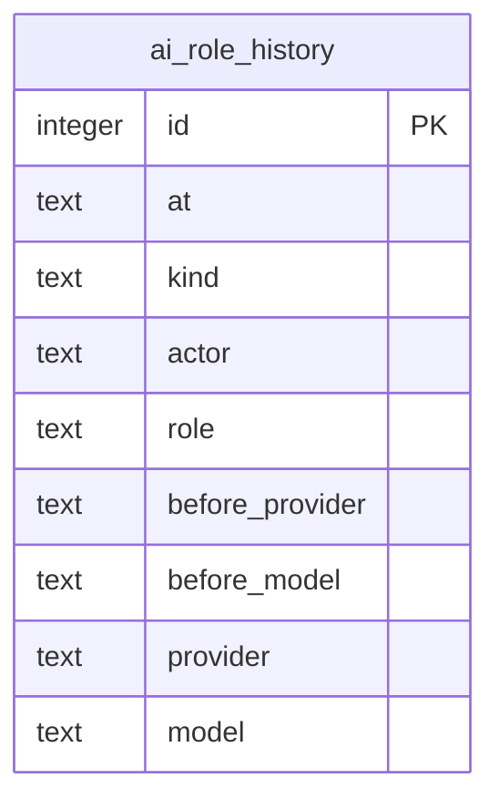

# ER / データモデル: テーブル定義（AI の役割のプロバイダー設定の記録）

`docs/architecture/er.md` から分割した章。対象: `ai_role_history` と、役割の設定を持つ`runtime_settings`のキー`ai.role.<role>`。型・規約と全体ER図は `docs/architecture/er.md` を参照。設計は`docs/architecture/overview/integrations-ai-providers.md`（issue #1080）。

## runtime_settings のキー

| キー | 値 | 既定 |
|---|---|---|
| `ai.role.jev` / `ai.role.sol` / `ai.role.opus` / `ai.role.luna` | JSON `{"provider":"custom"\|"openrouter","model":"…"}`。`openrouter`は`model`必須（1〜100 文字、空白・制御文字なし）、`custom`の`model`はjevだけ（空は`JEV_MODEL`）。未知の項目は拒否 | 行なし＝`custom`・モデル指定なし（今までと同じ接続先・キー・モデル） |

書くのは Settings 画面（`system.AIRoleRepository`）だけで、MCP の`settings_set`の許可リストには無い。値が壊れている行は無視して既定で動く（画面に理由を出す）。API キー・URL は`secrets`のまま、ここには入れない。

## ai_role_history（役割のプロバイダー・モデルの記録、issue #1080）

画面で役割の設定を保存・既定に戻した履歴（`kind='saved'`）と、アプリの起動時に実際に使い始めた組（`kind='started'`）。マイグレーション`000057`。

| カラム | 型 | 制約 | 説明 |
|-------|-----|------|------|
| id | integer | PK, AUTOINCREMENT | |
| at | text | NOT NULL | 記録した時刻（UTC）。設定の反映にはアプリの再起動が要る |
| kind | text | NOT NULL, CHECK(`saved`/`started`) | `saved`＝画面での保存・既定に戻した変更、`started`＝起動時に使い始めた組 |
| actor | text | NOT NULL, CHECK(`gui`/`app`) | `saved`は`gui`（Settings 画面）、`started`は`app` |
| role | text | NOT NULL, CHECK(`jev`/`sol`/`opus`/`luna`) | 役割 |
| before_provider / before_model | text | `saved`は NOT NULL、`started`は NULL | 保存前の組（既定は`custom`・空） |
| provider | text | NOT NULL, CHECK(`custom`/`openrouter`) | 保存後・使い始めた組のプロバイダー |
| model | text | NOT NULL, DEFAULT `''` | モデル名。`''`は指定なし（`started`のjevは実際のモデル名） |

CHECK: `saved`は`gui`で前の組と違うものだけ、`started`は`app`で前の組なし。インデックス: `(role, id)`。**入るのはプロバイダー名とモデル名だけ**（API キー・接続先 URL などの秘密は入れない）。ライブの Jev の`saved`の行は Paper 実績 MCP の調整の実験の交絡として使う（`jev_model_changes`と並ぶ。`docs/architecture/paper-results-mcp-experiments.md`）。
