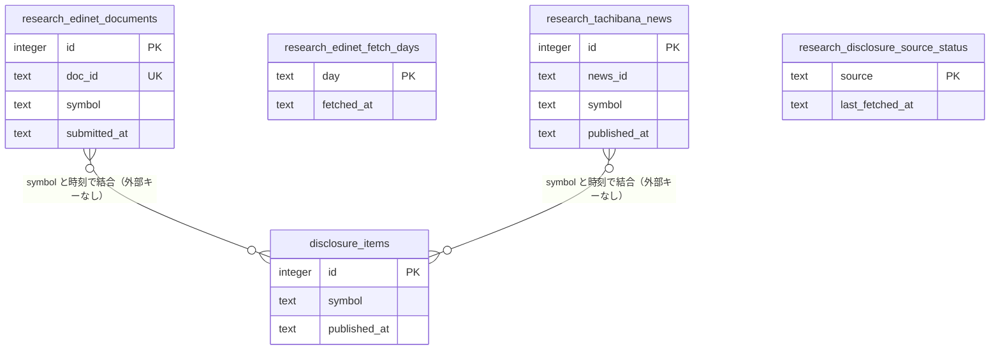

# ER: 開示・ニュースの追加の情報源（研究用）

`docs/architecture/er.md` から分割した章。対象: `research_edinet_documents` / `research_edinet_fetch_days` / `research_tachibana_news` / `research_disclosure_source_status` と、読み取り用のビュー `research_disclosure_source_events_v`（マイグレーション `000059`。issue #1096）。型・規約と全体 ER 図は `docs/architecture/er.md` を参照。設計は `docs/architecture/overview/integrations-disclosure-sources.md`、読み取りツールは `docs/api/endpoints/paper-results-mcp-disclosure-sources.md`。実装は `internal/repository/disclosuresrc`（表）・`internal/service/disclosuresrc`（記録部品・EDINET クライアント）・`internal/bootstrap/disclosuresrcwire`（メンテナンスタスク）。

**研究専用**。ゲート・Policy・Risk・発注・Paper ガード・Live・Jev・RAG の索引・Calibration・メタモデルの学習・自己改善・既存の開示見送りルールは、これらの表を読まない。`disclosure_items`・`jev_decisions`・`jev_shadow_decisions`・`jev_trial_decisions`・`market_snapshots`・`daily_bars` には何も書かず、列も制約も足さない。書類・ニュースの本文は持たない。API キー・認証情報は持たない。時刻はすべて UTC の RFC3339（小数 9 桁固定）。



## research_edinet_documents

EDINET API v2 の書類一覧（`documents.json?type=2`）の 1 書類 1 行。メタデータだけ。

| カラム | 型 | 制約 | 説明 |
|--------|-----|------|------|
| id | integer | PK, AUTOINCREMENT | |
| doc_id | text | NOT NULL, UNIQUE, CHECK 空でない | EDINET の書類管理番号。再取得は UPDATE（冪等） |
| symbol | text | NOT NULL, CHECK 空でない | 4 桁の証券コード（`disclosure_items.symbol` と同じ形）。secCode の先頭 4 桁 |
| sec_code | text | NOT NULL, CHECK 空でない | EDINET が返した secCode そのまま（5 桁） |
| edinet_code / filer_name | text | NOT NULL, 既定 '' | 提出者の EDINET コード・提出者名 |
| doc_type_code | text | NOT NULL, 既定 '' | 書類種別コード（例 120=有価証券報告書、350=大量保有報告書） |
| title | text | NOT NULL, 既定 '' | docDescription（書類の説明） |
| submitted_at | text | NOT NULL | 提出日時（JST で返るものを UTC に直す。`disclosure_items.published_at` と同じ形式） |
| submit_day | text | NOT NULL, CHECK 長さ 10 | 提出日（JST の YYYY-MM-DD）。日ごとの集計・保持期間の削除のキー |
| first_seen_at / updated_at | text | NOT NULL | 初めて取得した時刻・最後に取得した時刻 |

索引: `(symbol, submitted_at)`・`(submit_day)`。`secCode` の無い書類は行を作らない。

## research_edinet_fetch_days

書類一覧を取った日（提出日 JST）ごとの記録。日が終わってから取った日だけを「取り終えた」とみなす（`fetched_at` の JST の日が `day` より後）。

| カラム | 型 | 制約 | 説明 |
|--------|-----|------|------|
| day | text | PK, CHECK 長さ 10 | 提出日（JST） |
| fetched_at | text | NOT NULL | 最後に取った時刻 |
| total_count / recorded_count / skipped_count | integer | NOT NULL, CHECK >= 0 | 一覧の書類数・記録した数・記録しなかった数（secCode が無い・提出日時が読めない） |

## research_tachibana_news

立花 e支店のニュースの見出し・時刻・関連銘柄。`(news_id, symbol)` で一意。関連銘柄が複数あるニュースは銘柄ごとに 1 行、無いニュースは `symbol = ''` の 1 行。立花の実機計測（#725）が終わるまで本番には繋がない（本番の起動はこの表に書かない）。

| カラム | 型 | 制約 | 説明 |
|--------|-----|------|------|
| id | integer | PK, AUTOINCREMENT | |
| news_id | text | NOT NULL, CHECK 空でない | 立花のニュースの識別子 |
| symbol | text | NOT NULL, 既定 '' | 4 桁の証券コード。関連銘柄が無いときは '' |
| headline | text | NOT NULL | 見出し（本文は持たない） |
| published_at | text | NOT NULL | ニュースの時刻（UTC） |
| first_seen_at | text | NOT NULL | 初めて取得した時刻 |

UNIQUE `(news_id, symbol)`。索引: `(symbol, published_at)`・`(published_at)`。

## research_disclosure_source_status

情報源ごとの取得状況（1 源 1 行）。`source` は `edinet` / `tachibana_news`。

| カラム | 型 | 制約 | 説明 |
|--------|-----|------|------|
| source | text | PK, CHECK IN ('edinet','tachibana_news') | |
| requests_day / requests_today | text / integer | NOT NULL | 1 日の要求数の上限の判定に数える、JST の日とその日の要求数（失敗した要求も数える。要求は送る前に 1 文で数える） |
| request_count / failure_count | integer | NOT NULL, CHECK >= 0 | 累計の要求数・失敗数 |
| last_fetched_at / last_success_at / last_failure_at | text | NULL 可 | 最後に要求を出した・成功した・失敗した時刻 |
| last_failure_code | text | NOT NULL, 既定 '' | 最後の失敗の固定コード（`http_401` / `http_403` / `http_429` / `http_4xx` / `http_5xx` / `timeout` / `transport` / `invalid_response` / `api_error`）。エラーの本文・URL は残さない |

## 結合（`disclosure_items` と同じ銘柄・時刻）

`research_disclosure_source_events_v` は 2 つの情報源を `(source, ref_id, symbol, event_at, headline)` に揃える（立花ニュースは `symbol <> ''` の行だけ）。やのしんの開示の直後 2 時間に、同じ銘柄で出た EDINET の書類・立花ニュースを探す例:

```sql
SELECT i.symbol, i.published_at AS tdnet_at, e.source, e.ref_id, e.event_at
FROM disclosure_items i
JOIN research_disclosure_source_events_v e
  ON e.symbol = i.symbol AND e.event_at >= i.published_at AND e.event_at < :window_end
ORDER BY i.published_at, e.event_at;
```

`:window_end` は `i.published_at` の 2 時間後を、アプリと同じ固定幅の文字列（`2026-11-13T07:30:00.000000000Z`）で渡す。表を直接結合してもよい（`research_tachibana_news n JOIN disclosure_items i ON n.symbol = i.symbol AND n.published_at = i.published_at`）。

## 保持

`disclosure_src.retention_days`（既定 1095 日、30〜3650）より古い行を記録部品が実行の終わりに削除する（`research_edinet_documents` は `submitted_at`、`research_tachibana_news` は `published_at`、`research_edinet_fetch_days` は `day`）。`research_disclosure_source_status` は削除しない。記録がオフの間は書き込みも削除もしない。
