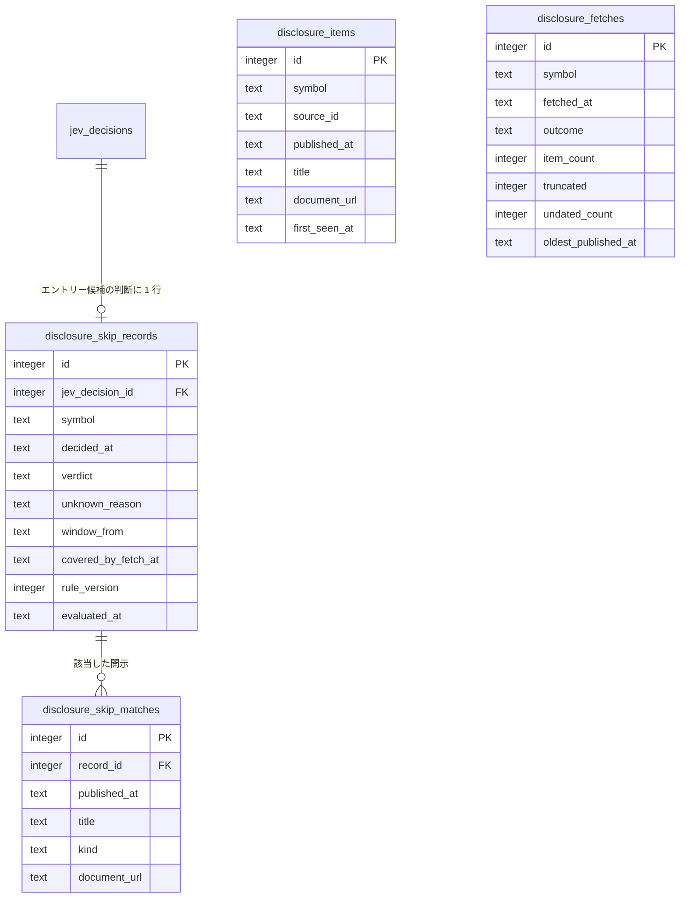

# ER / データモデル: テーブル定義（適時開示による見送りルールの記録）

`docs/architecture/er.md` から分割した章。対象: `disclosure_items` / `disclosure_fetches` / `disclosure_skip_records` / `disclosure_skip_matches`（マイグレーション `000049`。issue #935）。型・規約と全体 ER 図は `docs/architecture/er.md` を参照。仕様は `docs/architecture/disclosure-skip.md`。

4 表とも**記録だけ**で、取引・Policy・Risk・発注・Jev のプロンプトのどれも読まない。書くのは、News Ingest の取得結果を横取りする記録部品と、判断を後追いで評価する評価部品（どちらも専用の DB 接続。`DBWriteFailures` に触れない）だけ。`jev_decisions` と `calibration_outcomes` は読むだけで、既存の列・制約は変えない。日時は UTC の RFC3339（小数秒 9 桁固定）。

## disclosure_items

やのしん TDnet WebAPI の開示インデックス（銘柄・開示時刻・表題・URL）。News Ingest が取得した応答の各項目を保存する。PDF の本文は取得しない。`UNIQUE (symbol, source_id)`。INDEX `(symbol, published_at)`。

| カラム | 型 | 制約 | 説明 |
|--------|-----|------|------|
| id | integer | PK, AUTOINCREMENT | |
| symbol | text | NOT NULL | 銘柄コード（`instruments.symbol` と同じ。FK は張らない） |
| source_id | text | NOT NULL | やのしんの開示 ID（無ければ表題。News Ingest の重複排除キーと同じ） |
| published_at | text | NOT NULL | 開示時刻（やのしんの `pubdate` は JST。UTC に直して保存） |
| title | text | NOT NULL | 表題。見送りルールの種類の判定に使う |
| document_url | text | | やのしんが返した文書 URL。取りに行かない |
| first_seen_at | text | NOT NULL | 初めて取得した時刻（取得の遅れを後から調べる用） |

## disclosure_fetches

News Ingest の 1 回の取得の成否。取得の穴を「該当なし」と区別して「不明」にする根拠。INDEX `(symbol, fetched_at)`。評価が終わる期間より古い行（7 日）は評価部品が消す。バックオフ中でリクエストを出さなかった回と、終了処理で中断した回は行を作らない。

| カラム | 型 | 制約 | 説明 |
|--------|-----|------|------|
| id | integer | PK, AUTOINCREMENT | |
| symbol | text | NOT NULL | |
| fetched_at | text | NOT NULL | リクエストを始めた時刻 |
| outcome | text | NOT NULL, CHECK (`ok` / `error`) | `error` はタイムアウト・HTTP エラー・不正な応答 |
| item_count | integer | NOT NULL, 0 以上 | 応答の項目数（`ok` のとき） |
| truncated | integer | NOT NULL, 0/1 | 応答が件数上限（`newsfeed.YanoshinLimit` = 10）に届き、古い開示が切れている可能性がある |
| undated_count | integer | NOT NULL, 0 以上 | 開示時刻を読めなかった項目の数。1 件でもあればその取得は窓を覆わない |
| oldest_published_at | text | | 応答の最古の開示時刻（時刻のある項目が無ければ NULL） |

## disclosure_skip_records

Jev のエントリー候補の判断（`jev_decisions` の `decision_type='trader'` かつ `direction` が `LONG` / `SHORT`）1 件につき 1 行。`jev_decision_id` は UNIQUE。INDEX `(decided_at)`。判断から最大 60 分は行が無い（覆う取得を待つ）。

| カラム | 型 | 制約 | 説明 |
|--------|-----|------|------|
| id | integer | PK, AUTOINCREMENT | |
| jev_decision_id | integer | NOT NULL, UNIQUE, FK → `jev_decisions.id` | |
| symbol | text | NOT NULL | |
| decided_at | text | NOT NULL | 判断の時刻（`jev_decisions.timestamp`）。ルールの `t` |
| verdict | text | NOT NULL, CHECK (`skip` / `no_skip` / `unknown`) | 該当 / 非該当 / 不明 |
| unknown_reason | text | CHECK (`no_fetch` / `incomplete_fetch`) | `unknown` のときだけ入る（`verdict = 'unknown'` と同値） |
| window_from | text | NOT NULL | 窓の始まり（判断日の直前の東証営業日の 15:00 JST）。窓は `[window_from, decided_at]` |
| covered_by_fetch_at | text | | 窓を覆った取得の時刻。覆えていなければ NULL（`skip` は覆えていなくても確定する） |
| rule_version | integer | NOT NULL | ルールの版（`disclosureskip.RuleVersion`） |
| evaluated_at | text | NOT NULL | 記録した時刻 |

## disclosure_skip_matches

`skip` になった判断の該当開示。1 判断に複数ありうる。INDEX `(record_id)`。

| カラム | 型 | 制約 | 説明 |
|--------|-----|------|------|
| id | integer | PK, AUTOINCREMENT | |
| record_id | integer | NOT NULL, FK → `disclosure_skip_records.id` ON DELETE CASCADE | |
| published_at | text | NOT NULL | 開示時刻 |
| title | text | NOT NULL | 表題 |
| kind | text | NOT NULL, CHECK (`earnings` / `forecast_revision`) | 決算短信 / 業績予想の修正（上方・下方とも） |
| document_url | text | | 文書 URL |

Paper 実績 MCP の `disclosure_skip_summary`（`api/endpoints/paper-results-mcp-disclosure-skip.md` §3.31）は 4 表のうち `disclosure_skip_records` と `disclosure_skip_matches` を件数としてだけ読み、表題・URL は返さない。

## 変更履歴

| 版 | 日付 | 内容 | 出典 |
|---|---|---|---|
| 1.0 | 2026-10-30 | 新規作成。4 表（`000049`）。既存の表は変えない | issue #935 |
