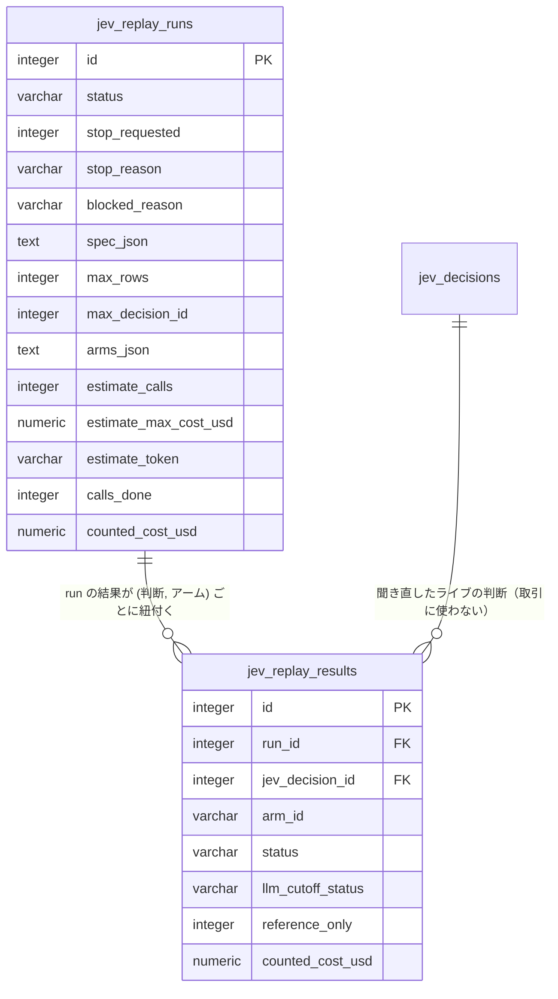

# ER / データモデル: テーブル定義（Jev リプレイ評価）

`docs/architecture/er.md` から分割した章。対象: `jev_replay_runs` と `jev_replay_results`（マイグレーション `000061`。issue #1085）。型・規約と全体 ER 図は `docs/architecture/er.md` を参照。仕様（フロー・スイッチ・見積もり・学習カットオフ・費用の上限）は `docs/architecture/overview/integrations-jev-replay.md`、MCP ツールは `docs/api/endpoints/paper-results-mcp-jev-replay.md`。

保存済みのライブの trader 判断の入力（`jev_decisions.state_json`）を、お試しのアーム（`jev.trial.arms`）に**後から**聞き直した結果を残す研究用の表。`jev_decisions`・`jev_shadow_decisions`・`jev_trial_decisions` には**書かない**（`replayflow/isolation_test.go` が、表名を扱うコードをリプレイのリポジトリと MCP の読み取りに限ることを固定）。取引・Risk・RAG の索引・Calibration・メタモデルの学習・既存シャドーのどれも、この 2 表を読まない。

## jev_replay_runs

1 回のリプレイ（run）。MCP の `replay_start` が `pending` の行を 1 件入れ、アプリ内のランナーが進め、`replay_stop` が停止フラグを立てる。

| カラム | 型 | 制約 | 説明 |
|--------|-----|------|------|
| id | integer | PK, AUTOINCREMENT | |
| status | varchar(10) | NOT NULL, CHECK IN | `pending`（入れた）/ `running`（進行中。上限などで待っているあいだも）/ `completed` / `stopped` / `failed`（始められなかった）。CHECK: 終わった状態と `finished_at` の有無が一致 |
| stop_requested | integer | NOT NULL, 既定 0, CHECK 0/1 | 停止フラグ。1 のとき、ランナーは次の呼び出しの前に `stopped`（`requested`）にする |
| stop_reason | varchar(32) | NOT NULL, 既定 '' | `stopped` / `failed` の理由の固定コード: `requested` / `run_cost_cap` / `payment_required` / `key_not_set` / `no_arms` |
| blocked_reason | varchar(32) | NOT NULL, 既定 '' | `running` のあいだ新しい呼び出しを出していない理由の固定コード（`daily_cap_overall` / `daily_cap_arm` / `stopped_*` / `throttled` / `check_failed`。`jevtrial.Skip*` と同じ語）。動いているときは空。日が変われば自動で再開する |
| spec_json | text | NOT NULL | 指定（`decision_type`=`trader`・`from`/`to`（JST の日付）・`max_rows`・`arms`）。`period_from` / `period_to` は判断の時刻の範囲 [from, to) の保存形式 |
| max_rows | integer | NOT NULL, CHECK 1〜1000 | 対象の判断の件数の上限（古い順） |
| max_decision_id | integer | NOT NULL, CHECK >= 0 | 見積もり時点の対象の最大の `jev_decisions.id`。見積もり後に増えた判断を対象に入れない |
| arms_json | text | NOT NULL | 開始時点のアームの設定（`jev.trial.arms` のうち選んだもの。**キーは含まない**）。実行中に設定が変わってもこの版で呼ぶ |
| estimate_decisions / estimate_calls | integer | NOT NULL, CHECK >= 0 | 見積もりの判断の件数・呼び出し数（判断 × アーム。学習カットオフ以前の除外後） |
| estimate_max_cost_usd | numeric(12,8) | NOT NULL, CHECK >= 0 | 最悪値側の費用の見込み（予約と同じ単価）。ランナーはこの額を超えたら止める |
| estimate_list_price_usd | numeric(12,8) | NULL可 | 定価での費用の目安。定価が分からないアームがあれば NULL |
| estimate_token | varchar(64) | NOT NULL, CHECK 空でない | 見積もりの内容のハッシュ。開始時に今の見積もりと一致するかを確かめる |
| calls_done / calls_failed | integer | NOT NULL, 既定 0 | 記録した結果の行数（失敗を含む）・うち `failed` の行数。結果の保存と同じトランザクションで更新する |
| counted_cost_usd | numeric(12,8) | NOT NULL, 既定 0 | 記録した行の `counted_cost_usd` の合計（この run が上限の判定に数えた額） |
| created_by | varchar(64) | NOT NULL, 既定 '' | 開始した MCP の接続元ホスト（監査用）。キー・資格情報は入れない |
| created_at / started_at / finished_at / updated_at | text | created・updated は NOT NULL。started・finished は NULL可 | UTC RFC3339（固定幅） |

インデックス: `jev_replay_runs_status_idx (status, id)`（動いている run の検索）。

## jev_replay_results

(run, ライブの判断, アーム) ごとの結果。**`jev_trial_decisions` と同じ答え・費用・状態の列**（意味は `er/tables-jev-trial.md` と同じ）に、`run_id`・学習カットオフの確認状態・参考扱いの印を足したもの。`UNIQUE (run_id, jev_decision_id, arm_id)`（同じ組を 1 つの run で 2 回聞かない。再開はこの一意性に支えられる）。

| カラム | 型 | 制約 | 説明 |
|--------|-----|------|------|
| id | integer | PK, AUTOINCREMENT | |
| run_id | integer | NOT NULL, FK → `jev_replay_runs.id` | |
| jev_decision_id | integer | NOT NULL, FK → `jev_decisions.id` | 聞き直したライブの判断。ライブの答えは同じ行で見る |
| arm_id・prompt_version・provider・requested_model・served_*・response_id | | `jev_trial_decisions` と同じ | アーム・版・モデル・応答が返した値 |
| status・failure_code・http_status・error_excerpt | | `jev_trial_decisions` と同じ | `ok` / `failed` / `refused` / `partial`。`failed` のときだけ `failure_code` が非空（CHECK）。エラーの抜粋は 200 バイトまでで、キーは `[redacted]` に伏せる |
| direction・regime・entry_quality・confidence・toxic_flow・liquidity_stressed・continuation_probability | | `jev_trial_decisions` と同じ | 拒否・欠落は NULL（補わない）。`status='ok'` のときは全問が非 NULL（CHECK） |
| response_json | text | NULL可 | 応答の本文そのまま。MCP は返さない |
| latency_ms・input_tokens・output_tokens | | `jev_trial_decisions` と同じ | |
| cost_usd・cost_source・counted_cost_usd | | `jev_trial_decisions` と同じ | `cost_source` = `reported` / `list_price_estimate` / `unknown`（不明は NULL で 0 にしない）。`counted_cost_usd` は上限の判定に数えた額で、**1 日（JST）の上限の判定はお試しの行と合算する** |
| request_bytes | integer | NOT NULL, 既定 0 | 実際に送ったリクエスト本文の大きさ。送った `state` は `jev_decisions.state_json` そのままで、何も足さない |
| state_bytes・truncation_suspected | | `jev_trial_decisions` と同じ | `state_bytes` は保存された入力の大きさ |
| llm_cutoff_status | varchar(20) | NOT NULL, CHECK IN (`verified`, `unverified`) | `verified`＝アームに `llm_cutoff` があり、その日より後の判断だけを送った／`unverified`＝公表されていない（画面では「未確認」。日付を推測で入れない） |
| reference_only | integer | NOT NULL, CHECK 0/1 | 1＝参考扱い。CHECK: `unverified` の行は必ず 1 |
| rag_includes_live_model_answers | integer | NOT NULL, 既定 0 | リプレイは類似事例（RAG）を足さない（判断より後のデータが入るため）ので常に 0 |
| created_at | text | NOT NULL | UTC RFC3339（固定幅）。費用の日次集計は JST の日で切る |

インデックス: `jev_replay_results_created_at_idx (created_at)`・`jev_replay_results_arm_idx (arm_id, created_at)`（日次の費用）・`jev_replay_results_decision_idx (jev_decision_id)`。

## 読み取り

- 結果は `replay_results`（`trialquery.CompareReplay`）が、`jev_trial_compare` と同じ指標で、run の行とライブの判断を同じ行どうしで比べる。**ライブの判断・学習・メタモデル・RAG には混ぜない**。
- 1 日（JST）の費用の上限は、`jev_trial_decisions.counted_cost_usd` と `jev_replay_results.counted_cost_usd` の合計で判定する（リプレイがお試しと同じ上限を超えない）。
- 保持: お試しの表と同じく、この Issue では自動削除を足さない。
