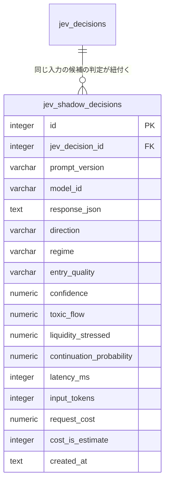

# ER / データモデル: テーブル定義（Jev プロンプトのシャドー・昇格）

`docs/architecture/er.md` から分割した章。対象: `jev_shadow_decisions` / `jev_prompt_promotions`（マイグレーション `000047`。issue #872）。型・規約と全体 ER 図は `docs/architecture/er.md` を参照。仕様は `docs/architecture/paper-results-mcp-jev-prompt.md`。

## プロンプトの版

Jev のプロンプトの版は、`jev_decisions.question_version`（`er/tables-market.md` §jev_decisions）を**そのまま正式な版**とする。`prompt_version` 列は `jev_decisions` に足さない（すべての行が最初から埋めており、過去の行も埋まっていてバックフィルが要らない。同じ事実を 2 列に持つと食い違えるため）。以後の行も、`DecisionRepository.Insert` が空の版を拒否するので必ず入る。版とプロンプトの中身は、質問群の SHA-256 をテストで固定して結ぶ（文言を変えて版を上げ忘れるとテストが落ちる）。ライブの版は、ビルドの既定（`trader-v3`）か、昇格が `runtime_settings` の `jev.trader_prompt_version` に保存した登録済みの版。

## jev_shadow_decisions

ライブの Trader の判定（`jev_decisions`、`decision_type='trader'`）と**同じ入力**（同じ `TraderState`・同じ RAG 文脈）を候補のプロンプトの版で判定した結果。シャドーは取引に使わない（Policy・メタモデル・Risk・発注・RAG の索引・Calibration・メタモデルの学習のどれも、この表を読まない。`jev_decisions` に混ぜないための別表）。Paper のときだけ書かれ、既定は無効（Settings 画面から有効にするまで費用が発生しない）。

| カラム | 型 | 制約 | 説明 |
|--------|-----|------|------|
| id | integer | PK, AUTOINCREMENT | |
| jev_decision_id | integer | NOT NULL, FK → `jev_decisions.id` | シャドーが並べたライブの判定。ライブの版は `jev_decisions.question_version`、ライブの答えは同じ行で見る |
| prompt_version | varchar(40) | NOT NULL, CHECK 空でない | 候補の版（`internal/service/jev/prompts.go` の登録名） |
| model_id | varchar(100) | NOT NULL | 応答が返したモデル名 |
| response_json | text | NOT NULL | 応答（`TraderResponse`）の JSON。MCP は返さない |
| direction | varchar(10) | NOT NULL, CHECK | `LONG` / `SHORT` / `NONE`（`jev_decisions.direction` と同じ） |
| regime | varchar(10) | NOT NULL, CHECK | `TREND` / `RANGE` / `BREAKOUT` / `CHAOTIC` |
| entry_quality | varchar(12) | NOT NULL, CHECK | `poor` / `fair` / `good` / `strong` / `exceptional` |
| confidence / toxic_flow / liquidity_stressed / continuation_probability | numeric(5,4) | NOT NULL, CHECK 0〜1 | Jev 自身の報告値（検証済みの確率ではない。FR-TRADER-2）。`confidence` は direction の答えの確信度 |
| latency_ms | integer | NOT NULL | 呼び出しの総所要時間（再試行を含む） |
| input_tokens | integer | NOT NULL, 既定 0 | 入力トークン数。API が報告した値（`usage.input_tokens`）。応答に `usage` が無かった行（`cost_is_estimate` = 1）は、リクエスト本文のバイト数から保守的な比（2 バイト = 1 トークン）で推定した値 |
| request_cost | numeric(10,6) | NOT NULL, 既定 0 | **見積り**（USD）。入力トークン数 × 公表単価（Jev は 1M 入力トークンあたり 0.042 USD、出力は無料。2026-10-22 時点）。API は課金額を返さないので、請求書と突き合わせた値ではない（単価と上限の数字は確定、見積りの一致は未確認）。日次（JST の日）・累計の合計が 1 日の費用の上限（`jev.shadow.daily_cost_cap_usd`。既定 0.10 USD・確定）の判定と GUI・MCP の表示に使われる。`usage` が無い行も 0 にせず、推定のトークン数で入れる（0 だと上限をすり抜けるため） |
| cost_is_estimate | integer | NOT NULL, 既定 0, CHECK IN (0, 1) | 1 = 応答に `usage` が無く、`input_tokens` と `request_cost` を推定で入れた行。0 = API が報告した値。GUI・`jev_shadow_cost` の「うち見積り」（`estimated_calls` / `estimated_cost_usd`）はこの列の合計 |
| created_at | text | NOT NULL | 保存時刻（UTC の RFC3339） |

制約・インデックス: `UNIQUE (jev_decision_id, prompt_version)`（1 つのライブ判定に対し候補の版ごとに 1 行）、`INDEX (created_at)`（日次の費用の集計）、`INDEX (prompt_version, jev_decision_id)`。

## jev_prompt_promotions

ライブの版を候補の版に切り替えた**昇格**の監査（誰が・いつ・前の版・後の版）。昇格は MCP の `jev_prompt_promote` と Settings 画面の昇格だけが書く。自動では書かれず、自己改善ループ（Sol/Opus）には経路が無い。設定（`runtime_settings` の `jev.trader_prompt_version`）とこの行は同じトランザクションで書かれ、片方だけ残ることはない。`mcp_settings_audit` ではなく専用の表にした理由は、その表の操作名の CHECK と `settings_diff` の再構成が設定のキーと値の組を前提にしているため。

| カラム | 型 | 制約 | 説明 |
|--------|-----|------|------|
| id | integer | PK, AUTOINCREMENT | |
| at | text | NOT NULL | 昇格の時刻（UTC の RFC3339） |
| actor | text | NOT NULL, CHECK | `mcp`（`jev_prompt_promote`）／`gui`（Settings 画面） |
| client | text | NOT NULL, 既定 '' | `actor='mcp'` のときの接続元ホスト（IP だけ。ヘッダ・API キーは記録しない）。`gui` は空 |
| from_version | varchar(40) | NOT NULL, CHECK 空でない | 昇格前のライブの版 |
| to_version | varchar(40) | NOT NULL, CHECK 空でない | 昇格後のライブの版 |

## 関連する `runtime_settings` のキー

アプリ（Trader・シャドー・Settings 画面）と MCP（読み取りだけ）が同じ DB から毎回読む。`mcpwritesettings` のホワイトリストには無く、`settings_set` では書けない。

| キー | 値 | 意味 |
|------|----|------|
| `jev.trader_prompt_version` | JSON 文字列 | ライブの Trader の版。昇格だけが書く。無ければビルドの既定 `trader-v3` |
| `jev.shadow.enabled` | 整数 `1` / `0` | シャドーの有効。**行が無い・壊れている値は無効（既定）** |
| `jev.shadow.candidate_version` | JSON 文字列 | シャドーが動かす候補の版。無ければ何も呼ばない |
| `jev.shadow.daily_cost_cap_usd` | JSON 数値 | 1 日（JST）あたりの費用の上限。無ければ `jevshadowsettings.DefaultDailyCostCapUSD`（0.10 USD。確定した既定値で、Settings で上げ下げできる） |
| `jev.shadow.halt` | JSON オブジェクト | 上限で止めた日の記録（日・固定コード `daily_cost_cap` / `daily_failure_cap`・使った額・上限・失敗回数・時刻）。翌日（JST）に再開する |
| `jev.shadow.failures` | JSON オブジェクト | その日（JST）の失敗した呼び出しの回数（`{"date","count"}`）。`jevshadowsettings.DailyFailureCap`（20 回。確定。定数）に達するとその日のシャドーを止める。費用の合計は保存に成功した呼び出しだけを足すため、課金されても保存されない呼び出しの抑えにする。終了（`Shadow.Close`）の取り消しで途中になった呼び出しは数えない（ベンダーが課金した可能性はあるが、保存の前に取り消されれば費用にも入らない。保存がすでにコミットしていれば行と費用はある。1 回の終了で最大 4 回）。タイムアウトは数える |
| `jev.shadow.throttle` | JSON オブジェクト | Jev API の 429/529 でシャドーが止まった最後の記録（`{"date","count","status","reason","source","at","until"}`。`count` はその日（JST）の停止回数、`reason` は `api_rate_limited` / `api_overloaded`、`source` は `shadow`（シャドー自身の呼び出し）/ `live`（ライブの呼び出し）、`until` は再開の時刻＝`at` の 15 分後）。シャドーは `until` までは何も送らない。失敗回数・`jev.shadow.halt` には数えない。issue #883 |

## 改訂履歴

| 版 | 日付 | 変更内容 | 変更理由 |
|----|------|---------|---------|
| 1.0 | 2026-10-22 | 新規作成。`jev_shadow_decisions` / `jev_prompt_promotions`（`000047`）と、`question_version` を正式な版とする決定、関連する `runtime_settings` のキー | issue #872 |
| 1.1 | 2026-10-22 | `runtime_settings` のキー `jev.shadow.throttle`（Jev API の 429/529 でシャドーが止まった記録）を追加。マイグレーションは不要（`runtime_settings` の行） | issue #883 |
| 1.2 | 2026-10-22 | `jev.shadow.failures`: 終了時の取り消しで途中になった呼び出しは数えないことを追記 | issue #882 |
