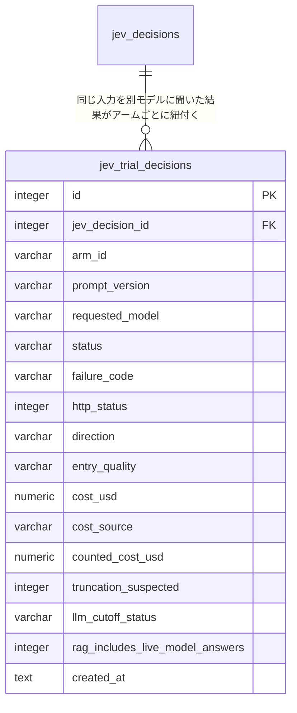

# ER / データモデル: テーブル定義（Jev 意思決定モデル比較のトライアル）

`docs/architecture/er.md` から分割した章。対象: `jev_trial_decisions`（マイグレーション `000054`。issue #1059）。型・規約と全体 ER 図は `docs/architecture/er.md` を参照。仕様（フロー・費用の数え方・隔離）は `docs/architecture/overview/integrations-jev-trial.md`。

## jev_trial_decisions

ライブの Trader の判定（`jev_decisions`、`decision_type='trader'`）と**同じ入力**（同じ `TraderState`・同じ RAG 文脈）を、別モデル・別プロバイダーの**アーム**に聞いた結果。成功も失敗（HTTP エラー・タイムアウト・拒否・不正な応答）も**1 行ずつ**残す。取引には使わない（Policy・メタモデル・Risk・発注・RAG の索引・Calibration・メタモデルの学習・既存のシャドー（`jev_shadow_decisions`）のどれも、この表を読まない。`jev_decisions` にも `jev_shadow_decisions` にも混ぜないための別表）。Paper のときだけ書かれ、既定は無効（Settings 画面から有効にするまで外部呼び出しも費用も発生しない）。第 1 段階のアームの例は `cloudflare/clef-flash`・`cloudflare/clef`・`google/gemini-decision-1`（すべて OpenRouter 経由。既定のアーム配列は空で、これは設定例にすぎない）。

| カラム | 型 | 制約 | 説明 |
|--------|-----|------|------|
| id | integer | PK, AUTOINCREMENT | |
| jev_decision_id | integer | NOT NULL, FK → `jev_decisions.id` | 並べたライブの判定。ライブの答えは同じ行で見る |
| arm_id | varchar(48) | NOT NULL, CHECK 空でない | アーム（`jev.trial.arms` の `id`。例 `or-clef-flash-v3`）。#1010 のアームへ写せる文字列 id |
| prompt_version | varchar(40) | NOT NULL, CHECK 空でない | 聞いた Trader プロンプトの版（`internal/service/jev/prompts.go` の登録名。第 1 段階はライブと同じ `trader-v3`） |
| provider | varchar(40) | NOT NULL, 既定 '' | アームのプロバイダー（`openrouter`） |
| requested_model | varchar(100) | NOT NULL, CHECK 空でない | リクエストに送ったモデル id |
| served_model / served_provider / response_id | varchar | NOT NULL, 既定 '' | 応答が返したモデル・実際に処理したプロバイダー・応答 id。応答が無い行は空（OpenRouter は処理元を切り替えうるので、送ったモデルと別に残す） |
| status | varchar(8) | NOT NULL, CHECK IN | `ok`＝全問に答えた／`failed`＝応答が得られなかった（通信・HTTP エラー・不正な応答）／`refused`＝全問を拒否／`partial`＝一部の質問を拒否 |
| failure_code | varchar(24) | NOT NULL, 既定 '' | `status='failed'` のときの短い固定分類（`http_402` / `http_403` / `http_413` / `http_429` / `http_529` / `http_4xx` / `http_5xx` / `timeout` / `transport` / `invalid_response`）。それ以外は空（CHECK `(status='failed') = (failure_code<>'')`） |
| http_status | integer | NULL可 | HTTP エラー応答のステータス。それ以外は NULL |
| error_excerpt | varchar(200) | NOT NULL, 既定 '' | エラーの**短い抜粋**（上限 200 バイト）。エラー本文の全文は残さない。`sk-…`・`Bearer …` は `[redacted]` に伏せる |
| direction | varchar(10) | NULL可, CHECK | `LONG` / `SHORT` / `NONE`。拒否・欠落した質問は **NULL**（`NONE` や 0 で補わない） |
| regime | varchar(10) | NULL可, CHECK | `TREND` / `RANGE` / `BREAKOUT` / `CHAOTIC` |
| entry_quality | varchar(12) | NULL可, CHECK | `poor` / `fair` / `good` / `strong` / `exceptional` |
| confidence | numeric(5,4) | NULL可, CHECK 0〜1 | `direction` の答えの confidence。モデルが報告しなかったら NULL（0 を測定値として扱わない） |
| toxic_flow / liquidity_stressed / continuation_probability | numeric(5,4) | NULL可, CHECK 0〜1 | 各答え。モデル自身の報告値で、検証済みの確率ではない（FR-TRADER-2） |
| response_json | text | NULL可 | 応答の本文そのまま（応答が無い行は NULL）。生の確率（`probabilities`）もここに残る。MCP は返さない |
| latency_ms | integer | NOT NULL, 既定 0 | 呼び出しの総所要時間（1 回きり。再試行しない） |
| input_tokens / output_tokens | integer | NULL可, CHECK 0 以上 | 応答の `usage`。応答が無い・`usage` が無い行は NULL |
| cost_usd | numeric(12,8) | NULL可, CHECK 0 以上 | 報告値 `usage.cost`、または定価×入力トークンの推定。**どちらも無ければ NULL（0 ではない）** |
| cost_source | varchar(20) | NOT NULL, CHECK IN | `reported`＝応答の `usage.cost`／`list_price_estimate`＝アームの定価（1M 入力トークンあたり）×入力トークン数の推定／`unknown`＝どちらも無い |
| counted_cost_usd | numeric(12,8) | NOT NULL, 既定 0 | **1 日の費用上限の判定に数えた額**。`reported`＝報告値、`list_price_estimate`＝推定値、`unknown`＝最悪値側の単価（`jevtrialsettings.WorstCaseUSDPerMtok`＝0.24 USD/百万トークン）で数えた額。`cost_usd` が NULL でもこの列は 0 と限らない。4xx 応答（413 を除く）と 529 は課金されない前提で 0（前提であり実測ではない。5xx・413・タイムアウト等は最悪値側で数える） |
| request_bytes / state_bytes | integer | NOT NULL, 既定 0 | リクエスト本文・`state` の大きさ（バイト）。切り詰め疑いを後から判断する材料 |
| truncation_suspected | integer | NOT NULL, 既定 0, CHECK IN (0, 1) | 報告された入力トークン数に対してリクエストが大きすぎる（`request_bytes / input_tokens` が `trial.TruncationSuspectBytesPerToken`＝6 を超える。未計測の目安）とき 1。**疑いの印であって断定ではない**。Clef 系の切り詰めの有無が実測できるまで、同じ入力での公平な比較とは扱わない |
| llm_cutoff_status | varchar(20) | NOT NULL, 既定 `unverified`, CHECK 空でない | モデルの学習データ終了日の確認状態。**既定は `unverified`**（日付を推測で作らない）。公開日以降の局面だけで評価する（下記） |
| rag_includes_live_model_answers | integer | NOT NULL, 既定 0, CHECK IN (0, 1) | リクエストに RAG の過去事例（ライブ Jev の過去の答えを含む）を 1 件でも載せた行は 1（保守的に判定する）。完全な独立条件ではないので、MCP は除外せず件数と内訳で出す |
| created_at | text | NOT NULL | 保存時刻（UTC の RFC3339）。日次の費用の集計は **JST の日**で切る |

制約・インデックス: `UNIQUE (jev_decision_id, arm_id)`（1 つのライブ判定に対しアームごとに 1 行）、`INDEX (created_at)`（日次の費用の集計）、`INDEX (arm_id, created_at)`（アームごとの集計）。`status='ok'` の行は全問の答えが入っていること（CHECK）。

### `llm_cutoff_status` の扱い

各モデルの学習データの終了日は公表されていないため、既定は `unverified`。評価は、**そのモデルの一般公開日以降に起きた局面だけ**で行う（公開日より前の局面は、学習データに入っていた可能性を排除できない）。公開日は、Gemini Decision 1 が 2026-11-11、Clef 系が 2026-10-01。終了日が公表された時点で、確認済みの値へ更新する（日付の推測値は入れない）。

### `rag_includes_live_model_answers` の扱い

トライアルは、ライブの判定に使った RAG 文脈（類似する過去事例）をそのまま各アームに送る。その過去事例にはライブ Jev の過去の答え（と後の結果）が含まれるため、`rag_includes_live_model_answers=1` の行は、アームがライブの答えの影響を受けうる条件で答えている。RAG を送らなかった（過去事例が 0 件の）行は 0。`jev_trial_compare` はこの印の行も除外せず、件数と内訳で出す。

## 関連する `runtime_settings` のキー

アプリ（トライアルのランナー・Settings 画面）と MCP が同じ DB から読む。**MCP の `settings_set`（`mcpwritesettings` のホワイトリスト）では 1 キーも書けない**（`jev.trial.enabled` を含む）。有効化・アーム・上限の変更はアプリの Settings 画面だけ。自己改善ループ（Sol/Opus）が書ける `policy.*` にも入らない。いずれも `jev.shadow.*` とは別系統で、キーが重ならない（`evalflow`・`isolationflow` のテストで固定）。

| キー | 値 | 意味 |
|------|----|------|
| `jev.trial.enabled` | 整数 `1` / `0` | トライアルの有効。**行が無い・壊れている値は無効（既定）** |
| `jev.trial.arms` | JSON 配列（`Arm`） | 比較するアーム（`id` / `provider` / `model` / `prompt_version` / 任意の `daily_cost_cap_usd` / `list_price_usd_per_mtok` / `provider_only` / `data_collection` / `zdr`）。**既定は空**（アームが無ければ何も呼ばない）。最大 8 アーム、`id` は重複不可 |
| `jev.trial.daily_cost_cap_usd` | JSON 数値 | 全アーム合計の 1 日（JST）あたりの費用の上限。無ければ `jevtrialsettings.DefaultDailyCostCapUSD`（0.10 USD）。0 以下・100 USD 超は保存できない |
| `jev.trial.halt` | JSON オブジェクト | トライアル全体をその日（JST）止めた記録（`{"date","reason","spent_usd","cap_usd","status","at"}`。`reason` は `daily_cost_cap` / `payment_required`＝HTTP 402）。翌日（JST）に再開する |
| `jev.trial.halt.<arm>` | JSON オブジェクト | そのアームをその日（JST）止めた記録（`reason` は `arm_cost_cap` / `daily_failure_cap` / `forbidden`＝HTTP 403）。翌日（JST）に再開する |
| `jev.trial.failures.<arm>` | JSON オブジェクト | そのアームのその日（JST）の失敗した呼び出しの回数（`{"date","count"}`）。`DailyFailureCap`（20 回。シャドーと同じ定数）に達するとその日そのアームを止める |
| `jev.trial.throttle.<arm>` | JSON オブジェクト | そのアームが 429/529 で止まった最後の記録（`{"date","count","status","reason","at","until"}`）。`until`（15 分後。シャドーと同じ待ち時間）まで呼ばない |

アームごとの上限（`Arm.daily_cost_cap_usd`。省略時 0.05 USD）と全体の上限（`jev.trial.daily_cost_cap_usd`）は両方とも判定し、どちらかに達すると止まる。

## 改訂履歴

| 版 | 日付 | 変更内容 | 変更理由 |
|----|------|---------|---------|
| 1.0 | 2026-11-13 | 新規作成。`jev_trial_decisions`（`000054`）と、関連する `runtime_settings` のキー（`jev.trial.*`） | issue #1059 |
