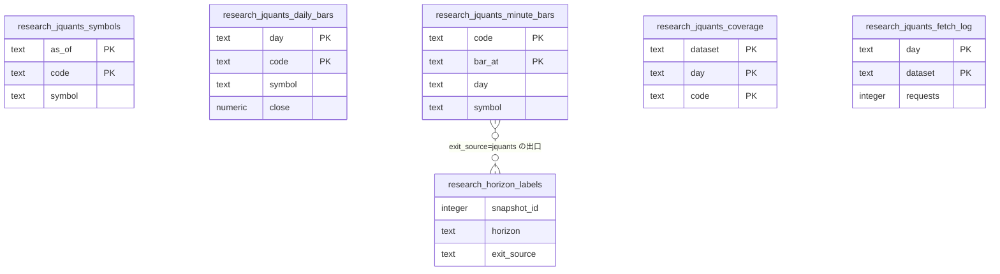

# ER: J-Quants の日足・分足（研究用）

`docs/architecture/er.md` から分割した章。対象: `research_jquants_symbols` / `research_jquants_daily_bars` / `research_jquants_minute_bars` / `research_jquants_coverage` / `research_jquants_fetch_log`、および `research_horizon_labels` に足した列 `exit_source`（マイグレーション `000058`。issue #1093）。型・規約と全体 ER 図は `docs/architecture/er.md` を参照。設計は `docs/architecture/overview/integrations-jquants.md`、運用は `docs/environment/setup/jquants.md`。

**研究専用・個人の私的利用**。ゲート・Policy・Risk・発注・Paper ガード・Live・Jev・RAG の索引・Calibration・メタモデルの学習・自己改善は、これらの表を読まない（`internal/repository/jquants/isolation_test.go` が固定）。`market_snapshots`・`daily_bars`・`disclosure_items`・`jev_decisions`・`jev_shadow_decisions`・`jev_trial_decisions` には何も書かず、列も制約も足さない。J-Quants のデータは、どの表も `source = 'jquants'` の列を持ち（CHECK で他の値を拒む）、解約したときの削除は「J-Quants 由来の行だけ」を対象にできる。API キーはどの表にも入れない。時刻は UTC の RFC3339（小数 9 桁固定）、日付は JST の `YYYY-MM-DD`。

## `research_jquants_symbols`

上場銘柄一覧（`/v2/equities/master`）の日ごとの写し。主キーは `(as_of, code)`。取り直しは上書き。

| カラム | 型 | 制約 | 説明 |
|--------|-----|------|------|
| source | text | NOT NULL, CHECK = 'jquants' | データ源 |
| as_of | text | PK, NOT NULL | 一覧の日付（JST） |
| code | text | PK, NOT NULL | J-Quants の銘柄コード（5 桁。例 `72030`） |
| symbol | text | NOT NULL | アプリが使う 4 桁の証券コード（`72030` → `7203`） |
| company_name / company_name_en / sector17_code / sector33_code / scale_category / market_code / market_name | text | NOT NULL, 既定 '' | 一覧の項目 |
| fetched_at | text | NOT NULL | 取得時刻 |

索引: `(symbol, as_of)`。

## `research_jquants_daily_bars`

株価四本値（`/v2/equities/bars/daily`）。主キーは `(day, code)`。取り直しは上書き（J-Quants はデータをその場で訂正することがある）。取引の無かった日は価格・出来高が NULL（API が null を返す）。

| カラム | 型 | 制約 | 説明 |
|--------|-----|------|------|
| source | text | NOT NULL, CHECK = 'jquants' | データ源 |
| day / code | text | PK, NOT NULL | 取引日（JST）・銘柄コード |
| symbol | text | NOT NULL | 4 桁の証券コード |
| open / high / low / close / volume / turnover | numeric | NULL 可 | 調整前の四本値・出来高・売買代金 |
| adj_factor / adj_open / adj_high / adj_low / adj_close / adj_volume | numeric | NULL 可 | J-Quants の調整後の値（株式分割などを反映。後から再計算されうる） |
| upper_limit / lower_limit | text | NOT NULL, 既定 '' | その日のストップ高・安に達したか（`0` / `1`） |
| fetched_at | text | NOT NULL | 取得時刻 |

索引: `(symbol, day)`。

## `research_jquants_minute_bars`

株価分足（`/v2/equities/bars/minute`。翌日に配信される）。主キーは `(code, bar_at)`。取引の無かった分は API が返さないので、行の無い分は「取引なし」であり欠測とは限らない。

| カラム | 型 | 制約 | 説明 |
|--------|-----|------|------|
| source | text | NOT NULL, CHECK = 'jquants' | データ源 |
| code / symbol | text | NOT NULL | 銘柄コード・4 桁の証券コード |
| day | text | NOT NULL | `bar_at` の JST の日付 |
| bar_at | text | PK（code と）, NOT NULL | その 1 分の開始時刻（UTC。API の `Time` は JST の `HH:mm`） |
| open / high / low / close | numeric | NOT NULL, CHECK > 0 | 四本値（調整前） |
| volume / turnover | numeric | NOT NULL, CHECK >= 0 | 出来高・売買代金 |
| fetched_at | text | NOT NULL | 取得時刻 |

索引: `(day, symbol)`。

## `research_jquants_coverage`

どの (データ種別, 日, 銘柄) を取り終えたかの印。埋め戻しは印の無いものだけを取る。

| カラム | 型 | 制約 | 説明 |
|--------|-----|------|------|
| source | text | NOT NULL, CHECK = 'jquants' | データ源 |
| dataset | text | PK, CHECK IN ('symbols','daily','minute','relabel') | `symbols`＝一覧（day は取得した日）、`daily`＝その日の全銘柄、`minute`＝その日のその銘柄、`relabel`＝その日の研究用ラベルを分足で付け直した印 |
| day | text | PK, NOT NULL | 日（JST） |
| code | text | PK, NOT NULL 既定 '' | `minute` のときだけ銘柄コード |
| row_count | integer | NOT NULL, >= 0 | その取得で書いた行数 |
| completed_at | text | NOT NULL | 印を付けた時刻 |

分足の応答が空のとき、直近 3 日（JST）の日は「まだ配信されていない」として印を付けず、次の実行で取り直す。それより古い日は「取引なし」として印を付ける。

## `research_jquants_fetch_log`

JST の日 × データ種別ごとの取得の記録。**1 日の要求数の上限（`jquants.daily_request_cap`）は、この表の `requests` の日合計で数える**。要求は送る前に数える（1 文の `INSERT … SELECT … WHERE 合計 < 上限 ON CONFLICT DO UPDATE`。失敗・中断でも上限を超えない）。秘密も応答本文も入れない。

| カラム | 型 | 制約 | 説明 |
|--------|-----|------|------|
| source | text | NOT NULL, CHECK = 'jquants' | データ源 |
| day / dataset | text | PK, dataset は CHECK IN ('symbols','daily','minute') | 要求を送った日（JST）・データ種別 |
| requests | integer | NOT NULL, 既定 0 | その日に送った要求数（ページ送りを含む） |
| rows_stored | integer | NOT NULL, 既定 0 | 書いた行数 |
| failures | integer | NOT NULL, 既定 0 | 失敗した要求数 |
| last_failure_code | text | NOT NULL, 既定 '' | 最後の失敗の固定コード（`http_401` / `http_403` / `http_429` / `http_4xx` / `http_5xx` / `transport` / `decode`）。応答本文は入れない |
| last_request_at / last_success_at | text | NULL 可 | 最後に要求を出した・成功した時刻 |

生データの削除（解約）でもこの表は消さない（市場データを含まず、消すと上限が日の途中で戻る）。

## `research_horizon_labels.exit_source`（追加列）

研究用ホライズンラベル（#1074。`er/tables-research.md`）の出口の足の出どころ。`TEXT NOT NULL DEFAULT 'snapshot' CHECK (exit_source IN ('snapshot','jquants'))`。

- `snapshot`: `market_snapshots` の足（#1074 の記録部品が書いた行。既存行はすべてこれ。既存の読み手は列を名前で選ぶため影響を受けず、既存行の数値は書き換えない）。
- `jquants`: `market_snapshots` に足の無かった窓を、J-Quants の分足の終値を出口にして付け直した行（`internal/service/researchlabel/jquantsrelabel`）。部分索引 `research_horizon_labels_jquants_idx (day) WHERE exit_source = 'jquants'` で見つける。解約時の削除はこの行だけを消し、その日の日次の集計（`research_label_days` / `research_label_day_stats`）を残りの行から作り直す。

付け直しの規則: エントリーは `market_snapshots` の足のまま（J-Quants の分足には板が無く、エントリーにできない）。J-Quants の 1 分足は「その分の最後の秒（`HH:mm:59`。大引けは 15:30 に丸める）」の価格として出口の候補になり、その時刻が目標の時刻以前で `calibration.HorizonBarTolerance`（2 分）以内のときだけ使う（記録部品と同じ窓の規則。先読みしない）。記録部品がすでに書いた行（`UNIQUE (snapshot_id, horizon)`）は書き換えない。1 日まるごと `market_snapshots` が無い日は、エントリーが無いので付け直せない。
