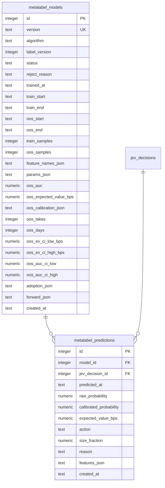

# ER / データモデル: テーブル定義（メタラベリング）

`docs/architecture/er.md` から分割した章。対象: `metalabel_models` / `metalabel_predictions`（issue #757、親 #752。マイグレーション000034、採用判定の列は000037＝issue #780）。実装は`internal/repository/metalabel`と`internal/service/metalabel`の`Store`。

メタラベリングは、Jevの方向判断（一次シグナル）に対して「入る/見送る」を決める二次モデルである。サイズ比（Kelly）は記録するだけで発注数量には使わない（FR-META-3、issue #781）。学習ラベルは`calibration_outcomes`のトリプルバリア（`label_version=2`、`net_return_bps > 0`で勝ち）。検証は paper のみで行う。**有効なモデルが無いときは見送りに倒す**（`LatestActiveModel`が見つからなければ呼び出し側は`skip`とする）。

## metalabel_models

学習ごとのモデルとウォークフォワードのOOS（検証窓）指標。

| カラム | 型 | 制約 | 説明 |
|-------|-----|------|------|
| id | integer | PK（AUTOINCREMENT） | |
| version | text | NOT NULL, UNIQUE, CHECK (`<> ''`) | 学習ごとの一意なモデル版 |
| algorithm | text | NOT NULL, CHECK (`<> ''`) | 学習アルゴリズム名（例: `logistic_regression`） |
| label_version | integer | NOT NULL | 学習に使ったラベルの版（`calibration_outcomes.label_version`。`2`=トリプルバリア） |
| status | text | NOT NULL, CHECK (`active`/`rejected`) | `active`=採用可、`rejected`=OOS指標が基準に届かず不採用（記録のみ） |
| reject_reason | text | NOT NULL, DEFAULT `''` | `rejected`の理由。`active`は空。OOS基準未達は`oos_samples_below_minimum`/`oos_days_below_minimum`/`oos_takes_below_minimum`/`oos_ev_ci_not_positive`/`oos_auc_ci_not_above_minimum`（FR-META-7）、現行モデルを有意に上回らなければ`candidate_not_better_than_active`・比較不能なら`active_model_not_comparable`、変更頻度制限なら`model_swap_rate_limited`・`policy_change_freeze`、`metalabel.llm_cutoff`が仮置きのままなら`llm_cutoff_placeholder`、OOS窓のJevモデルがcutoff確認時と異なれば`llm_model_changed`、Live前チェックで出典未記録なら`llm_cutoff_unverified`（FR-META-6、issue #776・#780。いずれも既存の有効モデルは更新されない） |
| trained_at | text | NOT NULL | 学習実行時刻（UTC）。最新の有効モデルは`status='active'`で`trained_at`が最大の行 |
| train_start / train_end | text | NOT NULL | 学習窓（UTC） |
| oos_start / oos_end | text | NOT NULL | OOS窓（UTC）。LLMのcutoff以降だけでJev特徴量を評価できるよう、窓を必ず保存し画面・ログに出せるようにする。`oos_start`は`train_end`以降（Storeが検証。情報漏洩の防止） |
| train_samples / oos_samples | integer | NOT NULL, CHECK (`>= 0`) | 学習窓・OOS窓の標本数 |
| feature_names_json | text | NOT NULL | 特徴量名の配列（学習時の並び） |
| params_json | text | NOT NULL | 推論に必要なパラメータ（係数・標準化・較正器等。中身はアルゴリズムごと） |
| oos_auc | numeric | NULL可, CHECK (0〜1) | OOSのAUC。OOSが片側のラベルだけ等で未定義ならNULL |
| oos_expected_value_bps | numeric | NULL可 | 較正後に`take`とした標本のコスト控除後平均EV（bps）。未定義ならNULL |
| oos_calibration_json | text | NOT NULL, DEFAULT `[]` | OOSの較正曲線 `[{"mean_predicted":…,"observed_rate":…,"count":…}]` |
| oos_takes | integer | NOT NULL, DEFAULT 0, CHECK (`>= 0`) | OOSで較正後に`take`とした件数（`oos_expected_value_bps`の母数。FR-META-7、issue #780） |
| oos_days | integer | NOT NULL, DEFAULT 0, CHECK (`>= 0`) | OOS標本が属する取引日（JST）の数＝ブートストラップの再抽出単位（同日クラスタ）の数 |
| oos_ev_ci_low_bps / oos_ev_ci_high_bps | numeric | NULL可 | 1 takeあたりEVの信頼区間（下側・上側、bps）。同日・同銘柄の相関を考慮したクラスタ・ブートストラップ。未定義（営業日不足等）ならNULL |
| oos_auc_ci_low / oos_auc_ci_high | numeric | NULL可 | OOS AUCの信頼区間（下側・上側）。未定義ならNULL |
| adoption_json | text | NOT NULL, DEFAULT `{}` | 採用判定の根拠: `criteria`（判定に使った基準値。最小OOS件数・take件数・営業日数・信頼区間の水準・乱数シード）、`comparison`（同一OOSでの現行モデルとの比較。件数・各モデルの平均純リターン・差と区間・比較不能の理由）、`gate`（変更頻度制限で採用を止めた理由・詳細・解除時刻）。`trained_cohort`（issue #881。モデルが学習に使った行のTraderのプロンプトのコホート。例`entry-quality-v3`。学習がライブの版のコホートを記録する。**マイグレーションなしでこの列に持つ**。Policyがライブの版のコホートと比べる。記録のない既存のモデルは「版が一致しない」ものとして扱う（ライブが`trader-v3`でも。Liveは使わず、Paperは警告して使う）。FR-POLICY-6）。値は集計指標と判定メタデータのみで、板・気配などの市場データは含まない |
| forward_json | text | NOT NULL, DEFAULT `{}` | 採用後の前向き評価（学習後の判断だけでの件数・take数・営業日数・EVと区間・`degraded`）。夜間再学習が現行の有効モデルについて更新する。採用判断・`status`は変えない |
| created_at | text | NOT NULL | |

インデックス: `(status, trained_at)`（最新の有効モデルの取得）

## metalabel_predictions

判断（`jev_decisions`）ごとのモデル予測値。同じモデルは1判断に1行。

| カラム | 型 | 制約 | 説明 |
|-------|-----|------|------|
| id | integer | PK（AUTOINCREMENT） | |
| model_id | integer | FK → metalabel_models.id, NOT NULL | 予測したモデル |
| jev_decision_id | integer | FK → jev_decisions.id, NOT NULL | 対象の判断 |
| predicted_at | text | NOT NULL | 予測時刻（UTC） |
| raw_probability | numeric | NOT NULL, CHECK (0〜1) | 較正前の勝率 |
| calibrated_probability | numeric | NOT NULL, CHECK (0〜1) | 較正後の勝率 |
| expected_value_bps | numeric | NOT NULL | 較正後確率から求めたコスト控除後の期待値（bps） |
| action | text | NOT NULL, CHECK (`take`/`skip`) | 入る/見送る |
| size_fraction | numeric | NOT NULL, CHECK (0〜1) | `take`のサイズ比（Kelly比`EV / WinBps`×`KellyFraction`を1以下に丸めた値）。`skip`は`0`、`take`は正（Storeが検証）。**記録専用で、発注数量には使わない**（数量はRisk上限だけで決まる。FR-META-3・FR-ENTRY-3、issue #781） |
| reason | text | NOT NULL, DEFAULT `''` | 判定根拠（`skip`の理由など） |
| features_json | text | NOT NULL, DEFAULT `{}` | 推論に使った特徴量（監査・再現用） |
| created_at | text | NOT NULL | |

インデックス: `UNIQUE (model_id, jev_decision_id)`、`(jev_decision_id)`

## metalabel_retrain_skips

夜間再学習がデータ不足で見送られた実行記録（issue #799、親 #752。マイグレーション000038）。見送りはモデルを保存しないため、この表が無いと外から気づけない。1見送り=1行。件数と固定コードだけを持ち、板・価格・自由文は含まない。

| カラム | 型 | 制約 | 説明 |
|-------|-----|------|------|
| id | integer | PK（AUTOINCREMENT） | |
| skipped_at | text | NOT NULL | 見送りを判定した時刻（UTC） |
| reason_code | text | NOT NULL, CHECK (`<> ''`) | 固定コード: `too_few_rows_before_oos`（検証窓より前の使えるラベル付き判断がfit+較正の最小件数に足りない）/ `too_few_rows_after_purge`（purge/embargo後にfitか較正が最小件数に足りない）/ `training_data_unusable`（件数はあるがラベルが片側だけ等で学習できない）。理由文は保存しない |
| usable_rows | integer | NOT NULL, CHECK (`>= 0`) | 使えるラベル付き判断の件数（`too_few_rows_before_oos`は検証窓より前の件数、`too_few_rows_after_purge`はpurge後にfit・較正の各最小件数まで数えた件数）。「必要130件中 x件」のx |
| required_rows | integer | NOT NULL, CHECK (`>= 0`) | 学習に必要な件数＝fitと較正の最小件数の合計（既定130）。「必要130件中 x件」の130 |
| oos_rows | integer | NULL可, CHECK (`IS NULL OR >= 0`) | 見送った時点でOOS窓にあった行数（issue #862。マイグレーション000044）。**NULLは「未記録」**（この列ができる前の行。既存行はUPDATEせずNULLのまま）。000044以降に書く行は実際の値（0件なら0）を入れる |
| required_oos_rows | integer | NULL可, CHECK (`IS NULL OR >= 0`) | OOS窓がさかのぼって集める行数＝採用基準の`MinOOSSamples`（確定値: 740）。NULLは「未記録」 |
| dropped_incomplete | integer | NULL可, CHECK (`IS NULL OR >= 0`) | 特徴量の欠けで`BuildRows`が落とした行数（ラベルはあるが8特徴量がそろわない）。NULLは「未記録」 |
| label_v1_rows / label_v2_rows | integer | NULL可, CHECK (`IS NULL OR >= 0`) | lookback内のラベル付き判断の`label_version`別の件数。v1は終値だけのラベルでOFI・micropriceが無く学習に使えない。「履歴が無い」のか「あるのに使えない」のかを分ける。NULLは「未記録」（件数を読めなかった夜を含む） |

上の5列（`oos_rows`・`required_oos_rows`・`dropped_incomplete`・`label_v1_rows`・`label_v2_rows`）は**すべてNULL可で、NULL＝未記録**。000044は既存行をUPDATEせずNULLのままにし、000044以降に書く行は実際の値（0を含む）を入れる。**読む側はNULLを0に読み替えない**（0は「数えて0件」の意味）。
| created_at | text | NOT NULL | |

インデックス: `(skipped_at)`
