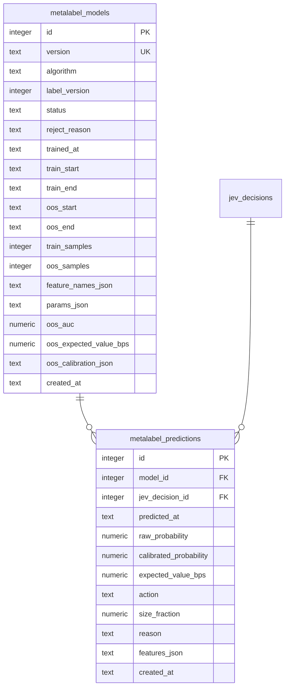

# ER / データモデル: テーブル定義（メタラベリング）

`docs/architecture/er.md` から分割した章。対象: `metalabel_models` / `metalabel_predictions`（issue #757、親 #752。マイグレーション000034）。実装は`internal/repository/metalabel`と`internal/service/metalabel`の`Store`。

メタラベリングは、Jevの方向判断（一次シグナル）に対して「入る/見送る」を決める二次モデルである。サイズ比（Kelly）は記録するだけで発注数量には使わない（FR-META-3、issue #781）。学習ラベルは`calibration_outcomes`のトリプルバリア（`label_version=2`、`net_return_bps > 0`で勝ち）。検証は paper のみで行う。**有効なモデルが無いときは見送りに倒す**（`LatestActiveModel`が見つからなければ呼び出し側は`skip`とする）。

## metalabel_models

学習ごとのモデルとウォークフォワードのOOS（検証窓）指標。

| カラム | 型 | 制約 | 説明 |
|-------|-----|------|------|
| id | integer | PK（AUTOINCREMENT） | |
| version | text | NOT NULL, UNIQUE, CHECK (`<> ''`) | 学習ごとの一意なモデル版 |
| algorithm | text | NOT NULL, CHECK (`<> ''`) | 学習アルゴリズム名（例: `logistic_regression`） |
| label_version | integer | NOT NULL | 学習に使ったラベルの版（`calibration_outcomes.label_version`。`2`=トリプルバリア） |
| status | text | NOT NULL, CHECK (`active`/`rejected`) | `active`=採用可、`rejected`=OOS指標が基準に届かず不採用（記録のみ） |
| reject_reason | text | NOT NULL, DEFAULT `''` | `rejected`の理由。`active`は空 |
| trained_at | text | NOT NULL | 学習実行時刻（UTC）。最新の有効モデルは`status='active'`で`trained_at`が最大の行 |
| train_start / train_end | text | NOT NULL | 学習窓（UTC） |
| oos_start / oos_end | text | NOT NULL | OOS窓（UTC）。LLMのcutoff以降だけでJev特徴量を評価できるよう、窓を必ず保存し画面・ログに出せるようにする。`oos_start`は`train_end`以降（Storeが検証。情報漏洩の防止） |
| train_samples / oos_samples | integer | NOT NULL, CHECK (`>= 0`) | 学習窓・OOS窓の標本数 |
| feature_names_json | text | NOT NULL | 特徴量名の配列（学習時の並び） |
| params_json | text | NOT NULL | 推論に必要なパラメータ（係数・標準化・較正器等。中身はアルゴリズムごと） |
| oos_auc | numeric | NULL可, CHECK (0〜1) | OOSのAUC。OOSが片側のラベルだけ等で未定義ならNULL |
| oos_expected_value_bps | numeric | NULL可 | 較正後に`take`とした標本のコスト控除後平均EV（bps）。未定義ならNULL |
| oos_calibration_json | text | NOT NULL, DEFAULT `[]` | OOSの較正曲線 `[{"mean_predicted":…,"observed_rate":…,"count":…}]` |
| created_at | text | NOT NULL | |

インデックス: `(status, trained_at)`（最新の有効モデルの取得）

## metalabel_predictions

判断（`jev_decisions`）ごとのモデル予測値。同じモデルは1判断に1行。

| カラム | 型 | 制約 | 説明 |
|-------|-----|------|------|
| id | integer | PK（AUTOINCREMENT） | |
| model_id | integer | FK → metalabel_models.id, NOT NULL | 予測したモデル |
| jev_decision_id | integer | FK → jev_decisions.id, NOT NULL | 対象の判断 |
| predicted_at | text | NOT NULL | 予測時刻（UTC） |
| raw_probability | numeric | NOT NULL, CHECK (0〜1) | 較正前の勝率 |
| calibrated_probability | numeric | NOT NULL, CHECK (0〜1) | 較正後の勝率 |
| expected_value_bps | numeric | NOT NULL | 較正後確率から求めたコスト控除後の期待値（bps） |
| action | text | NOT NULL, CHECK (`take`/`skip`) | 入る/見送る |
| size_fraction | numeric | NOT NULL, CHECK (0〜1) | `take`のサイズ比（Kelly比`EV / WinBps`×`KellyFraction`を1以下に丸めた値）。`skip`は`0`、`take`は正（Storeが検証）。**記録専用で、発注数量には使わない**（数量はRisk上限だけで決まる。FR-META-3・FR-ENTRY-3、issue #781） |
| reason | text | NOT NULL, DEFAULT `''` | 判定根拠（`skip`の理由など） |
| features_json | text | NOT NULL, DEFAULT `{}` | 推論に使った特徴量（監査・再現用） |
| created_at | text | NOT NULL | |

インデックス: `UNIQUE (model_id, jev_decision_id)`、`(jev_decision_id)`
