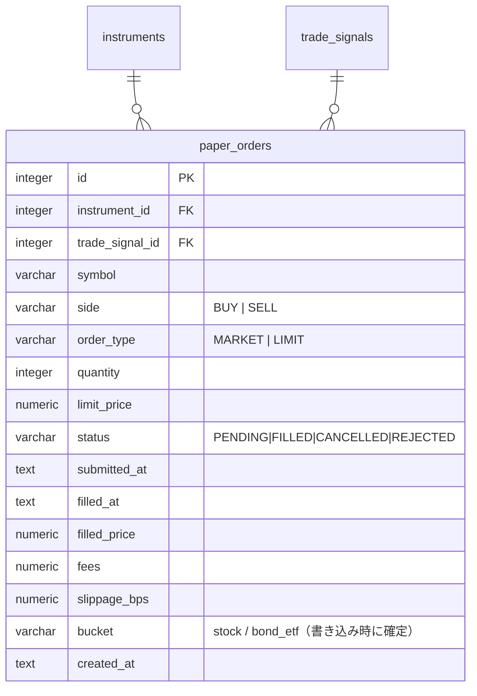
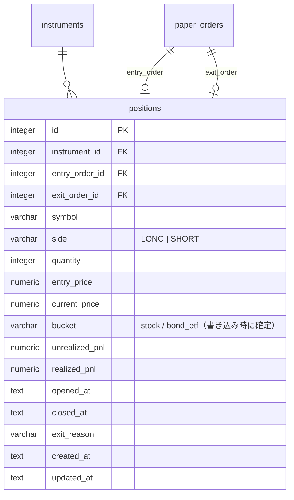
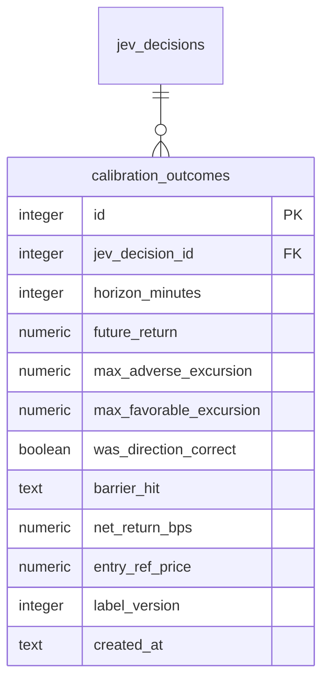
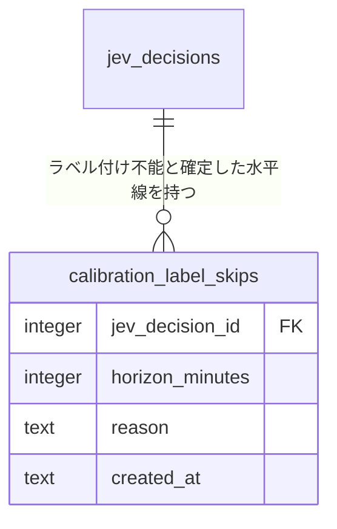
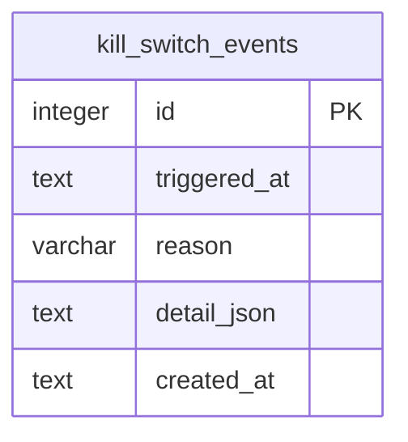
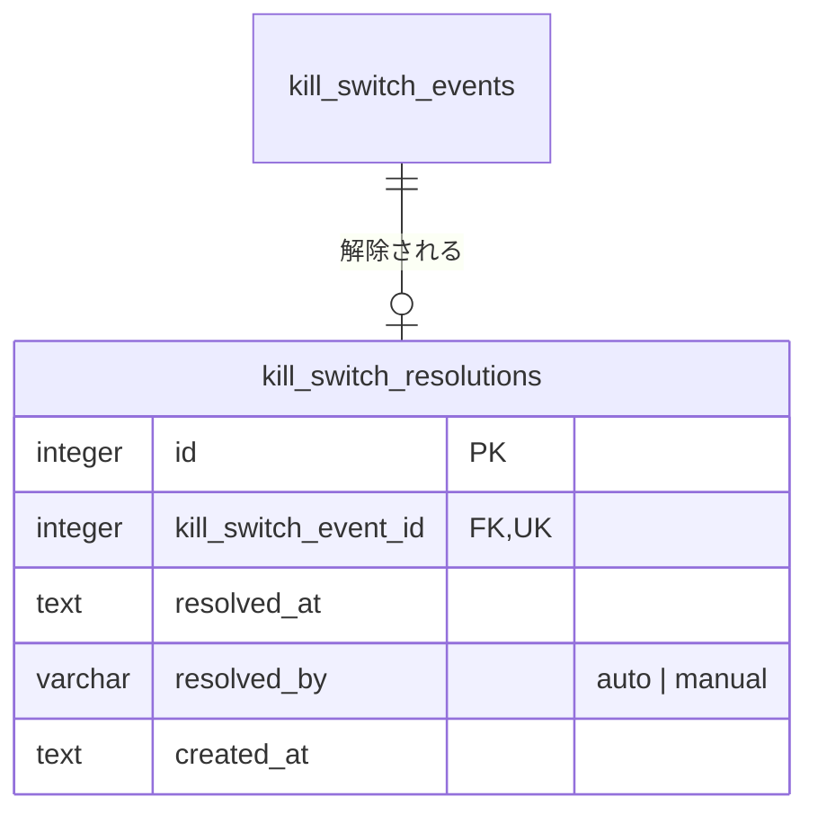
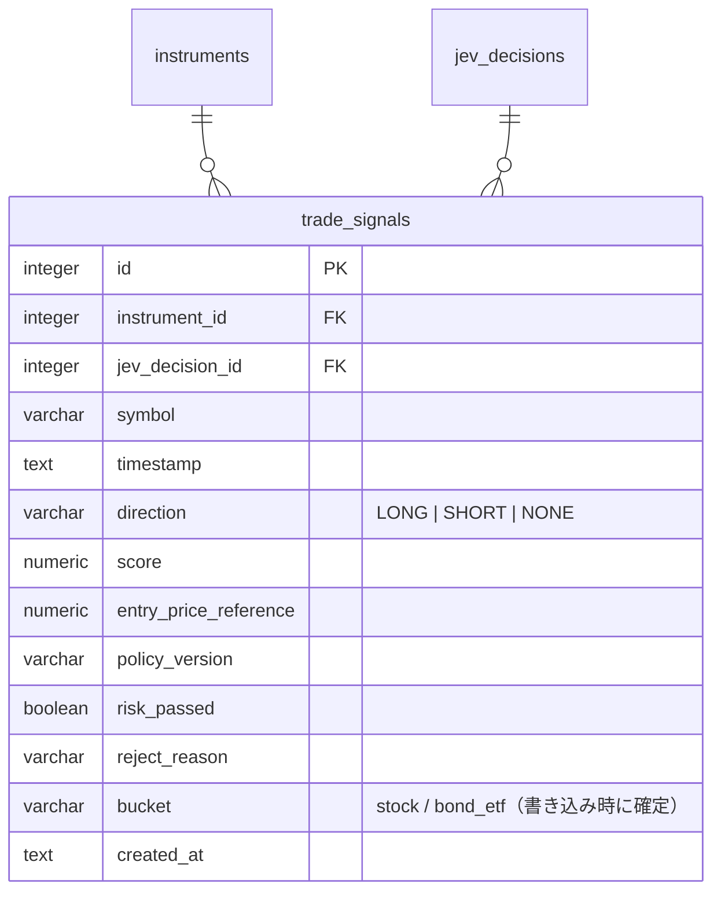
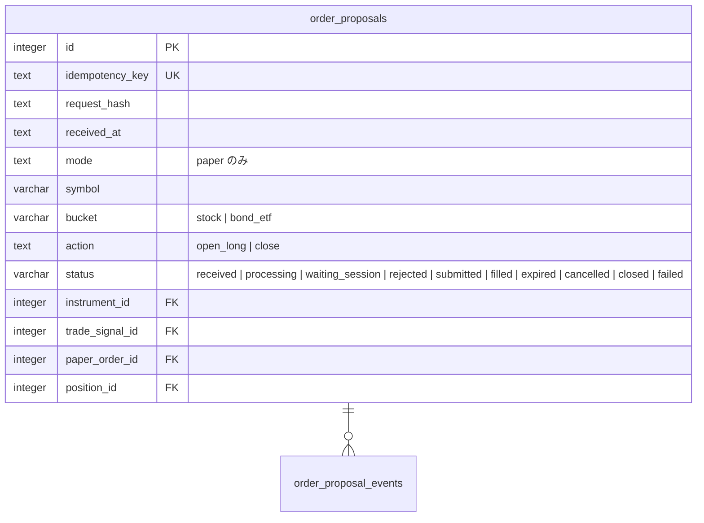

# ER / データモデル: テーブル定義（Paper執行・Kill Switch）

`docs/architecture/er.md` から分割した章。対象: `paper_orders` / `positions` / `calibration_outcomes` / `calibration_label_skips` / `kill_switch_events` / `kill_switch_resolutions` / `trade_signals` / `order_proposals` / `order_proposal_events`。型・規約と全体ER図は `docs/architecture/er.md` を参照。

## paper_orders

Paper Trading（将来は実発注）の注文・約定。

| カラム | 型 | 制約 | 説明 |
|-------|-----|------|------|
| id | integer | PK（AUTOINCREMENT） | |
| instrument_id | integer | FK → instruments.id, NOT NULL | |
| trade_signal_id | integer | FK → trade_signals.id, NULL可 | |
| symbol | varchar(10) | NOT NULL | |
| side | varchar(10) | NOT NULL, CHECK IN ('BUY','SELL') | |
| order_type | varchar(10) | NOT NULL, CHECK IN ('MARKET','LIMIT') | |
| quantity | integer | NOT NULL | |
| limit_price | numeric(12,2) | NULL可 | order_type=LIMIT時必須（アプリ層で検証） |
| status | varchar(20) | NOT NULL, CHECK IN ('PENDING','FILLED','CANCELLED','REJECTED') | |
| submitted_at | text | NOT NULL | |
| filled_at | text | NULL可 | |
| filled_price | numeric(12,2) | NULL可 | |
| fees | numeric(10,2) | NOT NULL, DEFAULT 0 | 約定手数料（円）。約定時に`fillmodel`の`FeeBps`×約定代金を記録する（既定0bps。FR-ENTRY-8）。`positions.realized_pnl`はエントリー・Exit両注文の`fees`を差し引いた値 |
| slippage_bps | numeric(8,2) | NULL可 | 約定時の直近価格（シグナル価格）に対する不利方向のbps（呼値丸め・スプレッド・滑り込み。負は有利。FR-ENTRY-8） |
| bucket | varchar(20) | NOT NULL, DEFAULT 'stock', CHECK IN ('stock','bond_etf') | その注文を書いた時点の銘柄の`instruments.asset_class`から確定させた予算枠（issue #824、親 #823、マイグレーション`000041`）。呼び出し側の値ではなく、挿入文が`instruments`から写す。書き込み時に確定し、あとから`asset_class`や枠の設定を変えても過去の行は変わらない。`000041`より前の行は`stock`（それまでは株だけ） |
| created_at | text | NOT NULL | |

インデックス: `INDEX (instrument_id, submitted_at DESC)`, `INDEX (status)`

## positions

保有ポジション（Entry/Exit紐付き）。

| カラム | 型 | 制約 | 説明 |
|-------|-----|------|------|
| id | integer | PK（AUTOINCREMENT） | |
| instrument_id | integer | FK → instruments.id, NOT NULL | |
| entry_order_id | integer | FK → paper_orders.id, NOT NULL | |
| exit_order_id | integer | FK → paper_orders.id, NULL可 | クローズ後に設定 |
| symbol | varchar(10) | NOT NULL | |
| side | varchar(10) | NOT NULL, CHECK IN ('LONG','SHORT') | |
| quantity | integer | NOT NULL | |
| entry_price | numeric(12,2) | NOT NULL | |
| current_price | numeric(12,2) | NOT NULL | 保有中はSchedulerが定期更新 |
| bucket | varchar(20) | NOT NULL, DEFAULT 'stock', CHECK IN ('stock','bond_etf') | そのポジションを書いた時点の銘柄の`instruments.asset_class`から確定させた予算枠（issue #824、`000041`）。書き込み時に確定し、あとから変えても過去の行は変わらない。`000041`より前の行は`stock`（それまでは株だけ）。Paperの各枠（`risk.bucket.stock.budget_jpy`・`risk.bucket.bond_etf.budget_jpy`）の保有額は、その枠の`bucket`で`closed_at IS NULL`の行の時価ベースの合計（`current_price × quantity`。`current_price`が0以下のあいだは`entry_price`を使う。総エクスポージャ上限と同じ計算）（`functional.md` FR-RISK-10） |
| unrealized_pnl | numeric(14,2) | NOT NULL, DEFAULT 0 | 保有中のみ有効（Mark周期で更新）。クローズ時（`closePosition`）に`0`へリセットし、クローズ済み行は実現損益（`realized_pnl`）のみを持つ。#682以前にクローズされた過去行もマイグレーション000029で`0`へ揃えた（保有中の行は不変、downはno-op） |
| realized_pnl | numeric(14,2) | NULL可 | クローズ時に確定 |
| opened_at | text | NOT NULL | |
| closed_at | text | NULL可 | |
| exit_reason | varchar(50) | NULL可 | 値は `internal/domain/position.go` の `ExitReason*` 定数（`functional.md` FR-EXIT-1 の8条件＋手動決済＋Kill Switch強制クローズ＋注文案の決済）: `stop_loss`（固定Stop Loss）/ `take_profit`（固定Take Profit）/ `trailing_stop`（Trailing Stop）/ `jev_direction_reversed`（Jev方向反転）/ `continuation_probability_dropped`（continuation_probability低下）/ `vwap_cross`（VWAP逆クロス）/ `max_holding`（最大保有時間到達）/ `force_flat_before_close`（引け前強制決済）/ `manual`（手動決済 `POST /positions/:id/close`）/ `force_close`（Kill Switchによる強制クローズ）/ `proposal_close`（MCP の注文案 `close` による決済。issue #828。リスクを減らす操作なので手動決済と同じくKill Switch・一時停止・日次ガード中も実行でき) |
| created_at / updated_at | text | NOT NULL | |

インデックス: `INDEX (instrument_id)`, `UNIQUE (instrument_id) WHERE closed_at IS NULL`（部分インデックス。SQLite 3.8+対応。同一銘柄の同時保有は1ポジションに制限し、状態管理§4.9の `position` フィールドと整合させる）

## calibration_outcomes

Jev判断と将来値動きの紐付け結果。

| カラム | 型 | 制約 | 説明 |
|-------|-----|------|------|
| id | integer | PK（AUTOINCREMENT） | |
| jev_decision_id | integer | FK → jev_decisions.id, NOT NULL | decision_type=trader対象 |
| horizon_minutes | integer | NOT NULL | トリプルバリアのラベル（`label_version=2`）ではSettingsのtimeout（`calibration.barrier_timeout_minutes`、1〜60分の整数、既定10分。FR-CAL-4・issue #762）。旧ラベルは5 / 10 / 15 等（旧水平線。FR-CAL-5、issue #711。20分の既存行は残るが新規には作らない） |
| future_return | numeric(8,4) | NOT NULL | **百分率（%）**（1.0 = +1%）。`entry`（判断時刻の足の価格）から水平線末尾の足の価格への `(price − entry)/entry × 100`。方向調整は**しない**（shortでも価格上昇なら正）。`market_snapshots.return_*`の小数比（0.004 = +0.4%）とは単位が異なり、×100の換算を要する |
| max_adverse_excursion | numeric(8,4) | NOT NULL | **百分率（%）**。窓内の方向調整済みリターン（short は符号反転）の最小値（0以下。含み損の最大幅）。`direction=NONE`はlong扱い（調整係数+1） |
| max_favorable_excursion | numeric(8,4) | NOT NULL | **百分率（%）**。窓内の方向調整済みリターンの最大値（0以上。含み益の最大幅） |
| was_direction_correct | boolean | NULL可 | direction=NONEの場合NULL。トリプルバリアのラベルでは`net_return_bps > 0`（flatを不正解とはせず、コスト控除後のリターンで評価。FR-CAL-4） |
| barrier_hit | text | NULL可, CHECK (`tp`/`sl`/`timeout`) | トリプルバリア方式のラベル（issue #756、マイグレーション000033）。利確（`tp`）・損切り（`sl`）・時間切れ（`timeout`）のうち先に触れたバリア。旧ラベル（`label_version=1`）の行はNULL |
| net_return_bps | numeric | NULL可 | 売買コスト（手数料＋スプレッド＋スリッページ想定）を差し引いた後の方向調整済みリターン（**bps**。`future_return`の百分率%とは単位が異なる）。旧ラベルの行はNULL |
| entry_ref_price | numeric | NULL可 | バリア幅と損益の基準にした執行できる価格（LONGはask、SHORTはbid。Jevの応答を受け取った後の時点）。旧ラベルの行はNULL |
| label_version | integer | NOT NULL, DEFAULT 1 | ラベル方式の版（`internal/domain/calibration.go`の`CalibrationLabelVersion*`）。`1`=旧ラベル（終値のみで判定。マイグレーション000033が既存行を全てこの値で埋める。新列は上記のとおりNULL）、`2`=トリプルバリア。旧ラベルと新ラベルはこの列で区別し、混ぜて集計しない |
| created_at | text | NOT NULL | |

インデックス: `UNIQUE (jev_decision_id, horizon_minutes)`

## calibration_label_skips

水平線まで足が揃わないことが確定した`(jev_decision_id, horizon_minutes)`の終端マーカー（マイグレーション000024、issue #481）。`calibration_outcomes`は作らず（短縮horizonを記録しない）、`PendingLabels`が当該ペアを再投入対象から外すためだけに使う。`internal/service/calibration.Labeler`が、判断時刻+horizon+5分の猶予後も窓が揃わない場合に書き込む（`INSERT OR IGNORE`で冪等）。猶予内は何も書かず、ジョブは`failed`ではなく`pending`へ戻して再試行する。マーカー記録時のジョブは`failed`ではなくskipとして`succeeded`で終了する（`jobs.last_error`に`skipped: …`の注記。issue #710）。

| カラム | 型 | 制約 | 説明 |
|-------|-----|------|------|
| jev_decision_id | integer | FK → jev_decisions.id, NOT NULL | |
| horizon_minutes | integer | NOT NULL | |
| reason | text | NOT NULL | 足が揃わなかった理由 |
| created_at | text | NOT NULL | |

インデックス: `PRIMARY KEY (jev_decision_id, horizon_minutes)`

## kill_switch_events

Risk EngineのKill Switch発動履歴（監査ログ）。**追記専用**であり、`UPDATE`/`DELETE`はDBトリガー（`kill_switch_events_no_update` / `kill_switch_events_no_delete`、マイグレーション000014）が`ABORT`で拒否する（`operator_manual`を許すCHECK拡張のためテーブルを作り直したマイグレーション000017でも同トリガーを再作成している）。解除は本テーブルを更新せず、`kill_switch_resolutions`へ行を追記して記録する。

| カラム | 型 | 制約 | 説明 |
|-------|-----|------|------|
| id | integer | PK（AUTOINCREMENT） | |
| triggered_at | text | NOT NULL | |
| reason | varchar(100) | NOT NULL, CHECK IN ('daily_loss_limit','consecutive_losses','market_data_down','jev_api_down','broker_api_error','unexpected_position','fill_discrepancy','db_write_failure','operator_heartbeat_timeout','operator_manual') | `functional.md` FR-RISK-2, FR-RISK-6 |
| detail_json | text | NOT NULL | 発動時のRisk状態スナップショット（JSON文字列） |
| created_at | text | NOT NULL | |

インデックス: `INDEX (triggered_at DESC)`

トリガー: `BEFORE UPDATE` / `BEFORE DELETE` → `RAISE(ABORT, 'kill_switch_events is append-only: ...')`

## kill_switch_resolutions

Kill Switch解除の監査ログ（追記専用）。`kill_switch_events`の1行につき高々1行を追記する。`kill_switch_events`に対応する行が無いイベントは未解除（Kill Switch継続中）を表し、Repositoryは`LEFT JOIN`で`resolved_at`/`resolved_by`を導出する。マイグレーション000014以前に解除済みだった行は本テーブルへ移行済み（旧`kill_switch_events.resolved_at`/`resolved_by`列は廃止）。`UPDATE`/`DELETE`は`kill_switch_resolutions_no_update` / `kill_switch_resolutions_no_delete`トリガーが拒否する。

| カラム | 型 | 制約 | 説明 |
|-------|-----|------|------|
| id | integer | PK（AUTOINCREMENT） | |
| kill_switch_event_id | integer | FK → kill_switch_events.id, UNIQUE, NOT NULL | 1イベントにつき解除は1回のみ |
| resolved_at | text | NOT NULL | |
| resolved_by | varchar(50) | NOT NULL, CHECK IN ('auto','manual') | |
| created_at | text | NOT NULL, DEFAULT (strftime ミリ秒3桁) | DEFAULTは固定9桁ではないため使わず、`KillSwitchRepository.Resolve`が`sqlutil.FormatTime`で常に明示する（`er.md`「日時列のDEFAULT」）。`kill_switch_events.created_at`も同様 |

## trade_signals

Policy Engineが生成した取引候補。

| カラム | 型 | 制約 | 説明 |
|-------|-----|------|------|
| id | integer | PK（AUTOINCREMENT） | |
| instrument_id | integer | FK → instruments.id, NOT NULL | |
| jev_decision_id | integer | FK → jev_decisions.id, NULL可 | 根拠となったJev Trader判断 |
| symbol | varchar(10) | NOT NULL | |
| timestamp | text | NOT NULL | |
| direction | varchar(10) | NOT NULL, CHECK IN ('LONG','SHORT','NONE') | |
| score | numeric(6,4) | NULL可 | Policy Engine内部スコア |
| entry_price_reference | numeric(12,2) | NULL可 | |
| policy_version | varchar(20) | NOT NULL | Policy Engineのロジック版。ライブ経路（メタラベリングのEV判定）は`policy-v2`、バックテストの再生は保存せず（`DecideReplay`はライブと同じ`policy-v2`、比較専用の旧しきい値ルールだけが`policy-v1`）。メタモデル未採用のPaperで、Settingsの「Paper ブートストラップ」（`paper.bootstrap_entry_enabled`）が有効なときの旧しきい値ルールの判断は`policy-vb`（LONG/SHORT/NONEのすべて。issue #798）。自己改善の適用提案のしきい値が有効な間は`policy-v2+sol-12`・`policy-vb+sol-12`のように`policy_proposals.applied_policy_version`を付加（`functional.md` FR-POLICY-4/5, FR-SELFIMPROVE-5）。MCP の注文案（`open_long`）が書いた行は`mcp-proposal-v1`（`jev_decision_id`はNULL。issue #828。`risk_rejections`が Policy の行と見分ける） |
| risk_passed | boolean | NOT NULL | Risk Engine通過可否。MCP の注文案の行は「Risk を通って注文まで進んだ」ときだけ true（Risk を通ったが数量・最大損失・Execution の拒否や失敗・期限切れ・取消で注文にならなかった行は、案の状態を変えるのと同じトランザクションで false に直す。issue #860、`000046`が過去行を直す） |
| reject_reason | varchar(255) | NULL可 | risk_passed=false時の理由。Policy Engineの理由（`spread_too_wide`等）、またはRisk Engine拒否時の`risk_engine_rejected: <Risk理由>`（例: `risk_engine_rejected: market_adverse_to_direction`。Risk理由が空なら`risk_engine_rejected`のみ）。Paperの予算枠の拒否理由は`bucket_disabled`（株の枠が0）・`bucket_budget_exceeded`（株の保有額＋今回のエントリー額が枠を超える）（issue #824、`functional.md` FR-RISK-10）。注文案が Risk を通ったが注文にならなかったときは`proposal_rejected_after_risk: <理由コード>`（`size_zero`・`max_trade_loss`・`position_already_open`・`pending_order_exists`・`symbol_in_cooldown`・`processing_error`・`expired`等。issue #860） |
| bucket | varchar(20) | NOT NULL, DEFAULT 'stock', CHECK IN ('stock','bond_etf') | そのシグナルを書いた時点の銘柄の`instruments.asset_class`から確定させた予算枠（issue #824、`000041`）。書き込み時に確定し、あとから`asset_class`や枠の設定を変えても過去の行は変わらない。`000041`より前の行は`stock`（それまでは株だけ） |
| created_at | text | NOT NULL | |

インデックス: `INDEX (instrument_id, timestamp DESC)`, `INDEX (risk_passed)`

## order_proposals

MCP（`order_proposal_submit`）が受け付けた Paper の注文案。1 案 1 行（マイグレーション`000042`、issue #827、`docs/architecture/paper-results-mcp.md` §8）。MCP が書くのは受け付けの`INSERT`（案 1 行と`order_proposal_events`の最初の 1 行を同じトランザクション）だけで、取消の依頼（`order_proposal_cancel`）は`cancel_requested_at`の`UPDATE`とイベント 1 行だけを書く（`000043`、issue #828）。`status`以降の更新と下の紐付け・計算値はアプリの処理役が埋める（`docs/architecture/order-proposal-processing.md`）。

| カラム | 型 | 制約 | 説明 |
|-------|-----|------|------|
| id / idempotency_key / request_hash | integer / text / text | PK / NOT NULL UNIQUE / NOT NULL | `idempotency_key`は 8〜64 文字の再送の識別子。`request_hash`は`idempotency_key`を除いた引数を正規化した SHA-256（16 進）。同じキーで内容が違う再送を拒否する根拠 |
| received_at / updated_at / expires_at | text | NOT NULL | 受け付け時刻・最後に状態を変えた時刻・有効期限（UTC。受け付けから最大 24 時間）。`(received_at)`と JST の 1 日 20 件の上限の数え上げに使う |
| client | text | NOT NULL, DEFAULT `''` | 接続元 IP だけ。ヘッダ・API キーは残さない |
| mode | text | NOT NULL, DEFAULT 'paper', CHECK IN ('paper') | Live の値は入れられない（Live の発注経路は作らない） |
| symbol / bucket / action | varchar(10) / varchar(20) / text | NOT NULL, bucket は CHECK IN ('stock','bond_etf')、action は CHECK IN ('open_long','close') | 銘柄コード・予算枠・買い（新規）か保有中ポジションの決済か。売り建ては無い |
| quantity / budget_jpy | integer / numeric | NULL可, CHECK > 0 | `open_long`のとき、どちらか一方（株数／使う金額）。`close`は両方 NULL |
| order_type / limit_price | varchar(10) / numeric | NOT NULL, CHECK IN ('MARKET','LIMIT') / NULL可 | `LIMIT`のときだけ`limit_price` |
| stop_loss_price / take_profit_price / exit_plan / max_loss_jpy | numeric / numeric / text / numeric | NULL可, 価格・損失は CHECK > 0 | 答え合わせのための記録。`open_long`は損切り・手じまいの計画（500 文字以内）・最大損失が必須（MCP が検証）。第 1 段階ではアプリの Exit の判定には使わない |
| rationale / sources_json | text | NOT NULL | 判断の理由（2000 文字以内）と、情報源（`title`・`url`・`retrieved_at`の配列。1〜10 件）の JSON |
| status / status_reason | varchar(20) / text | NOT NULL, status は CHECK（上の図の 10 値）, DEFAULT 'received' / DEFAULT `''` | 状態と、固定コードの理由。受け付け時は`received`と空 |
| instrument_id / trade_signal_id / paper_order_id / position_id | integer | FK → instruments / trade_signals / paper_orders / positions, NULL可 | アプリが issue #828 で埋める。最初は NULL |

| cancel_requested_at | text | NULL可 | `order_proposal_cancel`が取消を依頼した時刻（UTC）。NULL は依頼なし。MCP が書く唯一の`UPDATE`列（`000043`）。実際の取消はアプリ |
| applied_quantity | integer | NULL可, CHECK (> 0) | アプリが実際に注文した（`open_long`）／決済した（`close`）株数。案の数量とアプリが決めた数量（`risk.Engine.PositionSize`）の小さいほう（`000043`） |
| computed_max_loss_jpy | numeric | NULL可, CHECK (>= 0) | アプリが計算した最大損失（円）＝ 数量 ×（予想約定価格 − 実際に効く損切り価格）。あいりの`max_loss_jpy`と並べて残す（`000043`） |
| effective_stop_loss_price | numeric | NULL可, CHECK (> 0) | 上の計算に使った損切り価格＝案の損切りとアプリの損切りのうち、エントリーから遠い方（`000043`） |

インデックス: `UNIQUE (idempotency_key)`, `INDEX (received_at)`, `INDEX (status, received_at)`。`000043`は`paper_orders (trade_signal_id)`と`positions (entry_order_id)`のインデックスも足す（再起動時の回復と紐付けの検索用）

## order_proposal_events

注文案の状態の変化を 1 行ずつ残す（マイグレーション`000042`）。追記のみで、`UPDATE` / `DELETE`はトリガー（`order_proposal_events_no_update` / `_no_delete`）で拒否する。受け付け時の最初の行は`from_status` NULL・`to_status='received'`・`actor='mcp'`。

| カラム | 型 | 制約 | 説明 |
|-------|-----|------|------|
| id | integer | PK（AUTOINCREMENT） | |
| proposal_id | integer | FK → order_proposals.id, NOT NULL | |
| at | text | NOT NULL | 変化の時刻（UTC） |
| from_status / to_status | varchar(20) | from は NULL可（最初の行だけ）、どちらも`order_proposals.status`と同じ CHECK | 変化前・変化後 |
| reason_code | text | NOT NULL, DEFAULT `''` | 固定コード（無いときは空） |
| detail_json | text | NOT NULL, DEFAULT `''` | イベントの補足（固定キーの JSON。数量を減らしたときの`{"requested_quantity":…,"applied_quantity":…,"limited_by":…}`、再起動の回復の`{"recovered_after_restart":true}`。無いときは空文字。数値・コードだけで自由文は入れない。`000043`） |
| actor | text | NOT NULL, CHECK IN ('mcp','app','gui') | `mcp`＝`order_proposal_submit`、`app`＝アプリの処理役（issue #828）、`gui`＝Settings 画面 |

インデックス: `INDEX (proposal_id, id)`
