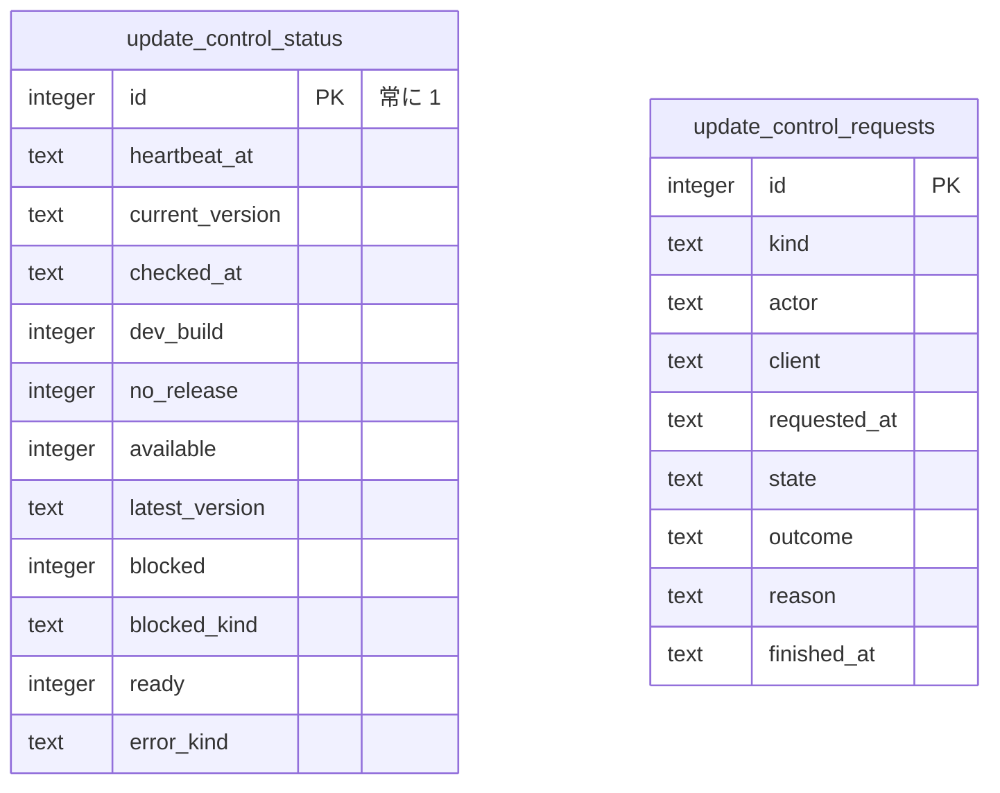

# ER / データモデル: テーブル定義（自動更新の MCP への受け渡し）

`docs/architecture/er.md` から分割した章。対象: `update_control_status` / `update_control_requests`（マイグレーション `000071`。issue #1222）。設計は `docs/architecture/update-tools/paper-results-mcp-update.md`、ツールは `docs/api/endpoints/update-tools/paper-results-mcp-update.md` §3.52。

## 位置づけ

デスクトップアプリの自動更新（`internal/service/updater`）を、別プロセスの Paper 実績 MCP から見る・動かすための**受け渡しの 2 表**。MCP はアプリの `Checker`・SafeGate・インストーラー起動を持たず、アプリの DB 接続もハンドルも環境変数も渡さない（起動の安全条件、`paper-results-mcp-lifecycle.md` §2 は変えない）ため、注文案（`order_proposals`）と同じく DB を窓口にする。状態を書き、依頼を実行するのはアプリ（`internal/service/updater/mcpbridge`）だけ。MCP は状態を読み、依頼を 1 行 INSERT し、時間切れの依頼を取り下げる（`UPDATE` 1 回）だけで、設定・注文・ポジションには書かない。取引・Risk・SafeGate の入力にならない。`cmd/server` にはアップデーターが無く、2 表は何も書かれない。

固定のコードだけを持つ。生のエラー文・インストーラーのパス・URL・公開鍵は持たない。

## update_control_status

アプリが書く現在の状態。常に 1 行（`id = 1`、CHECK）。アプリの起動中、状態が変わったとき・10 秒ごと（`heartbeat_at`）に上書きし、アプリの終了時に消す。`heartbeat_at` が 1 分以上古い行（アプリが落ちて残った行）は、MCP が「アップデーターなし」として扱う。

| カラム | 型 | 制約 | 説明 |
|---|---|---|---|
| id | integer | PK, CHECK (id = 1) | |
| heartbeat_at | text | NOT NULL | アプリが最後に書いた時刻（RFC3339 UTC） |
| current_version | text | NOT NULL | 動いているアプリの版（`internal/version.Version`） |
| checked_at | text | NULL可 | 最後の確認が終わった時刻。未確認は NULL |
| dev_build / no_release / available / blocked / ready | integer | NOT NULL, CHECK IN (0, 1) | `updater.Status` の同名のフラグ |
| latest_version | text | NOT NULL, 既定 '' | `available` のときの最新リリースのタグ |
| blocked_kind | text | NOT NULL, CHECK IN ('', 'open_positions', 'kill_switch', 'recent_order', 'check_failed') | `updater.BlockKind`。`blocked` でなければ '' |
| error_kind | text | NOT NULL, CHECK IN ('', 'network', 'rate_limit', 'access', 'verification', 'release', 'other') | `updater.ErrorKind`。失敗していなければ '' |

## update_control_requests

MCP の依頼。1 依頼 1 行。`update_apply` の行は導入の依頼の**監査**を兼ねる（`actor` と `client` を残す。`mcp_settings_audit` は設定キーの変更の表で、存在しないキーを載せないため別の表にした）。書き込み許可がオフの `update_apply` は行を作らない。

| カラム | 型 | 制約 | 説明 |
|---|---|---|---|
| id | integer | PK AUTOINCREMENT | |
| kind | text | NOT NULL, CHECK IN ('check', 'apply') | `check`＝`update_check_now`（`Checker.CheckForUpdate`。終了・導入はしない）、`apply`＝`update_apply` |
| actor | text | NOT NULL, CHECK (actor = 'mcp') | |
| client | text | NOT NULL, 既定 '' | 接続元ホスト（IP のみ） |
| requested_at | text | NOT NULL | 依頼時刻（RFC3339 UTC） |
| state | text | NOT NULL, 既定 'pending', CHECK IN ('pending', 'running', 'done') | アプリが着手すると `running`、終えると `done` |
| outcome | text | NOT NULL, 既定 '', CHECK IN ('', 'checked', 'check_failed', 'accepted', 'deferred', 'expired') | `done` のときの結果。`expired`＝アプリが着手する前に MCP が取り下げた、またはアプリが 30 秒以上待った依頼を実行せず捨てた |
| reason | text | NOT NULL, 既定 '', CHECK IN ('', 'open_positions', 'kill_switch', 'recent_order', 'check_failed', 'not_ready') | `deferred` の理由（SafeGate の種別、`not_ready`＝検証済みのインストーラーが無い） |
| finished_at | text | NULL可 | `done` にした時刻 |

インデックス: `(state, id)`（アプリが 1 秒ごとに `state='pending'` を読み取りだけで探す。見つかったときだけ `UPDATE ... RETURNING` で確保する）。

書き込みの経路: MCP の `Writer.InTx`（`update_apply` は書き込み許可の確認を同じトランザクションで行う）が `INSERT`（`kind='check'` のときは終わった check の行を先に消し、すでに `pending`・`running` の check があればそれに相乗りして新しい行を作らない）と、`state='pending'` の依頼だけを `done`/`expired` にする `UPDATE`。アプリ（`updatecontrol.Store`）が `update_control_status` の `INSERT ... ON CONFLICT DO UPDATE` / `DELETE`、依頼の `UPDATE`（`pending`→`running`→`done`、起動時に前回の未完了を `expired` にする）。

## 改訂履歴

| 版 | 日付 | 変更内容 | 変更理由 |
|----|------|---------|---------|
| 1.0 | 2026-11-25 | 新規作成（マイグレーション 000071） | issue #1222 |
