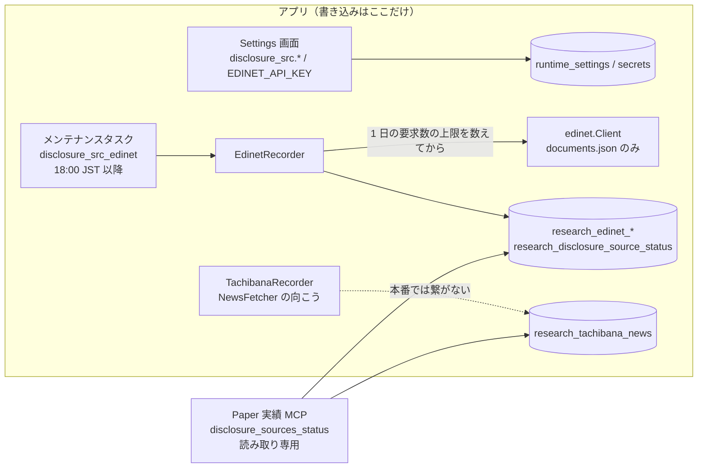

# 開示・ニュースの追加の情報源（EDINET・立花ニュース）

`docs/architecture/overview.md` §6 から分割した章。issue #1096（関連: #935 やのしん TDnet と開示の見送りルール、#725 立花の実機計測）。

## 1. 位置づけ

適時開示は、やのしん TDnet WebAPI を News Ingest が取得し、`disclosure_items` に記録している（#935）。やのしんは非公式の API で、続くかどうかに不安がある。その補助と比較の材料として、次の 2 つを**記録するだけ**の部品を足す。

| 情報源 | 取得するもの | 取得しないもの |
|--------|--------------|----------------|
| EDINET API v2（金融庁、無料、API キー要） | 書類一覧（`documents.json?type=2`）の、提出日時・書類管理番号・書類種別コード・証券コード・提出者名・書類の説明 | 書類の本文（XBRL・PDF・CSV）。書類取得の API は呼ばない。クライアントにその呼び出しが無い |
| 立花証券 e支店 API のニュース（無料、口座要、未検証） | 見出し・時刻・関連銘柄 | 本文 |

記録は研究用の表（`er/tables-disclosure-sources.md`）に書く。**取引には使わない**: ゲート・Policy・Risk・発注・執行・Paper ガード・Live・Jev（プロンプト・RAG の索引・Calibration・メタモデルの学習・自己改善）・既存の開示見送りルール（`internal/service/disclosureskip`。読むのは今までどおり `disclosure_items` だけ）は、これらの表を読まない。`internal/repository/disclosuresrc/isolation_test.go` が、表・パッケージ名を参照してよいファイルを固定し、記録部品のパッケージが自分の 4 表以外へ書かないことも固定する。

## 2. 構成

- **`internal/config/disclosuresrcsettings`**: `runtime_settings` のキー。`disclosure_src.edinet.enabled` / `disclosure_src.edinet.daily_request_cap` / `disclosure_src.edinet.lookback_days` / `disclosure_src.tachibana_news.enabled` / `disclosure_src.tachibana_news.daily_request_cap` / `disclosure_src.retention_days`。値は JSON 整数。**行が無い・壊れている・読めない間はすべてオフ**。Settings 画面（運用設定の「開示・ニュースの追加の情報源（EDINET・立花）」）だけで変える。Paper 実績 MCP の `settings_set` の許可リスト（`mcpwritesettings`）には入れない（`jev.trial.enabled` と同じ。テストで固定）。
- **`internal/service/disclosuresrc/edinet`**: EDINET の書類一覧だけを読むクライアント。キーは秘密 `EDINET_API_KEY`（`secrets` 表。Settings の「EDINET（開示書類の一覧）」）から起動時に読む。キーが無ければ要求を 1 回も送らない。EDINET はキーをクエリ（`Subscription-Key`）に載せるため、**URL をログにもエラーにも残さない**: 失敗は `RequestError{Code, Status}`（固定コードと HTTP ステータスだけ）にして返し、`*url.Error` の文字列・応答本文は捨てる。
- **`internal/service/disclosuresrc`**: 記録部品。`EdinetRecorder` は直近 `lookback_days`（保持期間を超えない）の営業日（土日は取らない）の書類一覧を、新しい日から取る。ある日の一覧は、まだ取っていなければ取り、その日が終わってから 1 回だけ取り直す（提出は夕方まで続くため）。1 回の実行は最大 5 要求の小分け（残りがあれば `maintenance.ErrMore`）で、要求の間に 1 秒置く。要求は送る**前**に `research_disclosure_source_status` で 1 日（JST）の要求数の上限を 1 文で数える（失敗した要求も数える。上限に達したらその日はそこで止まり、翌日に続く）。失敗は固定コード（`http_401` / `http_429` / `timeout` など）と件数だけ記録し、その実行を止める（同じ実行の中で再試行しない）。
- **`TachibanaRecorder`**: 立花ニュースの記録部品。取得は `NewsFetcher` インターフェースの向こう、認証情報の有無は `CredentialHolder.Configured()` だけで知る（認証情報そのものは読まない）。`Configured()` が偽・fetcher が nil・スイッチがオフのときは何もしない（要求 0、書き込み 0）。**本番の起動には `NewsFetcher` の実装が無く、タスクも登録しない**（`disclosuresrcwire.Tasks` は EDINET だけ）。立花の実機計測（#725）が終わってから、fetcher の実装とタスクの登録を別のチケットで足す。それまでテストはフェイクで動かす。
- **`internal/bootstrap/disclosuresrcwire`**: メンテナンスタスクの配線（`internal/bootstrap/researchwire` が登録する）。タスクは、スイッチがオフ・キーが未設定・18:00 JST 前のとき `maintenance.ErrSkipped` を返し、何も書かない（実行日の記録も書かない）。

## 3. 結合（`disclosure_items` との突き合わせ）

どちらの表も、`disclosure_items` と**同じ銘柄コードの形・同じ時刻の形**で保存する。

- 銘柄: `disclosure_items.symbol`（4 桁の証券コード。`instruments.symbol` と同じ。例 `7203`、`130A`）。EDINET の `secCode` は 5 桁（4 桁＋チェック桁、例 `72030`）なので先頭 4 桁（`domain/disclosuresrc.NormalizeSymbol`）。`secCode` の無い書類（投資信託など）は記録しない（日ごとの `skipped_count` に数える）。
- 時刻: `disclosure_items.published_at` と同じ UTC・RFC3339 の小数 9 桁固定（`sqlutil.FormatTime`）。EDINET の `submitDateTime` は JST の「YYYY-MM-DD HH:MM」なので UTC に直す。時刻は文字列比較がそのまま時系列になる。
- 結合の例は `er/tables-disclosure-sources.md` §結合。読み取り用のビュー `research_disclosure_source_events_v`（2 つの情報源を `(source, ref_id, symbol, event_at, headline)` に揃える）がある。`internal/service/disclosuresrc/disclosuresrctests/join_test.go` が、モックの応答から記録した行を `disclosure_items` と実際に結合して確かめる。

## 4. 保持期間

`disclosure_src.retention_days`（既定 1095 日、30〜3650）より古い行（EDINET は提出日時、立花ニュースは時刻、取得日の記録は日）を、記録部品が実行の終わりに自分の表から削除する。取得状況の表（`research_disclosure_source_status`）は削除しない。記録がオフの間は削除もしない。`market_snapshots` の保持（90 日）や `retention` パッケージの削除の対象ではない。

## 5. 守ること

- 既定オフ。オンにする（`disclosure_src.*.enabled`）のはマージ後に運用者が Settings 画面で行う。EDINET のキーの取得と入力も運用者が行う。
- キー・認証情報・URL・エラー本文・見出し・書類の表題は、ログにも、エラーにも、MCP の応答にも、テストの固定データにも入れない（テストは明らかに偽の `test-key-xxxx` を使う）。
- 実在のサービスを呼ぶテストは無い（`httptest` のサーバー・フェイク・数えるトランスポートだけ）。キー・認証情報が未設定のとき・スイッチがオフのとき外部への要求が 0 回であることを、数えるトランスポートで確かめる。
- ライブの Jev（trader-v3・`JEV_*`）・Risk・発注・執行・ブローカー・Paper ガード・リスク・資金の既定値・既存のシャドー（trader-v5）・既存のお試し（`internal/service/jev/trial`）・既存の開示見送りルール（`internal/service/disclosureskip`）・やのしんの記録（`internal/service/newsfeed/yanoshin.go`）は変えない。
