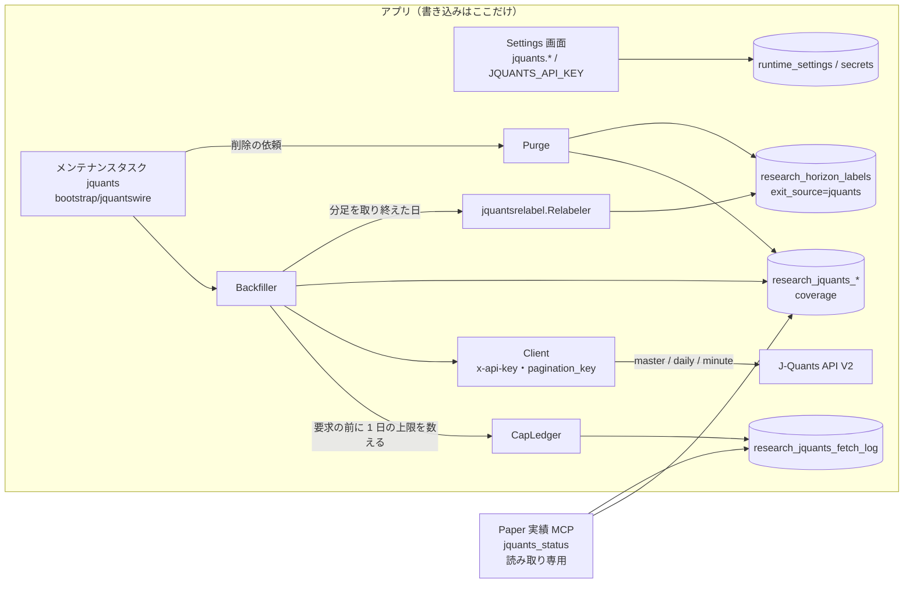

# J-Quants の日足・分足の取り込み

`docs/architecture/overview.md` §6 から分割した章。issue #1093（関連: #1074 研究用ラベル）。運用は`docs/environment/setup/jquants.md`、表は`docs/architecture/er/tables-jquants.md`、要件は`docs/requirements/functional/jquants.md`。

## 1. 位置づけ

kabu ステーションには過去の日足・分足を取る API が無い。J-Quants（有料。Light は月 1,650 円で日足 5 年分、分足は別に月 5,500 円のアドオンで過去 2 年分・翌日配信）の日足・分足・銘柄一覧を、**契約したときだけ**研究用の表へ取り込む読み取りアダプタを、契約の前に用意しておく。契約するかはまだ決まっていないため、**既定はオフで、キーが無いあいだは一切呼ばない**。

**取引には使わない**: ゲート・Policy・Risk・発注・執行・ブローカー・Paper ガード・Live・Jev（プロンプト・RAG の索引）・Calibration・メタモデルの学習・自己改善は、取り込んだデータを読まない（`internal/repository/jquants/isolation_test.go`が、これらのパッケージのソースに J-Quants の表・パッケージ・設定・キーの名前が現れないことを固定する）。kabu のアダプタ・ライブの市場データの経路（`marketdata`のキュー・`market_snapshots`の書き込み）は変えない。`market_snapshots`・`daily_bars`・`disclosure_items`・`jev_decisions`・`jev_shadow_decisions`・`jev_trial_decisions`には何も書かず、混ぜない（専用の表に分け、どの表も`source = 'jquants'`を持つ）。

J-Quants の利用条件（個人の私的利用・外部へ送らない・解約後は生データと元に戻せる派生物を削除）を守るため、取り込んだ値は MCP・ログ・エラー・通知に出さず、解約時の削除手順（§5）を持つ。

## 2. 構成

| 部品 | 場所 | 役割 |
|------|------|------|
| 設定 | `internal/config/jquantssettings` | `jquants.enabled` / `plan_daily` / `plan_minute` / `daily_request_cap` / `backfill_days` / `purge_requested`。既定はオフ・未契約・上限 200。壊れた値は既定扱い。Settings 画面だけが書き、`mcpwritesettings`の許可リストには**入れない**（テストで固定） |
| キー | `internal/config`の秘密`JQUANTS_API_KEY` | 任意。未設定でもアプリは起動し、Setup Guard の必須に入らない。起動時に 1 回読み、`jquants.Client`だけが持つ。ヘッダ`x-api-key`でだけ送り、URL・ログ・エラー・DB・MCP に出さない |
| クライアント | `internal/service/marketdata/jquants` | J-Quants API V2（`/equities/master`・`/equities/bars/daily`・`/equities/bars/minute`）の読み取り。`*http.Client`とベース URL を差し替えられる。**キーが空なら HTTP 要求を 1 回も送らない**（`ErrNoKey`）。要求の間は 1.5 秒以上あけ、`pagination_key`を追う。失敗は固定コード（`http_401`・`http_429`・`transport`・`decode` など）だけを返し、応答本文もキーも含めない |
| 上限 | `CapLedger`（`research_jquants_fetch_log`） | **要求を送る前に**、JST の日の合計が上限未満のときだけ 1 文で数えて進める。失敗・中断した要求も数えるので、上限を超えない。数えは DB にあり、再起動しても戻らず、日が変われば新しく数える |
| 埋め戻し | `Backfiller` | 昨日までの取引日（今日・休日は取らない）を古い順に見て、印（`research_jquants_coverage`）の無い単位だけを取る。1 回の実行は少数の読みで区切り（`maintenance.ErrMore`）、上限に達したらその日は止める（`nil`で終わり、残りは翌日）。401/403・429 は実行を止めてエラーで返す。契約していない側（`plan_*`が 0）の API は呼ばない |
| 保存 | `internal/repository/jquants` | 自然キーでの upsert（取り直しは上書き）。J-Quants の表だけを書く |
| 付け直し | `internal/service/researchlabel/jquantsrelabel` と`internal/repository/researchlabel/jquantslabel` | §4 |
| 削除 | `jquants.Purge` | §5 |
| 配線 | `internal/bootstrap/jquantswire` | メンテナンスタスク`jquants`（`internal/bootstrap/researchwire` が登録する）。オフ・キー無し・契約無しのときは`ErrSkipped`で、要求も書き込みも（実行日の記録も）しない。panic は握ってエラーで返し、取引と同じプロセスを落とさない |
| MCP | `jquants_status`（`paperresultsmcp/jquantsdiag`） | 読み取り専用。件数・日付・固定コードだけ。`docs/api/endpoints/paper-results-mcp-jquants.md` |

## 3. 取り込みの規則

- 日足: 取引日ごとに全銘柄（`date=`）。行が 0 件の取引日は、まだ配信されていないとして印を付けない。取引の無かった銘柄は価格が null の行（API が返すまま）。
- 分足: アプリが`market_snapshots`に記録した銘柄だけ（取引日ごとに銘柄ごとの要求）。J-Quants の`Time`（JST の`HH:mm`）はその 1 分の開始時刻で、UTC に直して保存する。価格・出来高・時刻が不正な行は捨てて件数をログに出す。直近 3 日の空の応答は「まだ配信されていない」として印を付けず、次の実行で取り直す。契約上、過去 2 年（730 日）より前は呼ばない。
- 銘柄コード: J-Quants は 5 桁（`72030`）。アプリの 4 桁（`7203`）への変換は`domain/jquants.SymbolOf`/`CodeOf`。

## 4. 研究用ラベルの付け直し

分足の取りこぼし（コレクターの停止など）で`market_snapshots`の足が欠けた窓は、記録部品（#1074）が「短い窓を記録しない」規則に従って行を作らなかった。J-Quants の分足を**出口の候補だけ**に加えて、その日のラベルを付け直す。

- エントリーは`market_snapshots`の足（板があるため）。分足は板を持たないのでエントリーにしない。したがって 1 日まるごと`market_snapshots`が無い日は付け直せない。
- 追加する出口の足は、その 1 分の最後の秒（大引けは 15:30）の価格。目標時刻以前で`calibration.HorizonBarTolerance`（2 分）以内のときだけ使う（記録部品と同じ窓の規則。出口が価格の分かる時刻より前になる先読みをしない）。
- 記録部品がすでに書いた行（`UNIQUE (snapshot_id, horizon)`）は書き換えない（`INSERT OR IGNORE`）。新しく入る行は`exit_source = 'jquants'`で区別する（既存の読み手は列を名前で選ぶので影響を受けない。既存行は`snapshot`）。
- 日の集計（`research_label_days` / `research_label_day_stats`）は、付け直した行を含めて作り直す。記録部品が完了印を付けていない日は付け直さない（`ErrDayNotRecorded`。記録部品が日をまるごと付けるのを待つ）。付け直しを済ませた日は`research_jquants_coverage`に`relabel`の印を付ける。
- ライブのラベル・`calibration_outcomes`・`jev_*`には触れない。

## 5. 解約時の削除

`jquants.Purge`（メンテナンスタスクが、運用設定`jquants.purge_requested`の依頼を受けて実行し、依頼を消す。キーもスイッチも要らず、外部へ要求を送らない）。削除するのは J-Quants 由来の行だけ: `research_jquants_symbols` / `daily_bars` / `minute_bars` / `coverage`の全行、`research_horizon_labels`の`exit_source = 'jquants'`の行（出口の価格から分足を逆算できる派生物）。そのあと、影響した日の集計を残りの行から作り直す（J-Quants の値を含む集計を残さない）。ほかの出どころの行（`market_snapshots`・`daily_bars`・`disclosure_items`・`jev_*`・記録部品のラベル）には触れず、要求数の記録`research_jquants_fetch_log`は残す（市場データを含まず、消すと上限の数えが日の途中で戻る）。テスト（`jquantstests/purge_test.go`、`jquantswire_test.go`）が、他の出どころの行が残ることを固定する。削除は 1000 行ずつの短いトランザクションで進み、失敗したら依頼を残して次のチェックで続きを消す。

## 6. 守ること（まとめ）

- ライブの Jev（trader-v3・`JEV_*`）、Risk、発注・執行・ブローカー、Paper のガード、リスク・資金の既定値、既存のシャドー（trader-v5）、既存の試験運用（`jev/trial`）と開示の見送りルール（`disclosureskip`）は変えない。
- すべて既定オフで記録だけ。結果を取引の判断・Policy・Risk・Jev・ゲート・RAG の索引・Calibration・メタモデルの学習・ライブ／シャドーの表に入力しない。
- 外部の要求は、キーが未設定・スイッチがオフ・契約していない側のとき 0 回（テストは数える RoundTripper と件数付きの httptest サーバー）。テストは実際の J-Quants を呼ばない（保存したサンプル応答）。
- 秘密（API キー）をコード・ログ・エラー・MCP の応答・テストの固定値・文書に書かない（テストは`test-key-xxxx`）。
