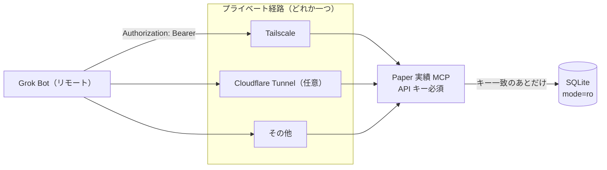

# 読み取り専用 Paper 実績 MCP（Grok Bot コネクタ）

リモートの Grok Bot が、pitha-trador の SQLite に入っている Paper の取引実績・Jev 判断・メタモデル・Risk・収集状況の**集計とラベル**を読む仕様。issue #783。実装は `cmd/paper-results-mcp` と `internal/service/paperresultsmcp`（実行・設定の手順は `docs/components/paper-results-mcp.md` §4）。

ツールの入出力・上限・ホワイトリストは `docs/api/endpoints/paper-results-mcp.md`。エラー表は `docs/architecture/paper-results-mcp-errors.md`。置き場所とプロセス境界は `docs/components/paper-results-mcp.md`。機能要件は FR-MCP-1〜8（`docs/requirements/functional/components-platform.md` §4.22）。

## 1. 目的

実績の DB は Windows PC の `%AppData%\pitha-trador\pitha.db`（`internal/bootstrap/bootstrap.go` の `DefaultDBPath`。環境変数 `PITHA_DB_PATH` があればそれを優先）。Grok Bot はその PC では動かない。いまは DB ファイルを手渡しして集計している。本 MCP は、その手渡しの代わりに、認証を通した読み取りだけをプライベートな経路で届ける。

MCP はアプリ本体（Wails / `cmd/server`）とは別プロセスで、同じ Windows ユーザーのセッションで動く。話しかたは HTTP である（stdio ではない）。インターネットへ直接は公開しない。外へ届ける経路は実装に依存せず、§3.2 のどれを選んでも同じ MCP・同じ API キーで動く（悠太さん、2026-10-17。Cloudflare を必須にしない。Tailscale も検討する）。

## 2. issue #347 との関係

#347（クローズ済み。仕様はブランチ `cursor/kabu-status-mcp-spec-af46` の `docs/architecture/kabu-status-mcp.md` と `kabu-status-mcp-errors.md`。main には未マージ）は、**kabuステーションAPI の待受・ログイン・API 利用設定・パスワード不一致を読む** MCP である。本仕様はそれを踏襲するが、読む対象は別である。

| 項目 | #347 kabu ステータス MCP | 本仕様（#783） |
|------|--------------------------|----------------|
| 読むもの | 同一 PC の kabu `POST /token` と、`secrets` の `KABU_API_PASSWORD` | アプリの SQLite の集計・ラベル。`secrets` は読まない |
| トンネル | プライベートトンネル（Tailscale 等）。インターネット非公開 | 同じ方針。選択肢は §3.2。Cloudflare は必須にしない |
| 認証 | コネクタ用の別 API キー。無い・不一致は kabu へ繋ぐ前に拒否 | 必須は別 API キー（§3.3）。不一致は SQL の前に拒否 |
| 既定 | オフ。PC 上のローカル設定だけ。Grok からは戻せない | 同じ。ただしオフのとき待受しない（下の差分） |
| オフの応答 | キー一致のあと `issue=mcp_disabled` を返す | TCP 待受を開かない（接続不可）。#783 の受け入れ条件 |
| ポート | MCP が kabu の localhost:18080（検証時 18081）を叩く | 既定の待受は `127.0.0.1:48110`。kabu のポートは使わない |
| プロセスと鍵 | アプリの HTTP を叩かない。鍵は `KABU_API_PASSWORD` とは別 | 別プロセス・別の設定ファイル・別の API キー。#347 のツールは呼ばない |

衝突させない。#347 のスイッチやコネクタ鍵を、本 MCP のオン/オフや鍵に流用しない。kabu の待受やログイン状態は本 MCP のツールに出さない。#347 の仕様文は本仕様で書き換えない（main 未マージの別文書のまま）。

## 3. 接続と認証

### 3.1 待受

- 既定はオフ。オフの間はポートを bind しない。プロセスが起動していても接続は拒否される（`paper-results-mcp-errors.md` の `not_listening`）
- オンは Windows PC のローカル設定ファイルだけが行う（§3.4）。Grok Bot のツール引数、コネクタ、DB の `runtime_settings` からはオンに戻せない
- 既定の bind は `127.0.0.1:48110`。経路の実装（Tailscale の転送、Cloudflare Tunnel、その他）はここへ向ける。アプリの待受（`127.0.0.1:48080`）や kabu（18080/18081）とはポートを分ける
- Tailscale でこのプロセスが直接待つときは、`listen` をその PC の tailnet 側アドレス（Tailscale の仮想インターフェースにいま割り当てられているアドレス）へ限る。ポートは既定の 48110。インターフェースが無い、または指定アドレスがそのインターフェースに無いときは、別のインターフェースへ逃げずに起動失敗とする
- `0.0.0.0`・`::`・LAN・それ以外の公開インターフェースは起動を拒否する（`cmd/server` の `PITHA_SERVER_ALLOW_NON_LOOPBACK` に相当する抜け道は置かない）。根拠: インターネットへ直接出さず、届く範囲を tailnet かトンネルのメンバーに限る
- 指定ポートが使用中なら、別インターフェースへ逃げずに起動失敗とする
- Grok Bot に登録する URL は、選んだ経路の名前（Tailscale のホスト名、またはトンネルの HTTPS 名）である。`http://127.0.0.1:48110` も kabu の URL も登録しない

### 3.2 経路

経路は次のどれかで、MCP の実装は経路を知らない。どれも同じプロセス・同じ API キー（§3.3）で動く。アカウント・ホスト名の実値は本リポジトリに書かない。

| 経路 | 位置づけ | 待受 | 届く範囲 |
|------|----------|------|----------|
| Tailscale | 選択肢。#347 の「プライベートトンネル」に最も近い | 既定は loopback へ転送。直接待つときは tailnet の IP だけ（§3.1） | tailnet の中だけ。tailnet 外からは届かない |
| Cloudflare Tunnel | 任意。使う場合は §3.5 の Access を併用してよい | loopback へ転送する | トンネルの入口。待受自体はインターネットへ出さない |
| その他のプライベートトンネル | 選択肢 | loopback へ転送する | そのトンネルのメンバーだけ |

### 3.3 必須の認証

必須は MCP 自身の別 API キーだけである。根拠: 経路が Tailscale でも Cloudflare でも、URL を知っているだけでは DB に届かせない。入口の製品には依存しない。

- `api_key` が空なら `enabled: true` でも待受しない。ログは `paper-results-mcp: refusing to listen: no auth configured`（秘密は出さない）。§3.5 の Access 設定があっても、API キーが空なら同じである
- 待受が開いているリクエストで、`Authorization: Bearer` が無い、または一致しなければ `unauthorized`。SQL は発行せず、DB 接続も新規に開かない
- 無いことと違うことは、クライアントには同じ固定文で返す。提示された値はログ・標準出力・標準エラー・ツール戻り値に出さない。比較は定数時間で行う

### 3.4 ローカル設定

ファイルは `%AppData%\pitha-trador\paper-results-mcp.json`。`secrets` テーブルにも `runtime_settings` にも置かない。根拠: #347 と同じくリモートから書き換えられる DB にスイッチを置かない。バックアップがコピーしうる DB と、入口の鍵を分ける。

| フィールド | 意味 | 既定 |
|------------|------|------|
| `enabled` | 待受を開くか | `false` |
| `listen` | 待受アドレス | `127.0.0.1:48110`。許す値は §3.1 |
| `api_key` | MCP 自身の API キー。必須 | 空。空のあいだは待受しない |

Cloudflare を使うときの追加フィールドは §3.5。既定では置かない。

ファイルの権限はユーザーのみ読み取り可（アプリの DB ファイルと同じ `0600`）。Git にコミットしない。値の例を仕様書・ログ・テストの失敗メッセージに埋め込まない。読み取れない・JSON でない場合はオフと同じく待受しない。

### 3.5 Cloudflare を使う場合のオプション

本節は必須ではない。Tailscale やその他の経路では読まなくてよい。Cloudflare Tunnel を選んだときだけ使う。

同一 PC の `cloudflared` が、トンネルの ingress を `http://127.0.0.1:48110` へ向ける。ポート転送で待受を LAN やインターネットへ出さない。

Cloudflare を使うときの推奨は二重である。エッジの Cloudflare Access（サービストークン）と、必須の API キーを重ねる。根拠: 入口とアプリを分けると、片方の設定漏れだけでは DB に届かない。Access は API キーの代わりにならない。Access だけでは待受しない（§3.3）。必須要件・受け入れ条件・FR-MCP には含めない。

クライアントが Access へ提示するヘッダは `CF-Access-Client-Id` と `CF-Access-Client-Secret`（URL・クエリ・パスには置かない）。ポリシーは Cloudflare 側の設定であり、アカウント ID・トークン・ホスト名の実値は本リポジトリに書かない。

オリジンでもヘッダを照合するときは、ローカル設定に次を足す。既定は照合しない。

| フィールド | 意味 | 既定 |
|------------|------|------|
| `verify_access_headers` | オリジンで Access ヘッダを照合するか | `false` |
| `access_client_id` | 照合する Client-Id | 空 |
| `access_client_secret` | 照合する Client-Secret | 空 |

`verify_access_headers` が true で、id または secret が空なら待受しない（照合が空のまま通るのを避ける。値はログに出さない）。true かつ両方あるリクエストでは、API キーの検査より前に 2 ヘッダを定数時間で比較し、無い・不一致は `access_denied`。SQL は発行しない。`message` は `unauthorized` と同じ文で、どちらが欠けたかは返さない。

**要確認（本節の中だけ）**: `cloudflared` がオリジンまでこの 2 ヘッダを転送するか。転送されない構成でオリジン照合を必須にすると、Access を通過した正規クライアントも拒否される。転送されないと分かった場合は `verify_access_headers` を false のままにし、エッジの Access とオリジンの API キーで足りるとする。オリジン照合を必須要件にはしない。

## 4. DB

読むファイルはアプリと同じ解決順（`PITHA_DB_PATH`、無ければ `DefaultDBPath`）。コピーを別に作って読まない。

- 開き方は `mode=ro`（`internal/repository/sqlitedb.PeekRuntimeSetting` が起動前の読み取りに使う DSN と同じ考え方）。`internal/repository/sqlitedb.Open` は使わない。根拠: `Open` はファイル作成・`PRAGMA journal_mode=WAL`・golang-migrate を行う
- 開いた接続で `PRAGMA query_only=ON` を実行する。失敗したら待受しない
- `PRAGMA wal_checkpoint` は一切実行しない。マイグレーションも実行しない。ファイルが無ければ作らず `db_unavailable`
- `busy_timeout` は 1 秒。アプリ本体の 60 秒（`sqlitedb` の `_busy_timeout=60000`）には合わせない。根拠: バックアップやチェックポイントでロックを待っている間、リモートの読み取りがアプリの書き込み側の待ちを長引かせない
- 接続は読み取り 1 本（`SetMaxOpenConns(1)`）。同時実行の上限は API 仕様の表
- 認証に失敗したリクエストは SQL を発行せず、接続も新規に開かない。起動時の疎通（`SELECT 1`）は、認証設定が §3.3 を満たして待受を開く場合に限り 1 回だけ行ってよい
- `secrets` への `SELECT` をツールからも疎通確認からも発行しない

書き込みを試みた SQL は SQLite が拒否する。その失敗をツールの成功応答にしてはならない（受け入れ条件のテストが、MCP の接続で `INSERT` がエラーになることを確認する）。

## 5. ツールの範囲

ツールは次の 8 つだけである。定義・フィールドは API 仕様。売買・発注・取消・設定変更・`runtime_settings` の更新・Kill Switch の操作はツールにしない。

| ツール | 読むもの |
|--------|----------|
| `paper_performance_summary` | 期間内のクローズ済み `positions` の件数・勝率・期待値・ドローダウン |
| `paper_daily_pnl` | クローズ日（JST）ごとの損益と件数 |
| `paper_trades` | クローズ済み取引のホワイトリスト列 |
| `jev_calibration` | `jev_decisions` と `calibration_outcomes` の件数・的中率・バケット・Brier |
| `metalabel_history` | `metalabel_models` の採用/却下と OOS AUC/EV、予測の take/skip 件数 |
| `risk_rejections` | `trade_signals.reject_reason` のうち Risk Engine 拒否の理由コード別件数 |
| `kill_switch_history` | `kill_switch_events` と `kill_switch_resolutions` のラベル |
| `collection_status` | `jobs` の件数、`market_snapshots` の鮮度と欠損日、`daily_bar_runs` の失敗件数、ラベルスキップ件数 |

新規テーブルは作らない。根拠: 必要な列はマイグレーション `000001`〜`000036` の既存表にある。

kabu の板・時価の保存を続けるかは #778 の現状のままである（保存は継続、リスクは理解済み、公式回答待ち）。本仕様は規約の適否を判断しない。リモートへ出す対象から生データを外すのは、その現状を広げないためである。

## 6. 非目標

- 実売買・Live の発注・口座の認証情報の読み書きを追加しない
- `market_snapshots.raw_data_json`、`jev_decisions.state_json` / `response_json`、板・気配・時価の列、`secrets`、API キーを戻り値にもログにも出さない（一覧は API 仕様の「出さないもの」）
- アプリの Gin ルート（セッション Cookie・CSRF・`/api/v1`）に本 MCP を相乗りさせない
- #347 のツール名（`kabu_station_status` / `kabu_api_error_guidance`）を本 MCP に生やさない

## 改訂履歴

| 版 | 日付 | 変更内容 | 変更理由 |
|----|------|---------|---------|
| 1.0 | 2026-10-17 | 新規作成 | issue #783。読み取り専用 Paper 実績 MCP の仕様。実装は範囲外 |
| 1.1 | 2026-10-17 | 必須の認証を API キーだけにし、経路を Tailscale・任意の Cloudflare Tunnel・その他のプライベートトンネルへ一般化した。Cloudflare Access は §3.5 の任意 | 悠太さん指示。Cloudflare を必須にしない。Tailscale も検討する |
| 1.2 | 2026-10-18 | 実装を追加した（`cmd/paper-results-mcp`、`internal/service/paperresultsmcp`）。冒頭の「実装は範囲外」を改めた。トランスポートは Streamable HTTP（POST のみ・JSON 応答）とし、旧来の HTTP+SSE は実装しない（API 仕様の要確認事項への回答） | issue #783 の実装。仕様の変更はなし |
