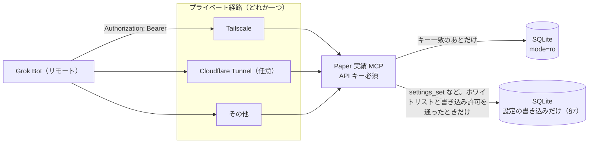

# Paper 実績 MCP（Grok Bot コネクタ）

リモートの Grok Bot が、pitha-trador の SQLite に入っている Paper の取引実績・Jev 判断・メタモデル・Risk・収集状況の**集計とラベル**を読む仕様。issue #783（設定の読み書きは #806・#807）。実装は `cmd/paper-results-mcp` と `internal/service/paperresultsmcp`（実行・設定の手順は `docs/components/paper-results-mcp.md` §4）。

ツールの入出力・上限・ホワイトリストは `docs/api/endpoints/paper-results-mcp.md`。エラー表は `docs/architecture/paper-results-mcp-errors.md`。置き場所とプロセス境界は `docs/components/paper-results-mcp.md`。機能要件は FR-MCP-1〜8 と、設定ツールの FR-MCP-18〜22（`docs/requirements/functional/components-platform.md` §4.22）。

## 1. 目的

実績の DB は Windows PC の `%AppData%\pitha-trador\pitha.db`（`internal/bootstrap/bootstrap.go` の `DefaultDBPath`。環境変数 `PITHA_DB_PATH` があればそれを優先）。Grok Bot はその PC では動かない。いまは DB ファイルを手渡しして集計している。本 MCP は、その手渡しの代わりに、認証を通した読み取りと、ホワイトリストに載った基本設定の読み書き（§7。issue #806・#807）だけをプライベートな経路で届ける。

MCP はアプリ本体（Wails / `cmd/server`）とは別プロセスで、同じ Windows ユーザーのセッションで動く（アプリが子プロセスとして起動し、アプリの終了で止まる。`paper-results-mcp-lifecycle.md`）。話しかたは HTTP である（stdio ではない）。インターネットへ直接は公開しない。外へ届ける経路は実装に依存せず、§3.2 のどれを選んでも同じ MCP・同じ API キーで動く（悠太さん、2026-10-17。Cloudflare を必須にしない。Tailscale も検討する）。

## 2. issue #347 との関係

#347（クローズ済み。仕様はブランチ `cursor/kabu-status-mcp-spec-af46` の `docs/architecture/kabu-status-mcp.md` と `kabu-status-mcp-errors.md`。main には未マージ）は、**kabuステーションAPI の待受・ログイン・API 利用設定・パスワード不一致を読む** MCP である。本仕様はそれを踏襲するが、読む対象は別である。

| 項目 | #347 kabu ステータス MCP | 本仕様（#783） |
|------|--------------------------|----------------|
| 読むもの | 同一 PC の kabu `POST /token` と、`secrets` の `KABU_API_PASSWORD` | アプリの SQLite の集計・ラベル。`secrets` は読まない |
| トンネル | プライベートトンネル（Tailscale 等）。インターネット非公開 | 同じ方針。選択肢は §3.2。Cloudflare は必須にしない |
| 認証 | コネクタ用の別 API キー。無い・不一致は kabu へ繋ぐ前に拒否 | 必須は別 API キー（§3.3）。不一致は SQL の前に拒否 |
| 既定 | オフ。PC 上のローカル設定だけ。Grok からは戻せない | 同じ。ただしオフのとき待受しない（下の差分） |
| オフの応答 | キー一致のあと `issue=mcp_disabled` を返す | TCP 待受を開かない（接続不可）。#783 の受け入れ条件 |
| ポート | MCP が kabu の localhost:18080（検証時 18081）を叩く | 既定の待受は `127.0.0.1:48110`。kabu のポートは使わない |
| プロセスと鍵 | アプリの HTTP を叩かない。鍵は `KABU_API_PASSWORD` とは別 | 別プロセス・別の設定ファイル・別の API キー。#347 のツールは呼ばない |

衝突させない。#347 のスイッチやコネクタ鍵を、本 MCP のオン/オフや鍵に流用しない。kabu の待受やログイン状態は本 MCP のツールに出さない。#347 の仕様文は本仕様で書き換えない（main 未マージの別文書のまま）。

## 3. 接続と認証

### 3.1 待受

- 既定はオフ。オフの間はポートを bind しない。プロセスが起動していても接続は拒否される（`paper-results-mcp-errors.md` の `not_listening`）
- オンは Windows PC のローカル設定ファイルだけが行う（§3.4）。Grok Bot のツール引数、コネクタ、DB の `runtime_settings` からはオンに戻せない。§7 の書き込み許可は別のスイッチで、待受のオン/オフには触れない
- 既定の bind は `127.0.0.1:48110`。経路の実装（Tailscale の転送、Cloudflare Tunnel、その他）はここへ向ける。アプリの待受（`127.0.0.1:48080`）や kabu（18080/18081）とはポートを分ける
- Tailscale でこのプロセスが直接待つときは、`listen` をその PC の tailnet 側アドレス（Tailscale の仮想インターフェースにいま割り当てられているアドレス）へ限る。ポートは既定の 48110。インターフェースが無い、または指定アドレスがそのインターフェースに無いときは、別のインターフェースへ逃げずに起動失敗とする
- `0.0.0.0`・`::`・LAN・それ以外の公開インターフェースは起動を拒否する（`cmd/server` の `PITHA_SERVER_ALLOW_NON_LOOPBACK` に相当する抜け道は置かない）。根拠: インターネットへ直接出さず、届く範囲を tailnet かトンネルのメンバーに限る
- 指定ポートが使用中なら、別インターフェースへ逃げずに起動失敗とする
- Grok Bot に登録する URL は、選んだ経路の名前（Tailscale のホスト名、またはトンネルの HTTPS 名）である。`http://127.0.0.1:48110` も kabu の URL も登録しない

### 3.2 経路

経路は次のどれかで、MCP の実装は経路を知らない。どれも同じプロセス・同じ API キー（§3.3）で動く。アカウント・ホスト名の実値は本リポジトリに書かない。

| 経路 | 位置づけ | 待受 | 届く範囲 |
|------|----------|------|----------|
| Tailscale | 選択肢。#347 の「プライベートトンネル」に最も近い | 既定は loopback へ転送。直接待つときは tailnet の IP だけ（§3.1） | tailnet の中だけ。tailnet 外からは届かない |
| Cloudflare Tunnel | 任意。使う場合は §3.5 の Access を併用してよい | loopback へ転送する | トンネルの入口。待受自体はインターネットへ出さない |
| その他のプライベートトンネル | 選択肢 | loopback へ転送する | そのトンネルのメンバーだけ |

### 3.3 必須の認証

必須は MCP 自身の別 API キーだけである。根拠: 経路が Tailscale でも Cloudflare でも、URL を知っているだけでは DB に届かせない。入口の製品には依存しない。

- `api_key` が空なら `enabled: true` でも待受しない。ログは `paper-results-mcp: refusing to listen: no auth configured`（秘密は出さない）。§3.5 の Access 設定があっても、API キーが空なら同じである
- 待受が開いているリクエストで、`Authorization: Bearer` が無い、または一致しなければ `unauthorized`。SQL は発行せず、DB 接続も新規に開かない
- 無いことと違うことは、クライアントには同じ固定文で返す。提示された値はログ・標準出力・標準エラー・ツール戻り値に出さない。比較は定数時間で行う

### 3.4 ローカル設定

ファイルは `%AppData%\pitha-trador\paper-results-mcp.json`。`secrets` テーブルにも `runtime_settings` にも置かない。根拠: #347 と同じくリモートから書き換えられる DB にスイッチを置かない。バックアップがコピーしうる DB と、入口の鍵を分ける。

| フィールド | 意味 | 既定 |
|------------|------|------|
| `enabled` | 待受を開くか | `false` |
| `listen` | 待受アドレス | `127.0.0.1:48110`。許す値は §3.1 |
| `api_key` | MCP 自身の API キー。必須 | 空。空のあいだは待受しない |

Cloudflare を使うときの追加フィールドは §3.5。既定では置かない。

ファイルの権限はユーザーのみ読み取り可（アプリの DB ファイルと同じ `0600`）。Git にコミットしない。値の例を仕様書・ログ・テストの失敗メッセージに埋め込まない。読み取れない・JSON でない場合はオフと同じく待受しない。

設定の書き手は、運用者が手で書くか、アプリ本体の Settings 画面（issue #792、`internal/service/paperresultsmcp/admin`）である。画面は有効/無効と待受アドレスと API キーだけを書き、`verify_access_headers` / `access_client_id` / `access_client_secret`（§3.5）は既存の値を保つ。書き込みは同じディレクトリの一時ファイル（`0600`）へ書いて fsync し、rename で置き換える（途中の状態を読み手に見せない）。待受アドレスはサーバー側で §3.1 と同じ規則で検証し、拒否したときはファイルを変えない。API キーは画面が `crypto/rand` の 32 バイトで生成し、生成した応答に一度だけ表示する。以降は伏せ字だけで、DB の `secrets`・ログ・データエクスポート・バックアップには入れない（自動テストで確認する）。プロセスはファイルを起動時にだけ読むため、変更の反映にはプロセスの再起動が要る（画面の「再起動」。issue #795）。画面が出す状態は、設定ファイル、アプリが起動した子プロセスの有無、有効かつキーがあるときの待受アドレスへの TCP 接続の可否から決める（MCP のツールは呼ばない）。

画面からの起動・停止・再起動、アプリ起動時の自動起動、アプリ終了時の停止、アプリが異常終了しても孤児を残さない仕組みは `architecture/paper-results-mcp-lifecycle.md`（issue #795）。MCP は別プロセスのまま、アプリは子プロセスとして起動するだけで、アプリの DB 接続・書き込み権限・API キーは渡さず、環境変数は許可リストのもの（`components/paper-results-mcp.md` §4.2）だけを渡す（キーは `0600` の設定ファイルから子が読む）。

### 3.5 Cloudflare を使う場合のオプション

本節は必須ではない。Tailscale やその他の経路では読まなくてよい。Cloudflare Tunnel を選んだときだけ使う。

同一 PC の `cloudflared` が、トンネルの ingress を `http://127.0.0.1:48110` へ向ける。ポート転送で待受を LAN やインターネットへ出さない。

Cloudflare を使うときの推奨は二重である。エッジの Cloudflare Access（サービストークン）と、必須の API キーを重ねる。根拠: 入口とアプリを分けると、片方の設定漏れだけでは DB に届かない。Access は API キーの代わりにならない。Access だけでは待受しない（§3.3）。必須要件・受け入れ条件・FR-MCP には含めない。

クライアントが Access へ提示するヘッダは `CF-Access-Client-Id` と `CF-Access-Client-Secret`（URL・クエリ・パスには置かない）。ポリシーは Cloudflare 側の設定であり、アカウント ID・トークン・ホスト名の実値は本リポジトリに書かない。

オリジンでもヘッダを照合するときは、ローカル設定に次を足す。既定は照合しない。

| フィールド | 意味 | 既定 |
|------------|------|------|
| `verify_access_headers` | オリジンで Access ヘッダを照合するか | `false` |
| `access_client_id` | 照合する Client-Id | 空 |
| `access_client_secret` | 照合する Client-Secret | 空 |

`verify_access_headers` が true で、id または secret が空なら待受しない（照合が空のまま通るのを避ける。値はログに出さない）。true かつ両方あるリクエストでは、API キーの検査より前に 2 ヘッダを定数時間で比較し、無い・不一致は `access_denied`。SQL は発行しない。`message` は `unauthorized` と同じ文で、どちらが欠けたかは返さない。

**要確認（本節の中だけ）**: `cloudflared` がオリジンまでこの 2 ヘッダを転送するか。転送されない構成でオリジン照合を必須にすると、Access を通過した正規クライアントも拒否される。転送されないと分かった場合は `verify_access_headers` を false のままにし、エッジの Access とオリジンの API キーで足りるとする。オリジン照合を必須要件にはしない。

## 4. DB

読むファイルはアプリと同じ解決順（`PITHA_DB_PATH`、無ければ `DefaultDBPath`）。コピーを別に作って読まない。

- 開き方は `mode=ro`（`internal/repository/sqlitedb.PeekRuntimeSetting` が起動前の読み取りに使う DSN と同じ考え方）。`internal/repository/sqlitedb.Open` は使わない。根拠: `Open` はファイル作成・`PRAGMA journal_mode=WAL`・golang-migrate を行う
- 開いた接続で `PRAGMA query_only=ON` を実行する。失敗したら待受しない
- `PRAGMA wal_checkpoint` は一切実行しない。マイグレーションも実行しない。ファイルが無ければ作らず `db_unavailable`
- `busy_timeout` は 1 秒。アプリ本体の 60 秒（`sqlitedb` の `_busy_timeout=60000`）には合わせない。根拠: バックアップやチェックポイントでロックを待っている間、リモートの読み取りがアプリの書き込み側の待ちを長引かせない
- 接続は読み取り 1 本（`SetMaxOpenConns(1)`）。同時実行の上限は API 仕様の表
- 認証に失敗したリクエストは SQL を発行せず、接続も新規に開かない。起動時の疎通（`SELECT 1`）は、認証設定が §3.3 を満たして待受を開く場合に限り 1 回だけ行ってよい
- `secrets` への `SELECT` をツールからも疎通確認からも発行しない

読み取りの接続は上の通り `mode=ro` のままで、書き込みを試みた SQL は SQLite が拒否する。その失敗をツールの成功応答にしてはならない（受け入れ条件のテストが、MCP の読み取り接続で `INSERT` がエラーになることを確認する）。設定ツール（§7）の書き込みは、この接続を使わず、別の狭い書き込み接続（§7.3）だけが行う。

## 5. ツールの範囲

ツールは、次の読み取りの 9 つ（`health_today` を含む）と、§7 の設定ツール 6 つ（`settings_get` / `settings_diff` / `settings_audit` / `settings_set` / `settings_write_enable` / `settings_write_disable`）だけである。定義・フィールドは API 仕様。売買・発注・取消・送金・Kill Switch の操作・Live の値の変更・秘密の読み書きはツールにしない。`runtime_settings` を書けるのは、§7 のホワイトリストのキーに対する `settings_set` だけである。

| ツール | 読むもの |
|--------|----------|
| `paper_performance_summary` | 期間内のクローズ済み `positions` の件数・勝率・期待値・ドローダウン |
| `paper_daily_pnl` | クローズ日（JST）ごとの損益と件数 |
| `paper_trades` | クローズ済み取引のホワイトリスト列 |
| `jev_calibration` | `jev_decisions` と `calibration_outcomes` の件数・的中率・バケット・Brier |
| `metalabel_history` | `metalabel_models` の採用/却下と OOS AUC/EV、予測の take/skip 件数、`metalabel_retrain_skips`（データ不足の再学習見送り。固定コードと必要件数中の件数） |
| `risk_rejections` | `trade_signals.reject_reason` のうち Risk Engine 拒否の理由コード別件数と、それ以外の拒否の固定コード別内訳 |
| `kill_switch_history` | `kill_switch_events` と `kill_switch_resolutions` のラベル |
| `collection_status` | `jobs` の件数と失敗の日別・キュー別・エラーコード別内訳・スキップ件数（保持期間の違いを `retention` に明記）、`market_snapshots` の鮮度と欠損日、`daily_bar_runs` の失敗件数、ラベルスキップ件数、立会中の市況データ停止の警告 `alerts[]`（`health_alerts`・`health_alert_checks`。固定コードと開始時刻だけ） |
| `health_today` | 今日（JST・東証立会日判定つき）の健康診断を 1 回で返す。Paper 取引数（`positions`）、採用中メタモデルの有無（`metalabel_models`）、ブートストラップの設定と有効状態（`runtime_settings` の固定キー `paper.bootstrap_entry_enabled` と `trade_signals.policy_version`）、kabu ログイン・market-data の状態（`collection_status.alerts[]` と同じ `health_alerts` 由来）、直近 7 日の欠損セッション（`market_snapshots`。それ以前のスナップショットが無い日は欠損でなく `insufficient_history_dates[]`＝判定不可。#814）、日次ガード（`runtime_settings` の `system.daily_guard` と閾値）、Kill Switch（`kill_switch_events`・`kill_switch_resolutions`・`system.killed`）、再学習の見送り（`metalabel_retrain_skips`）、そして要対応フラグ `needs_attention` と固定コード `attention_codes[]` |

MCP のためのテーブルは作らない。`metalabel_retrain_skips`（`000038`）はアプリの再学習ジョブが記録する表で（#799）、`health_alerts` / `health_alert_checks`（`000039`）はアプリの検知（`internal/service/healthalert`）が書く表である（#802。MCP は別プロセスの読み取り専用接続で、アプリの状態を DB 経由でしか見られないため）。どちらも MCP は読むだけである。他のツールが読む列はマイグレーション `000001`〜`000036` の既存表にある。`jobs.last_error` は本文を返さず、先頭 256 バイトからエラーコードのトークンだけを取り出す（`readonly_db_test` が SQL への現れ方を固定する）。

`health_today`（#808）は、アプリの状態を 1 回で見るために `runtime_settings` を読み取りだけで読む。読むキーは固定の許可リスト（日次ガードの閾値キー、`system.daily_guard`、`system.killed`、`paper.bootstrap_entry_enabled`。`query.ReadableSettingKeys`）だけで、リスト外のキーは SQL を発行する前に拒否する。値の解釈はアプリと同じ関数（`dailyguardsettings`・`paperbootstrapsettings`）で行い、日次停止のメッセージ文など自由文は戻り値に載せない。書き込みはしない（接続は `mode=ro`）。`readonly_db_test` は `runtime_settings` を読む文を `SELECT value FROM runtime_settings WHERE key = ?` の 1 本だけ許す。

kabu の板・時価の保存を続けるかは #778 の現状のままである（保存は継続、リスクは理解済み、公式回答待ち）。本仕様は規約の適否を判断しない。リモートへ出す対象から生データを外すのは、その現状を広げないためである。

## 6. 非目標

- 実売買・Live の発注・口座の認証情報の読み書きを追加しない。Live の値（Live の上限・Live の判定経路・Live の発注可否）も MCP から変えない
- `market_snapshots.raw_data_json`、`jev_decisions.state_json` / `response_json`、板・気配・時価の列、`secrets`、API キーを戻り値にもログにも出さない（一覧は API 仕様の「出さないもの」）
- アプリの Gin ルート（セッション Cookie・CSRF・`/api/v1`）に本 MCP を相乗りさせない
- #347 のツール名（`kabu_station_status` / `kabu_api_error_guidance`）を本 MCP に生やさない

## 7. 設定の読み書き（issue #806・#807）

Grok Bot（運用はあいり）が、GUI の Settings と同じ基本設定を MCP から一覧・変更・差分確認できる。「MCP は書かない」という不変条件は「**書くのはホワイトリストの設定ツールだけで、書き込み接続は §7.3 の狭い書き手だけ**」に改めた。それ以外の経路（読み取り 8 ツール、読み取り接続）は従来どおり書けない。

### 7.1 ホワイトリスト

MCP から書けるキーは、`internal/config/mcpwritesettings` の表に載ったものだけで、GUI の Settings（`runtime_settings`）にあるキーのうち次の 17 個である。表にないキーは、未知のキーも既知の別のキーも `key_not_allowed` で拒否し、DB には何も触れない（書き込み許可の確認よりも前に拒否する）。

| キー | 単位 | 意味 | 受け付ける値 |
|------|------|------|--------------|
| `risk.paper.initial_capital_jpy` | 円 | Paper の運用資金（FR-RISK 各上限と数量算出の基準。issue #804） | 0 円より大きく 1 兆円以下 |
| `risk.paper.max_position_per_symbol_pct` | % | Paper の 1 銘柄あたりの建玉上限 | 0 より大きく 100 以下 |
| `risk.paper.max_total_exposure_pct` | % | Paper の総エクスポージャ上限 | 0 より大きく 100 以下 |
| `risk.paper.max_trade_loss_pct` | % | Paper の 1 回の最大損失 | `papersettings.MinTradeLossPct`（0.1）以上 `MaxTradeLossPct`（3.0）以下 |
| `risk.bucket.stock.budget_jpy` | 円 | Paper の株の予算枠（issue #824）。保有中の株の建玉（取得価格×株数の合計）に今回のエントリー額を足してこの額を超えると新規エントリーを見送る。0 は株の新規エントリーを止める。保存がなければ運用資金の全額 | 0 以上 1 兆円以下の整数。株と債券ETFの合計が運用資金以下 |
| `risk.bucket.bond_etf.budget_jpy` | 円 | Paper の債券ETFの予算枠（issue #824）。0 はこの枠を使わない。保存がなければ 0。今回は保存だけで、債券ETFのエントリーはまだない | 0 以上 1 兆円以下の整数。株と債券ETFの合計が運用資金以下 |
| `risk.operating_capital_jpy` | 円 | 日次ガードの運用資金（FR-RISK-8）。0 は未設定 | 0 以上 1 兆円以下 |
| `risk.daily_loss_limit_pct` | % | 日次損失上限（運用資金比） | 0 以上 100 以下（0 は使わない） |
| `risk.profit_lock.trigger_pct` | % | 利益確保の発動水準（運用資金比） | 0 以上 100 以下 |
| `risk.profit_lock.giveback_pct` | % | 利益確保の戻し許容 | 0 以上 100 以下 |
| `risk.max_daily_trades` | 回 | 1 日の最大エントリー回数 | 0 以上の整数 |
| `risk.daily_loss_limit_jpy` | 円 | 日次損失上限（円で直接指定） | 0 以上 |
| `risk.profit_lock.trigger_jpy` | 円 | 利益確保の発動水準（円で直接指定） | 0 以上 |
| `metalabel.llm_cutoff` | 日付 | Jev が使う LLM の学習データの終端日（UTC） | `YYYY-MM-DD` |
| `metalabel.llm_cutoff_model` | 文字列 | 上の終端日を確認した Jev のモデル名（出典） | 200 文字以内・制御文字なし |
| `metalabel.llm_cutoff_confirmed_on` | 日付 | 上の終端日を確認した日（出典） | `YYYY-MM-DD` |
| `metalabel.llm_cutoff_source` | 文字列 | 上の終端日の根拠（出典） | 200 文字以内・制御文字なし |

入れないもの: Live の値（`risk.live.*` など Live で効く上限・判定・発注可否。この表に Live のキーは 1 つもない）、#798 の Paper ブートストラップのスイッチ（`paper.bootstrap_entry_enabled`）、ブローカー・認証情報・`secrets`、発注・送金・Kill Switch 解除に関わるもの、そのほかすべての運用設定（policy・screener・ログ・バックアップ先など）。書き込み許可のスイッチ自体も設定キーではなく、専用ツール（§7.2）だけが切り替える。表を広げるのは仕様の変更（悠太さんの決定）で、テスト（`TestWhitelistIsExactlyTheDecidedKeys`）が内容を固定する。

値の検証は GUI と同一のコードを使う。MCP 専用の検証は作らない。Paper の 4 キーは `papersettings`（`Validate` と `MinTradeLossPct` / `MaxTradeLossPct`。1 回の最大損失は 0.1〜3.0 を含む）、予算枠の 2 キーは `bucketsettings`（`Validate` と、合計の検査 `CheckSave`）、日次ガードは `dailyguardsettings`（`Apply`）、`metalabel.*` は `metalabelsettings`（`Normalize` / `Apply`）で、どれも `internal/service/opsettings` の `Save` を通る。範囲外は `invalid_value`（理由を `error.data.detail` に載せる）で、何も保存しない。

予算枠の合計（株 + 債券ETF）は運用資金（`risk.paper.initial_capital_jpy`）以下でなければならない。この検査は枠の 2 キーの保存、運用資金を下げる保存、「既定に戻す」のどれにも同じように掛かり、超えるときは `invalid_value` で拒否して、設定も監査行も残さない（GUI の保存も同じ）。枠は 1 キーずつ保存するので、枠の間で予算を移すツールは設けない。**移すときは、減らす方の枠を先に保存し、そのあとで増やす方の枠を保存する**（先に増やす方を保存すると、途中の合計が運用資金を超えて拒否される）。運用資金そのものを下げるときも、枠の合計が下がった額に収まるよう、先に枠を減らす。枠は Paper だけの設定で、Live には影響しない。

### 7.2 書き込み許可のスイッチ

- 保存先は `runtime_settings` のキー `mcp.settings_write_enabled`（JSON の整数 `1` / `0`）。**行が無いときは許可（既定オン）**。MCP は API キーがあるときだけ待受するので、キーがあれば書き込みも既定で使える（悠太さんの決定。issue #806 のコメント）。値が `0` / `1` 以外に壊れているときは禁止として扱う（安全側）
- 保存先を `runtime_settings` にした理由: アプリ（Settings 画面）と MCP は別プロセスで、同じ DB を見る。`paper-results-mcp.json` はアプリが書き、MCP が起動時に一度読むだけなので、実行中の切り替えが MCP に届かない（再起動が要る）。`runtime_settings` なら両方が毎回同じ値を読む。待受のオン/オフ・API キー（`paper-results-mcp.json`、§3.4）とは別物で、そちらは引き続き DB に置かない
- 切り替えは両方からできる。**Settings 画面**: 「外部連携」→ MCP カードの「MCP からの設定変更を許可する」チェック（`POST /settings/mcp/write`、セッション Cookie と CSRF が必要）。**MCP**: `settings_write_enable` / `settings_write_disable`（Bearer 認証が必要。書き込みが禁止のあいだも呼べる。禁止のままでは戻せなくなるため）
- 禁止のあいだ、`settings_set` は `write_disabled`（HTTP 403）で拒否し、何も保存しない。読み取りの 9 ツール・`settings_get` / `settings_diff` / `settings_audit`・スイッチのツールは使える
- スイッチは設定キーではなく、`settings_set` で書けない（`key_not_allowed`）

### 7.3 書き込み経路（狭い書き手）

- 読み取りの接続は `mode=ro`・`query_only=ON` のまま変えない。書き込みは、同じ DB ファイルへの**別接続**（`internal/service/paperresultsmcp/mcpset.Writer`）が、最初の書き込みの呼び出しで初めて開く。ファイルは作らず（`mode=rw`）、マイグレーションも `journal_mode` の変更もしない
- 書き手が実行する変更は 2 種類の 1 トランザクションだけ: ①ホワイトリストのキー 1 つの `runtime_settings` への upsert と、その監査 1 行の `INSERT`（`settings_set`）、②スイッチの upsert と監査 1 行（`settings_write_enable` / `settings_write_disable`）。ほかの表・文は発行しない（`mcptests.TestSettingsWritePathIsNarrow` が、実行された文を数えて固定する）
- 保存は GUI と同じ `runtime_settings`（`system.RuntimeSettingsRepository`）で、値の形も GUI と同じ（`opsettings` が検証して JSON で保存する）。アプリは毎回この表から読むので、保存後すぐに GUI と各エンジンに反映される（再起動不要）
- 同じ DB を書く単一ライターはアプリである。書き手は 2 秒の `busy_timeout` と `BEGIN IMMEDIATE` で短く待ち、取れなければ `db_locked`。アプリの書き込みを長く待たせない

### 7.4 監査ログ

- 表 `mcp_settings_audit`（マイグレーション `000040`）。1 変更 1 行: 時刻（UTC）、**誰が**（`actor` = `mcp` か `gui`。`mcp` のときは接続元ホストの IP だけ。ヘッダの値・API キーは記録しない）、操作（`set` / `reset` / `write_enable` / `write_disable`）、キー、**変更前の値**、**変更後の値**
- MCP からの変更に加え、Settings 画面から行ったホワイトリストのキーの保存・既定への戻し、書き込み許可の切り替えも同じ表に残す（`mcpset.Audited` が `opsettings.Service` を包んで Save / Reset を記録する）。GUI での変更も記録しないと、`settings_diff` が過去の状態を再構成できないため。ホワイトリスト外のキーの GUI での変更は記録しない
- 設定と監査は同じトランザクションに入れる（MCP の書き込みも、GUI の保存・既定への戻しも、書き込み許可のスイッチも同じ）。監査行の書き込みに失敗したら設定の変更も取り消され、保存はエラーになる。設定の書き込みが失敗したら監査行は残らない。どちらか一方だけ残ることはない（`mcpset.Audited`、`mcpset/atomic_test.go`）。例外は、保存済みの値が壊れていて変更前の値を読めないキーで、上書き・リセットを妨げないよう監査なしで変更する（ログに警告を出す）
- **マスク方針**: ホワイトリストのキーに秘密に分類されるものは 1 つもないため、値はそのまま記録・表示する（`mcpwritesettings.Spec.Secret` はすべて false。テストが固定する）。将来、秘密に分類されるキー（名前に secret・password・token・api_key・private_key・credential を含む、または `Secret` を付けたもの）やホワイトリスト外のキーを監査・ツール出力に載せることになった場合は、**既定で `****` に伏せる**（`mcpwritesettings.Mask`、`maskedEntry`）。API キー・`secrets`・板や時価の生データは、設定ツールの入出力にもログにも出さない
- 変更前後の値は、運用の分かる値（数値・日付・短い出典テキスト）だけで、自由文の長文（200 文字以内に検証済み）以外は載らない
- 見えるところ: MCP の `settings_audit`、Settings 画面の MCP カード（直近 10 件。誰が・いつ・何を・前後）。保持期間による削除は設けない（1 変更 1 行で量が少ない）

### 7.5 一覧・変更・差分（#807）

- `settings_get`: ホワイトリストの全キーの現在値を、単位・出どころ（`stored` = 保存値、`default` = 保存値なしで既定が効いている）・既定値・許容範囲つきで返す。書き込み許可と**スナップショット ID**（最新の監査行の `id`。変更がなければ 0）も返す
- `settings_get` は LLM cutoff の状態の固定コード `llm_cutoff_status`（`placeholder` / `unverified` / `confirmed`。`metalabelsettings.Settings.CutoffStatus` と同じ分類）も返し、`settings_set` は LLM cutoff の 4 キーの応答に同コードを付ける。4 キーを 1 回ずつ書くだけで日付と出典を更新でき、日付だけなら `unverified` のまま（採用判定は変えない）。
- `settings_set`: キーと値を 1 つ。許可の確認と GUI と同じ検証のあと保存し、監査 ID を返す
- `settings_diff`: 比較の基準になる**スナップショット**は、監査ログの行 ID（`since_id`。その行の保存**直後**の状態。0 は最初から）か時刻（`since_at`、RFC3339。その時点の状態）。引数なしは「直近 1 回の保存の直前」との差分。現在値と基準の値が違うキーだけを、値・出どころ・最後に変えた時刻と誰がで返す（保存して元の値に戻したキーは差分に出ない）。基準の状態は、監査ログから再構成する（基準より後に監査行があるキーは、その最初の行の「変更前」が基準時点の値。ないキーは変わっていない）。監査を通さずに DB が直接書き換えられた変更は、そのキーに監査行がない限り見えない
- 3 つで一覧 → 変更 → 差分が確認できる: `settings_get`（`snapshot_id` を控える）→ `settings_set` → `settings_diff`（`since_id` に控えた値）

### 7.6 Paper 資金の分母

リターン率・ドローダウン比の分母（`paper_performance_summary` の `capital_jpy`）は、`runtime_settings` の `risk.paper.initial_capital_jpy`（Settings で保存した Paper の運用資金。読み取り接続で 1 キーだけ読む）が有効に保存されていればそれ、なければ `config/risk.yaml` の `paper.initial_capital`（MCP プロセスの起動時に読む。アプリと同じ解決順）とする。壊れた行は無視して yaml の値を使う（Risk Engine と同じ扱い）。Live の資金は使わない。

## 改訂履歴

| 版 | 日付 | 変更内容 | 変更理由 |
|----|------|---------|---------|
| 1.0 | 2026-10-17 | 新規作成 | issue #783。読み取り専用 Paper 実績 MCP の仕様。実装は範囲外 |
| 1.1 | 2026-10-17 | 必須の認証を API キーだけにし、経路を Tailscale・任意の Cloudflare Tunnel・その他のプライベートトンネルへ一般化した。Cloudflare Access は §3.5 の任意 | 悠太さん指示。Cloudflare を必須にしない。Tailscale も検討する |
| 1.2 | 2026-10-18 | 実装を追加した（`cmd/paper-results-mcp`、`internal/service/paperresultsmcp`）。冒頭の「実装は範囲外」を改めた。トランスポートは Streamable HTTP（POST のみ・JSON 応答）とし、旧来の HTTP+SSE は実装しない（API 仕様の要確認事項への回答） | issue #783 の実装。仕様の変更はなし |
| 1.3 | 2026-10-19 | §3.4 に Settings 画面からの設定（有効/待受アドレス/API キー）を追加。原子的な書き込み、サーバー側の検証、鍵の一度きりの表示、DB・ログ・エクスポート・バックアップに入れないこと、プロセスは起動・停止せず反映に再起動が要ることを明記 | issue #792 |
| 1.4 | 2026-10-19 | §3.4 に、画面からの起動・停止・再起動とアプリ起動時の自動起動・アプリ終了時の停止を追記し、設計メモ `paper-results-mcp-lifecycle.md` への参照を追加。「画面はプロセスを起動も停止もしない」を改めた。DB 読み取り専用・既定オフ・キーが空なら待受しない・待受アドレス検証は変更なし | issue #795 |
| 1.5 | 2026-10-20 | §5 の `collection_status` に立会中の市況データ停止の警告 `alerts[]` を追加。状態はアプリの検知が `health_alerts`（`000039`）に保存し、MCP は読むだけ。アプリが止まっているときは MCP が `jobs` から `market_data_idle` を導く。DB は読み取り専用のまま | issue #802 |
| 1.6 | 2026-10-20 | §5 に `health_today`（今日の健康診断。取引数・メタモデル・ブートストラップ・kabu/market-data・欠損・日次ガード・Kill Switch・要対応コード）を追加し、ツール数を 9 にした。`runtime_settings` を固定キーの許可リストで読み取りだけ読む旨を追記。新規テーブルなし | issue #808 |
| 1.7 | 2026-10-20 | 設定の読み書きを追加（§7。ホワイトリスト 15 キー（当時。issue #824 で 17 キーになった。版 1.11）、書き込み許可のスイッチ＝`runtime_settings`、狭い書き手、監査ログ `mcp_settings_audit`、`settings_get` / `settings_set` / `settings_diff`）。「MCP は書かない」を「書くのはホワイトリストの設定ツールだけで、書き込み接続は別の狭い書き手」に改めた（§4・§5・§6）。Paper 資金の分母を Settings の保存値に追従させた（§7.6）。読み取り接続・待受・認証は変更なし | issue #806・#807 |
| 1.8 | 2026-10-20 | §7.5 に、`settings_get` の `llm_cutoff_status` と、`settings_set` の LLM cutoff 4 キー応答の同コードを追記 | issue #809 |
| 1.9 | 2026-10-20 | §7.4 の GUI の保存を、MCP と同じく設定と監査を 1 トランザクションにする形に改めた（監査の失敗は保存も取り消す）。MCP の書き込み経路は従来から 1 トランザクションで、変更なし | issue #813 |
| 1.10 | 2026-10-20 | §5 の `health_today` の欠損セッションを、それ以前のスナップショットがある日付だけ（実際の欠損）に改め、履歴が足りず判定できない立会日は `insufficient_history_dates[]` に分けて警告にしない旨を追記。DB は読み取り専用のまま | issue #814 |
| 1.11 | 2026-10-20 | §7.1 のホワイトリストに Paper の予算枠 2 キー（`risk.bucket.stock.budget_jpy`・`risk.bucket.bond_etf.budget_jpy`）を足して 17 キーにした。枠の合計が運用資金を超える保存（枠の保存・運用資金を下げる保存・既定に戻す）の拒否と、枠の間で予算を移すときは減らす方を先に保存する手順を追記。ツール数（15）・読み取り接続・待受・認証は変更なし | issue #824（親 #823） |
