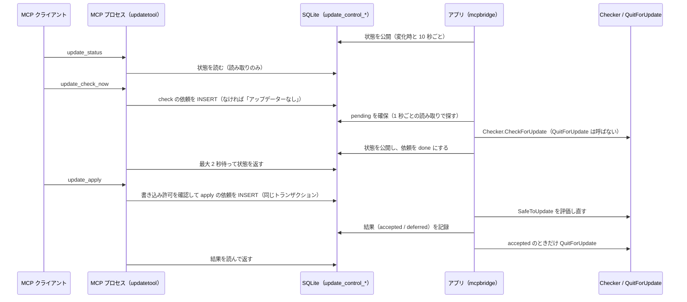

# 設計: Paper 実績 MCP のデスクトップアプリ自動更新ツール（issue #1222）

`docs/architecture/paper-results-mcp.md` の分割章。要件は FR-MCP-52、API は `docs/api/endpoints/update-tools/paper-results-mcp-update.md` §3.52、表は `docs/architecture/er/update-tools/tables-update-control.md`。

## 1. 方針

- 既存のアップデーターを再利用する。GitHub の取得・署名（ed25519 の分離署名）とチェックサムの検証・URL とサイズの制限・SafeGate・`dev` ビルドのスキップ・`checkMu` の直列化は、`Checker.CheckForUpdate` のまま。導入は `cmd/desktop` の `QuitForUpdate`（`OnShutdown` が `mcpwire.Stop` と `Services.Stop` のあとにインストーラーを起動する）のまま。MCP 側で再実装しない。
- 専用の設定キーは増やさない（更新は `runtime_settings` ではなく `Checker` が持つ状態）。
- SafeGate の条件（ポジション 0・Kill Switch 非発動・直近の発注から 5 分以上）・署名必須・URL / サイズ制限・`dev` ビルドのスキップ・6 時間周期とバックオフ再試行（issue #240）・Paper 発注・Risk・ガードは変えない。

## 2. プロセス境界

Paper 実績 MCP は別プロセス（`paper-results-mcp`）で、`tooldef.Env` にアップデーターのハンドルは無い。アプリの DB 接続・ハンドル・環境変数を子に渡さない（`paper-results-mcp-lifecycle.md` §2 の安全条件 1・3、環境変数の許可リストは変えない）ので、注文案（`order_proposals`）と同じく**DB を窓口**にする。

- `mcpbridge.Bridge`（`internal/service/updater/mcpbridge`、`cmd/desktop` だけが作る）が、1 秒ごとに `Checker.Status()` を見て変化時と 10 秒ごとに `update_control_status` を書き、`pending` の依頼を 1 件ずつ実行する。`Run` の終了時に状態の行を消す。`cmd/server` は `Bridge` を作らず、行が無い → MCP は `unavailable=true`。
- 状態の行の `heartbeat_at` が 1 分以上古い（アプリが落ちて残った）ときも `unavailable`。アプリの起動時に前回の未完了の依頼は `expired` にする。
- Settings の「今すぐ確認」と周期確認は `SchedulerAdapter.CheckForUpdate`（Ready なら直ちに `QuitForUpdate`）のまま。HTMX 向けの `POST /system/update-check` を MCP の輸送路に使わない。

## 3. 確認と導入を分ける

- `update_check_now` の依頼は `Checker.CheckForUpdate` だけを呼び、`QuitForUpdate` は呼ばない。結果の `Result{Ready, InstallerPath}` は `Bridge` がメモリに持つ（`Status` にはパスが無い）。**導入できるのは `Bridge` 自身の確認が検証したインストーラーだけ**。
- `update_apply` の依頼: ① `Bridge` が検証済みのインストーラーを持ち `Status` が今も同じ版で `Ready` か（違えば `deferred`/`not_ready`）、② `Checker.SafeToUpdate`（`SafeGate` を導入の直前にもう一度評価）、保留なら `deferred`/種別、③ 通ったら**結果（`accepted`）を DB に記録してから** `QuitForUpdate`（MCP は終了手順の最初に止まるため、記録を先にしないと呼び出し側が結果を読めない。記録に失敗したら導入しない）。
- 署名・チェックサムの検証に失敗したリリースは `Checker` がインストーラーを残さず、`ErrorVerification` が `Status` に残る。`Bridge` は Ready を持たないので `update_apply` は `not_ready`。署名を飛ばす手段は無い。
- アプリ自身の自動更新の契約は変えない。MCP の `update_check_now` のあとに `Status.Ready` が残っても、スケジューラーの周期確認は今までどおり Ready なら導入しうる。`settings_write_enable` が効くのは MCP 起点の `update_apply` だけ。

## 4. 書き込み許可・監査・取り下げ

- `update_apply` は `mcpset.WriteEnabled` を読んでから（オフなら `write_disabled`、何も記録しない）、`Writer.InTx` の gated で同じトランザクション内でもう一度確認して依頼を INSERT する。`update_check_now` は書き込み許可に依存しない（確認はアプリの周期確認と同じ動き）。
- 監査は `update_control_requests` の `apply` の行（`actor='mcp'`、`client`、時刻、`outcome`、`reason`）。`mcp_settings_audit` は設定キー向けなので使わない（存在しないキーを載せない）。`update_status.last_apply` で読める。
- MCP が 2 秒待ってもアプリが着手しないとき、`apply` の依頼を `state='pending'` のまま `expired` にして `deferred`/`timeout` を返す（`UPDATE ... WHERE state='pending'` が 0 行なら、アプリが取った後なので結果を読み直す）。アプリが後から導入を動かすことはない。アプリ側も 30 秒以上前の依頼は実行せず捨てる。

## 5. 出さないもの

`LastError` の生文、インストーラーのローカルパス、ダウンロード URL、公開鍵、署名はツールの出力にも `update_control_*` にも入らない（種別 `BlockKind` / `ErrorKind` と固定文。文言は `updater.BlockedReason` / `updater.ErrorReason` で、Settings のパネルと共有する）。ダウングレード・任意の URL・アセット・SafeGate や署名の省略の引数は、スキーマにも実装にも無い（3 ツールとも引数なし、`additionalProperties:false`）。

## 6. テスト

`internal/service/paperresultsmcp/updatetests`（MCP の HTTP・`mcpbridge`・本物の `updater.Checker` を 1 つの DB に載せ、GitHub・SafeGate の入力・`QuitForUpdate` を偽物にする。実際の更新・ダウンロード・再起動はしない）と `internal/service/updater/mcpbridge` の単体テスト。

## 改訂履歴

| 版 | 日付 | 変更内容 | 変更理由 |
|----|------|---------|---------|
| 1.0 | 2026-11-25 | 新規作成 | issue #1222 |
