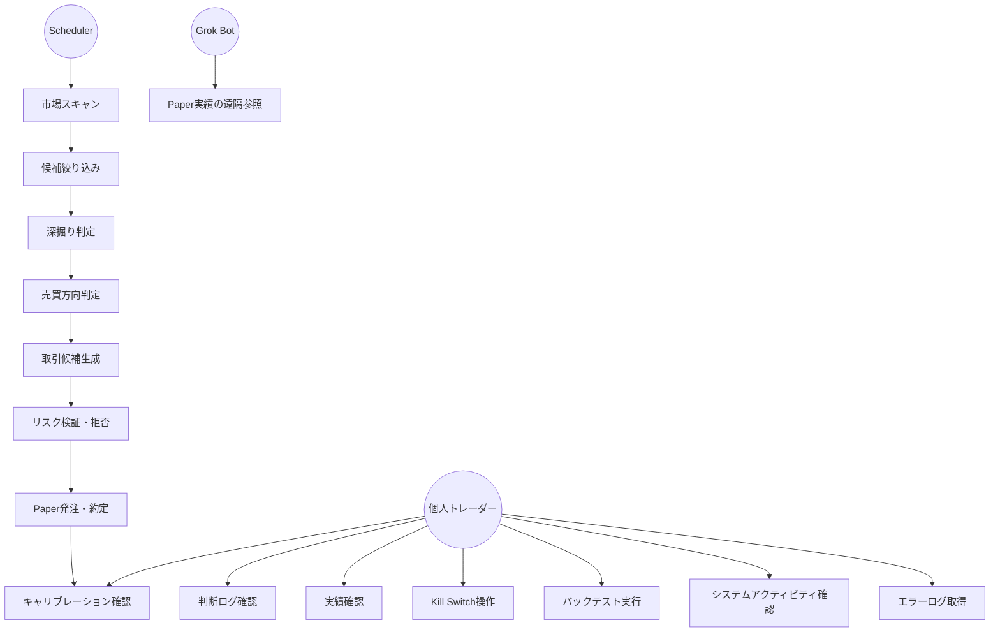
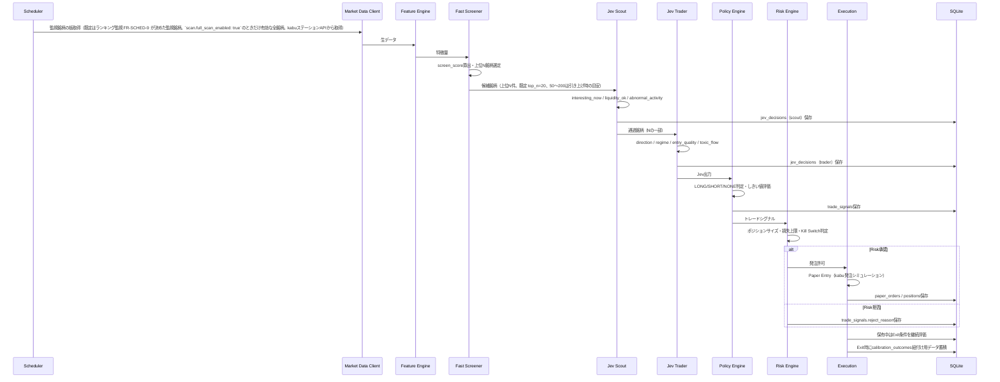
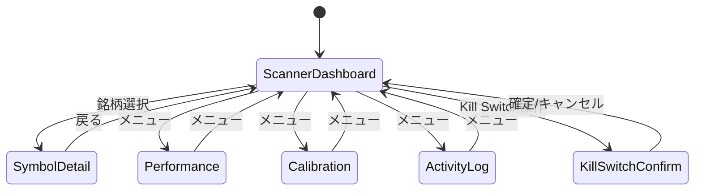

# 機能要件

## 1. ユースケース一覧

| ID | ユースケース | 主アクター | 概要 |
|----|------------|-----------|------|
| UC-1 | 市場スキャン | Scheduler | 監視銘柄（既定のランキング監視。`scan.full_scan_enabled: true`のときだけ全銘柄）を周期的にスキャンし、特徴量を算出する |
| UC-2 | 候補絞り込み | Fast Screener | 数値条件・スコアで候補銘柄を機械的に絞り込む |
| UC-3 | 深掘り判定 | Jev Scout | 候補銘柄が今分析する価値があるかを判定する |
| UC-4 | 売買方向判定 | Jev Trader | Scout通過銘柄の方向・レジーム・エントリー品質を判定する |
| UC-5 | 取引候補生成 | Policy Engine | Jev出力をルールでトレードシグナルへ変換する |
| UC-6 | リスク検証・拒否 | Risk Engine | ポジションサイズ・損失上限・取引禁止条件を強制する |
| UC-7 | Paper発注・約定 | Execution | Paper Entry/Exitを実行し、ポジション・PnLを更新する |
| UC-8 | 判断ログ確認 | 個人トレーダー | Symbol Detail画面でJevの判断根拠・履歴を確認する |
| UC-9 | 実績確認 | 個人トレーダー | Performance画面でPnL・勝率・期待値等を確認する |
| UC-10 | キャリブレーション確認 | 個人トレーダー | Calibration画面でconfidence帯別の的中率・平均リターンを確認する |
| UC-11 | Kill Switch操作 | 個人トレーダー | UIまたはサーバーから新規取引停止・強制決済を行う |
| UC-12 | バックテスト実行 | 個人トレーダー | Paper Trading開始前に過去データで戦略を検証する |
| UC-13 | システムアクティビティ確認 | 個人トレーダー | Log画面でジョブキュー実行状況・直近のJev呼び出し・Kill Switch関連イベントをリアルタイムに確認する |
| UC-14 | 環境設定 | 個人トレーダー | Settings画面でJev/ブローカー（kabuステーション・立花証券。`broker.provider`で1つを選択）/Slack/Luna/Sol/Opus/ニュースフィードの認証情報をキー単位で保存・削除する。立花証券 e支店のカードには接続環境（デモ/本番）を常にバッジで表示する |
| UC-15 | 初回セットアップ | 個人トレーダー | 選択したブローカーの必須認証情報（既定のkabuなら`KABU_API_PASSWORD`）とJevが未設定のとき、Setup画面へ誘導され、入力を完了してから通常画面へ進む |
| UC-16 | エラーログ取得 | 個人トレーダー（運用者） | Settings画面から期間・レベルを指定してエラーログをダウンロードし、調査・共有に使う |
| UC-17 | Paper実績の遠隔参照 | Grok Bot（リモート） | 認証を通した MCP で、Paper の損益・取引・Jev 判断・メタモデル・Risk・収集状況の集計とラベルを読み、ホワイトリストに載った基本設定（Paper の資金・上限、日次ガード、LLM cutoff と出典）だけを一覧・変更・差分確認できる。さらに、Paper の注文案（新規の買いと保有中ポジションの決済）を受け付けて記録できる（受け付けるだけで、発注はアプリが Risk check のあとに行う。受け付けスイッチは既定オフで、オンにできるのは Settings 画面だけ。FR-MCP-23〜27）。Live の発注・送金・Kill Switch の操作と解除・Live の値・秘密は扱わない（§4.22） |

## 2. 主要処理フロー

## 3. 対象市場とスコープ

- 対象: 東証上場銘柄、現物またはPaper Trading
- 市場データ・ブローカー: 1プロセスで1つを選ぶ（kabuステーションAPI＝既定・フォールバック、立花証券・e支店API。FR-BROKER-1・2）。対象銘柄は両ブローカーとも東証上場銘柄で、立花証券はランキング・歩み値が無い。本システムは市況データの読み取りのみで、発注は#55まで行わない（`architecture/overview/integrations.md` §5）
- 基本時間軸: 1分足
- MVP戦略: 短期モメンタム / 出来高急増 / ブレイクアウト / VWAP乖離からの継続・反転
- 想定保有時間: 最短数分、基本5〜15分（短い保有で小さなエッジを積み上げることを「勝ち」とする。FR-CAL-5）、原則として日跨ぎしない

## 4. コンポーネント別機能要件

§4は `.linterly.yml` の300行/ファイル制限のため別ファイルに分割している（節番号・FR-ID・内容は分割前と同一）。

| 節 | ファイル |
|----|----------|
| §4.1〜§4.9（Feature Engine〜状態管理） | `docs/requirements/functional/components-pipeline.md` |
| §4.10〜§4.23（Scheduler/Worker〜エラーログのダウンロード・ブローカー選択と立花証券の運用・取引ログ/判断ログのエクスポート・Paper実績MCP・管理ハブ） | `docs/requirements/functional/components-platform.md` |
| 改訂履歴（1.0〜。`functional.md`と`functional/`配下の改訂を追記する） | `docs/requirements/functional/history.md` |

## 5. 画面別機能（Wails デスクトップアプリ）

メインメニュー（issue #895）は「ホーム／候補銘柄／AIの注文提案／成績／（区切り）／設定」。画面名は日本語で、本節の英語見出しは画面の内部名（画面上の表示は 5.1 候補銘柄・5.3 成績（実績・バックテスト）・5.4 予測の精度・5.5 稼働ログ）。候補銘柄は「候補」「監視リスト」、成績は「実績」「バックテスト」「予測の精度」のタブを持ち、稼働ログは設定 ＞ システムから開く。画面とメニューの対応は `docs/components/screens.md`、受け入れ基準は FR-ADMIN-1〜5。「ホーム」（`/`、issue #896）は今日の Paper 損益・保有ポジション・新規エントリーの可否と理由・要対応・今日の詳細を1画面にまとめた読み取り専用の画面で、受け入れ基準は FR-HOME-1〜5（§4.24）。他のページのヘッダーは、要対応を「要対応 N 件」バッジに縮約してホームへリンクする。

### 5.1 Scanner Dashboard

表示項目: Symbol, Price, 1m/5m Return（パーセント表示。Feature Engineの小数比を×100）, Volume Ratio, VWAP距離, Spread, Jev Direction, Jev Confidence, Entry Quality, Current Position。Jev Direction/Confidence/Entry Qualityは当該銘柄の最新Jev Trader判断（`decision_type=trader`の`timestamp`・`id`最大の1行。件数窓・経過時間の上限は設けず、Scout行が続いても古くても採用し、Symbol Detailの Jev判定パネル・`GET /api/v1/symbols/{symbol}`・`/ws/symbols/{symbol}`・Exit評価と同一定義。古い判断の扱いに上限期間は定めていない）、Current Positionは保有中ポジションの符号付き数量（LONG正/SHORT負。保有なしは空）で、候補更新サイクルごとに`internal/bootstrap/candidates`が設定する（Trader判断が未生成の銘柄は空＝判定待ち）。候補銘柄更新周期（15〜30秒）に応じてライブ更新する。

候補表の上に**スキャン状況パネル**を置く（issue #303。動作確認・「なぜこの銘柄が候補に出ないか」の調査用）:

- FR-SCAN-3: 最新サイクルの**ファネル件数**（ユニバース → 特徴量算出 → Fast Screener通過 → Scout通過）と、最終サイクルの時刻・所要時間を表示する。Scout通過は候補に対するJev Scoutの判定が済んだ分までの件数（判定済み件数も併記）。「ユニバース」はスキャン対象の銘柄数で、既定のランキング監視（FR-SCHED-9）では監視銘柄（最大45）、`scan.full_scan_enabled: true`のときだけ有効な`stock`の全件（最大約4,000）になる。パネルのラベル・ツールチップにもこの旨を示す
- FR-SCAN-4: 「スキャン対象を見る」で、ユニバース（FR-SCAN-3。`scan.full_scan_enabled: true`のときは有効な`stock`の全件・最大約4,000。既定のランキング監視ではFR-SCHED-9の監視銘柄（最大45）で、監視外の銘柄は一覧に現れず、その除外理由も付かない）のコード・名称・市場・状態（通過/除外/データ欠損）・理由・Scout結果を一覧する。検索（コード/名称）、状態・理由での絞り込み、ページング（既定50件・最大200件）を備え、1回に描画する行数を抑える
- FR-SCAN-5: 除外は落ちた条件（FR-FS-1の閾値名＋上位N件の外）を、欠損は取得できなかった値（板情報なし・履歴不足（FR-FE-5）・市況データ未取得）に加え、立会中に最新の足が古すぎる市況データ（`stale_snapshot`。ランキング監視ではSettingsの`scan.snapshot_max_age_seconds`（既定`domain.DefaultMaxSnapshotAge`＝20秒。issue #754）超、`scan.full_scan_enabled: true`では全件RESTが1周約8分かかるため`scan.full_scan_max_snapshot_age_seconds`（同梱620秒）超。FR-SCAN-7/FR-SCHED-9）を、理由コードと人が読めるラベルで示す。`stale_snapshot`のラベルは閾値がモード別のため秒数を含めず「許容経過時間を超過」と表し、実際の閾値は上記の設定値で確認する（Scanner行・理由フィルタ・`GET /api/v1/scanner/scan`・CSVで同一文言。issue #690/#691）。全フィルターを評価し複数の理由を併記する
  - `scan.full_scan_enabled: true`では各銘柄の足が約8分間隔のため、`stale_snapshot`の許容（同梱620秒）を通過しても短窓の履歴ベース特徴量が全銘柄で履歴不足（FR-FE-5）の欠損となり、`missing_return_5m`・`missing_volume_ratio`・`missing_realized_vol`等で全銘柄が外れて候補は空のままになる（620秒が緩めるのは最新の足の鮮度判定だけ。FR-SCHED-7・issue #693）
- FR-SCAN-6: 結果は**開いた時点のスナップショット**で、「更新」ボタン・絞り込み・ページ送りで再取得する（`/ws/scanner`には流さず、その挙動は変えない）。保持は最新1サイクル分のメモリ上のみで、再起動後・初回サイクル完了前は「まだスキャンサイクルが実行されていません」の空状態を表示する
- FR-SCAN-7: 東証の立会時間外（土日・祝日・年末年始休場・昼休み・9:00前/15:30後。判定は`marketcalendar`、`non-functional.md` §3）は、スキャン状況パネルの先頭に「現在は東証の立会時間外のため、市場データ取得・フルスキャン・Jev Scoutは停止中です。表示は保存済みデータに基づきます」旨の停止通知（`data-testid="scan-offhours"`）を、サイクル未実行の空状態・サイクルありの双方で表示し、次回の立会開始時刻（JST。前場9:00／後場12:30、土日・祝日・年末年始をスキップ）を併記する。立会時間中は表示しない。「更新」ボタンは立会時間外でも無効化せず、押下すると保存済みデータを再取得して同じ通知を再描画する（新規スキャンは走らない）。既定のランキング監視でも、立会時間外・昼休みの候補リストとスキャン対象の一覧は直前の立会時間内サイクルの監視リスト（＋保有・注文中）を保存済みデータで評価して表示し続ける（FR-SCHED-9。PUSH登録・`market-data`投入は保有・注文中の銘柄だけに停止する。プロセス再起動直後の立会時間外は直前のリストが無いため保有・注文中の銘柄だけ）。立会再開直後は、保存済みの最新の足がSettingsの`scan.snapshot_max_age_seconds`（既定`domain.DefaultMaxSnapshotAge`＝20秒。立会時間外は判定しない。市況コンテキストの指数バーの許容は別で、ランキング監視では`domain.MarketContextMaxAge`＝3分）より古い銘柄（`scan.full_scan_enabled: true`では、各銘柄の足は全件RESTの1周（約8分）に1回しか更新されないため、ランキング監視の許容ではなく`scan.full_scan_max_snapshot_age_seconds`＝1周＋次サイクルの待ち・余裕、同梱620秒を超えたものとする。issue #686）を、一覧には残したまま`stale_snapshot`（欠損）で除外しJev Scoutへ投入しない。保持した監視リストの銘柄も、`market-data`が新しい足を書くまで評価しない（issue #685）。通知はスキャン状況パネルに限り、全ページ共通のバナーにはしない
  - 上記の`scan.full_scan_max_snapshot_age_seconds`は`stale_snapshot`（最新の足の鮮度）だけの許容で、全件スキャンの履歴ベース特徴量の欠損（FR-SCHED-7・FR-FE-5）は解消しない
- FR-SCAN-8: 有効な`stock`が1件も無い（銘柄マスタ未投入）間、スキャン状況パネルは「まだスキャンサイクルが実行されていません」の代わりに「銘柄マスタが未投入です」の案内（`data-testid="scan-universe-empty"`）を表示し、銘柄マスタCSVの置き場所（`PITHA_UNIVERSE_PATH`／実行ファイルと同じディレクトリの`config/universe.csv`）と、JPXの東証上場銘柄一覧（`data_j.xlsx`）を取得して投入する選択肢を示す。取得は運用者が「JPXから取得して投入する」を押した場合に限り1回だけ行い（起動時・定期の自動取得はしない）、株式のみをCSVと同じ検証で投入して再起動なしで次のスキャンサイクルから対象にする。失敗（ネットワーク・HTTPエラー・形式変更・保存失敗）はマスタを変更せず、失敗種別ごとの固定文言とCSV投入の案内を表示する（下位エラーは画面に出さず`slog`のみに記録する。issue #700）。有効な`stock`があるときは案内も取得も提供しない（`environment/setup.md`「銘柄マスタの投入」）

### 5.2 Symbol Detail

チャート（Price/VWAP/Volume）、Jev判定（Direction/Confidence/Regime/Entry Quality/Toxic Flow/Liquidity Stress）、Risk（Allowed Position/Stop/Take Profit）、Decision historyを表示する。

### 5.3 Performance

Total PnL, Daily PnL, Win Rate, Profit Factor, Expectancy, Max Drawdown, Average Hold Time, Sharpe/Sortino参考値, Signal countを表示する。

その下に「実績評価」節として、円建て・資金比の最大ドローダウン（`initial_capital`併記）、期間（日・週）・方向・exit_reason・メタモデル版・A/Bアーム別の指標、サンプル数と95%信頼区間（基準未満は「判定不能」）、コスト内訳（グロス/ネット）、Jevの的中率・Brier、メタモデルのOOSとPaper実績EVの並列、「勝てているか」の合格ライン判定を表示する（FR-EVAL-1〜5。定義・基準値・検証済みSQLは`functional/performance-evaluation.md`）。

### 5.4 Calibration

confidence帯（0.50-0.60 〜 0.90-1.00）ごとの実方向一致率、平均future returnを表示する。あわせて、最新のメタラベリングモデルのOOS AUC・OOS EV・OOS較正曲線とJev評価期間（OOS窓）を表示する（FR-META-5）。

### 5.5 System Activity Log

表示項目: キュー別（6キュー）の`pending`/`running`/直近`failed`件数、直近アクティビティ一覧（時刻・種別 [job/jev_scout/jev_trader/kill_switch/news_feed/broker_notice]・対象銘柄・詳細・latency_ms）、直近Kill Switchイベント。キュー種別・イベント種別でフィルタ可能とする。新規イベント発生に応じて`/ws/activity`経由でライブ更新する（§4.15）。

## 6. MVPフェーズ

| Phase | 内容 |
|-------|------|
| Phase 0: Data | 市場データ取得（kabuステーションAPI）、1分足保存、Feature Engine構築 |
| Phase 1: Scanner | Fast Screener、Scanner Dashboard、Top候補表示 |
| Phase 2: Jev Scout | Jev API接続、Scout Questions実装、Decision Log保存 |
| Phase 3: Jev Trader | LONG/SHORT/NONE判定、Policy Engine |
| Phase 4: Paper Trading | Entry/Exit、Position管理、Paper約定、PnL |
| Phase 5: Calibration | Outcome Labeling、Confidence bucket分析、Brier/Log Loss、RAG用embedding索引構築（§4.13） |
| Phase 6: Continuous Loop | Event-driven refresh、Open position monitoring、Kill Switch、Alert、Sol/Opusによる自己改善ループ（§4.14） |
| Phase 7: Small Live | 十分な検証後、法令・証券会社API規約を確認した上でごく小さなサイズから検討 |

## 7. MVP完了条件

- 対象銘柄マスタ（`instruments`: `stock`と`market_index`/`sector_index`）を銘柄マスタCSVから起動時に自動投入でき（kabuステーションAPIには上場銘柄一覧の取得手段が無いため。手順は`environment/setup.md`「銘柄マスタの投入」）、投入された銘柄の価格・板をkabuステーションAPI経由で自動取得できる
- ランキング監視が60秒周期で監視銘柄を更新しスキャンできる（全銘柄の60秒スキャンは`scan.full_scan_enabled: true`の明示オプトインで、FR-SCHED-7の制約付き）
- Fast Screenerで候補を絞れる
- Jev Scout / Traderを自動実行できる
- 判断結果をDB保存できる
- Risk Engineが拒否権を持つ
- Paper Tradingが動作する
- Exitが自動実行される
- PnLが集計される
- Jev判断と将来リターンを紐付けられる
- Calibration Dashboardが表示される
- Kill Switchが動作する
- RAGが類似局面をJevへの文脈として注入できる（§4.13）
- Sol/Opusの自己改善提案がシャドーバックテストで検証され、承認された場合のみ自動適用・監査ログ記録される（§4.14、Phase 6スコープ）
- System Activity Log画面でジョブキュー実行状況・直近アクティビティをリアルタイム確認できる（§4.15）

## 8. 実装時の最初の成功基準

「儲かるAI」を作ることを最初の目標にしない。最初に検証すべき問いは以下。

> Jevを通した銘柄群は、通していない銘柄群と比べて、5分後/10分後/15分後の期待リターン分布（および実現トレードPnLのconfidence別勝率・Brier Score。FR-CAL-5）が改善するか？

これが確認できた後にEntry、Exit、Position Sizingを最適化する。

## 改訂履歴

改訂履歴は`docs/requirements/functional/history.md`に分割している（1.0〜）。
